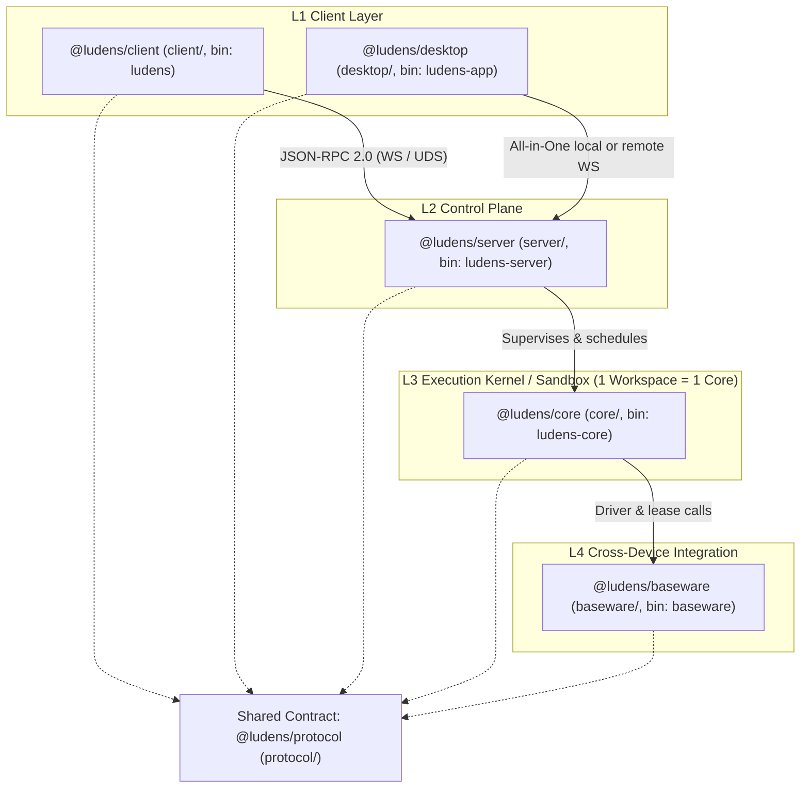

<p align="center">
  <picture>
    <source media="(prefers-color-scheme: dark)" srcset="client/public/brand/ludens-mark-dark.svg">
    
  </picture>
</p>

# Ludens

**English** · [简体中文](README.zh.md)

**A multimodal, cross-device Agent Harness for solving complex end-to-end tasks — across robotics, security monitoring, desktop automation, and real-time games.**

Instead of confining agents to static prompts and fixed action schemas, **Ludens** pairs a programmable coding workspace with live hardware and software targets:
- **Ludens** is both the overall harness and its own personified mascot.
- **Shiori** serves strictly as Ludens's **Agent Thread Core** (powered by OMP `18.22.2`), reasoning across turns inside an isolated coding workspace.
- **Baseware** is the **cross-device integration layer**, standardizing drivers, transports, and hardware leases across heterogeneous targets.

---

## Why Ludens

- **Any Screen, Any Device (`Baseware`)** — Play Three.js / WebGL games and web targets out of the box with the zero-setup **Built-in Browser (`builtin:browser` / `builtin-browser`)** in Ludens Desktop (`ludens-app`)—featuring isolated per-workspace `WebContentsView` spaces and a zero-dependency 3D WebGL starter page (`ludens-browser://start`)—alongside local Desktop CUA (`cua`), camera/HID hardware bridges (such as embedded controllers over SSH or TCP JSON-line bridges), simulators, or MCP endpoints. Mount multiple target nodes into one workspace and route actions uniformly.
- **Code-First Perception (`perception.py`)** — A resident Python worker continuously records fMP4 video into a searchable 30 Hz timeline while running and hot-reloading detectors and closed-loop state machines written by the agent.
- **Self-Verified Capabilities (`@capability` & `ludens workspace eval`)** — Turn trial-and-error behaviors into typed Python capabilities paired with offline `@eval_env` surrogates and `@eval_capability` checks, verifying regressions in milliseconds before running on physical devices.
- **Unified Console, `<DeviceViewport />`, Multi-Modal Loops & Replay** — Operate workspaces across four surfaces—the zero-port **Ludens Desktop App** (`ludens-app`), hosted web **Console**, remote `wss://` targets, and mobile browsers—all backed by one isomorphic Vite SPA (`@ludens/client`) and JSON-RPC 2.0 (`ludens-server`): interact live through the unified `<DeviceViewport />` 3-mode right workbench (`browser | computer | observe`, native `WebContentsView` in Desktop and HMAC `/viewport` binary WebSocket streaming in Web/Mobile), launch workspaces with one click, trigger **Auto Run**, send async guidance through the duplex **EventHub**, interrupt mid-turn (`ludens steer`), execute **Reclaim Control** (`ludens auto off`) at any instant, and inspect 30 Hz timeline replays alongside model traces. *(Includes an optional tray **Desktop Pet** widget.)*

## How It Works

Inside a workspace (`~/.ludens/workspaces/<name>`), the agent maintains ordinary Python modules runnable against live Baseware devices or offline surrogate environments:

```python
# skills/visual_guard.py
from ludens_tools import Client, capability, eval_capability, eval_env

@capability
def act_on_alert() -> dict:
    """Watch the 30 Hz perception stream and dispatch an actuation on an anomaly frame."""
    client = Client()
    for _ in range(30):
        records = client.observe()["records"]
        if records and records[-1]["data"].get("event") == "anomaly":
            client.call("controller/relay.trigger", {"channel": 1})
            return {"triggered": True}
    return {"triggered": False}

@eval_env
class WatchdogEnv:
    """Offline surrogate stream: nominal frames first, then a single anomaly on tick 5."""
    def __init__(self) -> None:
        self.tick, self.triggered = 0, False

    def observe(self, query=None) -> list[dict]:
        self.tick += 1
        return [{"data": {"event": "anomaly" if self.tick == 5 else "nominal"}}]

    def call(self, id: str, args: dict) -> dict:
        self.triggered = (id == "controller/relay.trigger" and self.tick == 5)
        return {"ok": True}

@eval_capability(act_on_alert, env=WatchdogEnv)
def eval_act_on_alert() -> dict:
    """Verify closed-loop response timing without touching a physical device."""
    with WatchdogEnv() as env:
        act_on_alert()
    return {"passed": env.triggered, "rewards": {"accuracy": 1.0 if env.triggered else 0.0}}
```

Run offline capability verification from the terminal or Console (**Capabilities**, `?view=caps`):

```sh
ludens workspace eval run --all
# Or inside a Core sandbox:
ludens-core eval run --all
```

## Quick Start

Requires **Bun 1.4+**, **Node.js 22.13+**, **Python 3.12+** with **uv**, and configured model credentials.

### 1. Install & Build

```sh
git clone https://github.com/Arkevo-Lab/Ludens.git && cd Ludens
bun install --frozen-lockfile
uv sync --project core/python --frozen
bun run build
export PATH="$PWD/baseware/bin:$PWD/core/bin:$PWD/server/bin:$PWD/client/bin:$PWD/desktop/bin:$PATH"
```

### 2. Launch Modes

Ludens runs an isomorphic React 19 + Vite static SPA (`@ludens/client`, `client/dist`), a pure-RPC CLI (`ludens`), an All-in-One Electron desktop shell (`@ludens/desktop`, `ludens-app`), and a unified JSON-RPC 2.0 control-plane server (`@ludens/server`, `ludens-server`) across four operating modes:

- **Desktop App (`ludens-app` — All-in-One Zero-Port Local Mode)**: Build once with `bun run build` (or `bun run build:desktop`) and launch `ludens-app --show-window` (or package native macOS `.dmg` / Windows `.exe` installers via `bun run pack:desktop` / `bun run dist:desktop`). Bundles `client + server + core + baseware` out of the box per `LUDENS_HOME` over a Unix Domain Socket (`app-server.sock`) with **0 listening TCP ports** (`ludens-app://console/`, `ludens-media://local/media?...`, `window.ludens.rpc`), hosts the zero-port local `BrowserHost` (`browser-host.sock`) that automatically injects the **Built-in Browser (`builtin:browser` / `builtin-browser`)** with isolated per-workspace `WebContentsView` spaces, and supports one-click switching to any remote `ludens-server`. Closing (`×`) hides to tray + optional Desktop Pet; Quit (`⌘Q` / tray **Quit**) exits immediately if no Cores are active (keeping the background service intact) or asks whether to **Keep Running in Background**, **Stop All Cores & Quit**, or **Cancel**.
- **Hosted Web / Remote Server (`ludens-server`)**: Open-source control-plane server for local, self-hosted, or cloud deployment. Serves the static Console SPA, WebSocket JSON-RPC `/rpc`, HMAC capability-ticket `/media`, and the `/viewport` binary WebSocket streaming stage over TCP with explicit auth: `ludens-server start --listen ws://127.0.0.1:3015 --auth token --token-env LUDENS_APP_TOKEN --static-dir "$PWD/client/dist"` (or run `bun run start:selfhost` for single-machine/VPS self-hosted foreground `ludens-server serve --static-dir client/dist`; non-loopback `--listen ws://` requires `--auth token`; URL `#token=...` bootstraps are scrubbed immediately via `history.replaceState`). Manage the background service with `ludens-server <start|stop|restart|status>`.
- **Pure-RPC CLI (`ludens` — Local UDS & `--remote`)**: Human-facing pure-RPC CLI (`@ludens/client`, zero Core/Server/Baseware dependencies). Initialize and orchestrate workspaces over local `app-server.sock` or target a remote `ludens-server` via `--remote ws(s)://... [--token ...]` (see [Devices & Drivers](docs/en/tutorials/devices.md) to attach external drivers via `--driver-package` or SSH/bridge targets):

```sh
# Zero-setup Built-in Browser workspace (when Ludens Desktop is running)
ludens workspace init --name webgl-play --driver browser --url https://example.com/game

# Or local Desktop CUA workspace
ludens workspace init --name my-agent --driver cua
cd "$HOME/.ludens/workspaces/my-agent"
ludens workspace up
```

  Other workspace and operator commands: `ludens workspace <list|open|forget|import|down|services|eval>`, `ludens config ...`, `ludens <status|auto|steer|consolidate|stop|model|logs>`. For direct single-workspace execution without the control plane, use `ludens-core run` and sandbox tools `ludens-core <controller|perception|event|machine|eval>`.

- **Mobile & Multi-Target Console**: Open the same isomorphic responsive Vite SPA (`@ludens/client`) from mobile or desktop browsers and switch cleanly between `electron-local` (IPC UDS), `same-origin` (hosted WebSocket `/rpc`), and `remote` (`ws://` / `wss://` + token) targets via `<ConnectionTargetDialog>`.

### 3. Development, Build & Verification

All development, build, packaging, and monorepo verification workflows are orchestrated from the repository root. Dev commands isolate state in `~/.ludens-dev` by default; pass `--real-home` (or use the `:real` script suffix) to mount your real `~/.ludens`:

- **Development (`~/.ludens-dev` by default, `:real` / `--real-home` for `~/.ludens`)**:
  - `bun run dev` (or `bun run dev:web` / `bun run dev:web:real`) — Web full-stack development (managed `ludens-server --dev` + Vite HMR)
  - `bun run dev:desktop` (or `bun run dev:desktop:real`) — Electron desktop development (Vite HMR + Electron native UDS)
  - `bun run dev:client` — Standalone cross-origin frontend development (connects directly to a remote/cloud `ludens-server`)
  - `bun run dev:server` (or `bun run dev:server:real`) — Standalone dev-mode `ludens-server`
- **Production Build, Packaging & Quality Checks**:
  - `bun run build` — Build all packages (`client/dist`, `server/dist`, `core/dist`, `baseware/dist`, `desktop/dist`), or build by pipeline via `bun run build:client` / `build:server` / `build:sandbox` / `build:desktop`
  - `bun run pack:desktop` / `bun run dist:desktop` — Package the All-in-One Electron desktop app
  - `bun run start:selfhost` — Single-machine / VPS self-hosted production run (`ludens-server serve --static-dir client/dist`)
  - `bun run typecheck` / `bun run test` — Run type checks and tests across all 6 packages

### 4. Auto Run, Reclaim Control & Async Collaboration

Open **Live** (`?view=live`) in the Desktop App or your connected Web Console to click **Start Auto Run**, or control the loop from CLI (locally or with `--remote`):

```sh
ludens auto on --message "Explore the target environment and build verified capabilities"
ludens steer "Pause actuation immediately"
ludens auto off
```

## Architecture

Ludens is organized into **6 packages** across **4 orthogonal layers**, coordinated by a zero-dependency shared contract package:



| Layer | Package | Path & Bin | Role |
| --- | --- | --- | --- |
| **L1 Client** | [`@ludens/client`](client/README.md) | `client/` · `ludens` | Isomorphic Web & Mobile Vite SPA Console (`client/dist`) with the unified `<DeviceViewport />` 3-mode right workbench, independently releasable, remote-first (depends only on `@ludens/protocol`), plus human-facing pure-RPC CLI `ludens`. |
| **L1 Desktop Shell** | [`@ludens/desktop`](desktop/README.md) | `desktop/` · `ludens-app` | All-in-One Electron desktop shell bundling `client + server + core + baseware` for zero-port local out-of-the-box use (`ludens-app://` / `ludens-media://`), local UDS `BrowserHost` (`browser-host.sock`) for isolated per-workspace `WebContentsView` spaces, `<ConnectionTargetDialog>`, optional Desktop Pet, and one-click switching to remote `ludens-server`. |
| **L2 Control Plane** | [`@ludens/server`](server/README.md) | `server/` · `ludens-server` | Open-source control-plane server for local, self-hosted, or cloud deployment: unified JSON-RPC 2.0, `EventHub`, HMAC `/media` & `/viewport` binary WebSocket stream, runtime `builtin-browser` injection, query engine, and Core runtime supervision. |
| **L3 Execution Kernel** | [`@ludens/core`](core/README.md) | `core/` · `ludens-core` | `1 Workspace = 1 Core` execution sandbox hosting **Shiori** (OMP `18.22.2`), resident `perception.py`, `loop.py`, workspace code & self-verification (`ludens-core run` and `ludens-core <controller\|perception\|event\|machine\|eval>`). |
| **L4 Device Integration** | [`@ludens/baseware`](baseware/README.md) | `baseware/` · `baseware` | Cross-device integration layer: built-in `browser` & `cua` plus standalone hardware/simulator/MCP drivers, generic `Viewport` capability, Controller contracts, `epoch` control lease arbitration, and MCP. |
| **Shared Contract** | [`@ludens/protocol`](protocol/README.md) | `protocol/` | Zero-runtime-dependency strongly-typed wire protocol (`@ludens/protocol/app-rpc`), event envelopes, connection policies, and cross-end DTOs. |

## Documentation

Full guides live in English ([`docs/en/`](docs/en/)) and Chinese ([`docs/zh/`](docs/zh/)), and inside the Console at `?view=docs`:

- **[Concepts](docs/en/concepts/index.md)** — [System Overview](docs/en/concepts/overview.md) · [Control Cycles & Collaboration](docs/en/concepts/loop-and-control.md) · [Perception & Self-Verification](docs/en/concepts/self-verification.md)
- **[Tutorials](docs/en/tutorials/index.md)** — [Quick Start](docs/en/tutorials/quickstart.md) · [Devices & Drivers](docs/en/tutorials/devices.md) · [Workspaces & Capabilities](docs/en/tutorials/workspace.md) · [Perception State Machine](docs/en/tutorials/perception-and-action.md) · [Console & Debugging](docs/en/tutorials/console-and-debugging.md)
- **[Reference](docs/en/reference/index.md)** — [Architecture](docs/en/reference/architecture.md) · [CLI Reference](docs/en/reference/cli.md) · [Baseware Contract](docs/en/reference/baseware.md) · [Driver Bridge Protocol](docs/en/reference/driver-bridge-protocol.md) · [Logging](docs/en/reference/logging.md)
- **[Insights](docs/en/insights/index.md)** — [Speculative Compaction](docs/en/insights/omp-compaction.md) · [WebSocket Delta Recovery](docs/en/insights/ws-recovery.md) · [Single-Channel Turn Injection](docs/en/insights/omp-injection.md) · [Perception Parameters](docs/en/insights/perception-parameters.md)

> **Safety Note:** Agents run shell and Python code directly on the host, and run archives retain visual recordings. Isolate untrusted environments in VMs or containers; run `ludens auto off` (or click **Reclaim Control** in Console) at any moment to revoke hardware actuation immediately.

## License

[MIT](LICENSE)
