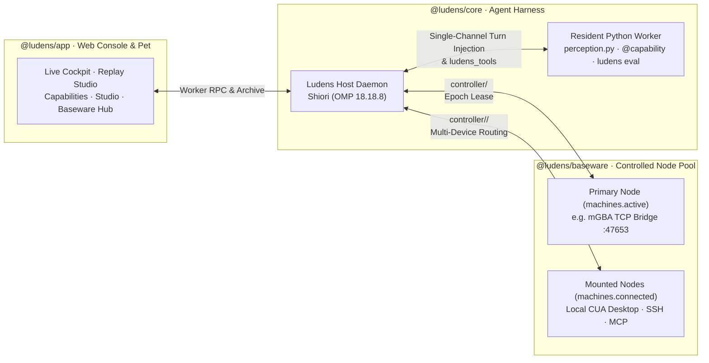

# Ludens

**English** · [简体中文](README.zh.md)

**A multimodal agent harness for complex, real-time environments through workspace-native self-adaptation and self-improvement.**

Ludens connects coding agents to arbitrary PC desktops, game emulators, and remote devices, giving them a persistent software engineering workspace to adapt to unfamiliar interfaces and continuously improve how they perceive and act. Instead of relying on static prompts or fixed action spaces, a Ludens agent authors and evolves its own resident perception-and-action state machine (`perception.py`), reusable capabilities (`@capability`), and offline surrogate evaluations (`@eval_capability` / `@eval_env`) directly in Python.

**Games** are the first flagship class of long-horizon, real-time multimodal tasks we tackle—spanning local PC applications and console emulators—backed by a multi-machine device control plane, a full-trace observability console, and verifiable capability evolution.

[Why Ludens](#why-ludens) · [How It Works](#how-it-works-in-30-seconds) · [Architecture](#architecture) · [Quick Start](#quick-start) · [Web Console](#web-console) · [Documentation](#documentation)

---

## Why Ludens

- **Multi-Machine Device Control Plane (`@ludens/baseware`).** Manage a persistent pool of controlled nodes (`~/.ludens/machines.json`) across local `stdio` drivers, emulator TCP bridges (such as mGBA `:47653`), remote `ssh` CUA tunnels, and `http`/`sse` MCP endpoints. Mount multiple devices into a single workspace simultaneously and switch or route targets on the fly (`ludens machine use | connect | disconnect`).
- **Resident Self-Adaptation (`perception.py`).** A hot-reloading resident Python worker keeps vision models, state machines, and high-frequency fMP4/H.264 timeline sampling in memory across turns without restarting the agent runtime.
- **Verifiable Self-Improvement (`Capability – Eval – Env` Triad).** Agents distill raw controller actions into typed `@capability` functions, pair them with `@eval_capability` assertions and offline `@eval_env` surrogate environments, and track reward trajectories across code revisions via `ludens eval`.
- **Long-Horizon Multimodal Transport Resilience.** Built on **Shiori** (powered by **OMP `18.18.8`**), Ludens supports stateful WebSocket delta transport (`previous_response_id` with 60s transient cooldown self-healing and `15 MiB` compaction-gated frame recovery), stateless prefix KV cache preservation (`appendOnlyContext`), and SHA-256 deduplicated image URL offloading (`blob-broker`).
- **Full-Trace Live & Replay Console (`@ludens/app`).** Inspect live multi-device video streams, steer running loops in real time, scrub 30-second replay windows with millisecond precision, trigger 1-click service lifecycles and capability evaluations, or follow runs from the optional **Ludens Pet** desktop companion.

---

## How It Works in 30 Seconds

Inside a Ludens workspace (`~/.ludens/workspaces/<name>`), the agent interacts with mounted devices and evolves its own Python codebase:

```python
# skills/dialogue.py — Agent-authored capability + verifiable offline evaluation
import ludens_tools
from ludens_tools import capability, eval_capability, eval_env

@capability
def advance_dialogue(machine: str | None = None) -> dict:
    """Press A to advance an active dialogue box on the target machine."""
    frame = ludens_tools.call("controller/screen.capture", {}, machine=machine)
    ludens_tools.call(
        "controller/pad.play",
        {"inputs": [{"atMs": 0, "durationMs": 80, "state": {"A": 1}}], "wait": True},
        machine=machine,
    )
    return {"advanced": True, "width": frame["width"]}

@eval_env
def dialogue_box_fixture() -> list[dict]:
    """Offline surrogate fixture replaying recorded dialogue frames."""
    return [{"dialogue_open": True}, {"dialogue_open": False}]

@eval_capability(capability="advance_dialogue", env="dialogue_box_fixture")
def eval_advance_dialogue(env_data: list[dict]) -> dict:
    passed = env_data[0]["dialogue_open"] and not env_data[-1]["dialogue_open"]
    return {"passed": passed, "rewards": {"pass_rate": 1.0 if passed else 0.0}}
```

Run offline verification at any time from the CLI or with 1 click in the Console (`?view=caps`):

```sh
ludens eval --all
```

---

## Architecture

Ludens cleanly decouples the **Control Plane**, the **Workspace**, the **Device Plane**, and the **Observability Console**:



### Four-Pillar Monorepo

| Package | Role |
| --- | --- |
| [`@ludens/protocol`](protocol/README.md) | Zero-dependency contract layer: RPC schemas, run-event envelopes, content-addressed archive formats (`.ludens/archive/`), and shared Console/Pet DTOs. |
| [`@ludens/baseware`](baseware/README.md) | Standalone device service: driver loader, `Controller` JSON Schema validation, `epoch` control-lease arbitration, and CLI / API / MCP endpoints. |
| [`@ludens/core`](core/README.md) | Recursive self-adaptation harness: `launchd` service orchestration, Shiori (`OMP 18.18.8`) runtime, resident Python `perception.py` worker, multi-machine routing, and `ludens eval`. |
| [`@ludens/app`](app/README.md) | Browser-first Next.js 16 observability and control console (`http://127.0.0.1:3015`), plus the optional Electron **Ludens Pet** desktop companion. |

### Workspace Layout

Each task runs in an isolated, Git-friendly workspace directory outside the repository (`~/.ludens/workspaces/<name>` by default):

```text
my-workspace/
├── ludens.json          # Model, budget, transport, driver & machine-pool bindings
├── baseware.json        # Exported Controller interface snapshot from active devices
├── perception.py        # Resident, hot-reloading perception-and-action state machine
├── skills/              # Agent-authored @capability, @eval_capability, and @eval_env modules
├── MEMORY.md & memory/  # Long-term cross-session strategies and domain notes
└── .ludens/             # Shiori sessions, fMP4/H.264 timeline media, and eval run records
```

---

## Quick Start

### 1. Prerequisites & Installation

Requires **macOS** (for `launchd` service management), **Bun 1.4+**, **Python 3.12+**, **Node.js 22.13+ / 24+**, **uv**, and configured **OMP model credentials** (default model: `openai-codex/gpt-6.1-sol`).

```sh
git clone https://github.com/Arkevo-Lab/Ludens.git
cd Ludens

bun install --frozen-lockfile
uv sync --project core/python --frozen
(cd app && npm run build)

export PATH="$PWD/baseware/bin:$PWD/core/bin:$PATH"
```

### 2A. Track A — Local PC Desktop (`CUA` Driver)

Initialize a workspace that observes and controls your local desktop (requires the upstream CUA driver binary and macOS Screen Recording + Accessibility permissions; see [Devices & Driver Setup](docs/en/tutorials/devices.md#cua)):

```sh
ludens init --name my-desktop-task --driver cua
cd "$HOME/.ludens/workspaces/my-desktop-task"
ludens up
ludens controller list
ludens auto on
```

### 2B. Track B — Game Boy Advance Emulator (`mGBA` TCP Bridge)

Launch mGBA with the built-in Lua bridge script (`:47653`) and attach a Ludens workspace in one command:

```sh
./scripts/run-gba.sh /path/to/your/rom.gba /Applications/mGBA.app
```

Or register and mount the `gba-mgba` node visually from the Web Console at [`http://127.0.0.1:3015/?view=baseware`](http://127.0.0.1:3015/?view=baseware).

### 3. Essential CLI Commands

| Command | Description |
| --- | --- |
| `ludens up` / `ludens down` | Start or stop workspace-managed background services (`emulator`, `baseware`, `host`, `dashboard`, `pet`). |
| `ludens down --keep-emulator && ludens up` | Hot-reload the Host and Baseware while keeping the emulator process alive. |
| `ludens auto on [goal]` / `ludens auto off` | Grant the agent a device control lease and start autonomous execution, or revoke control immediately. |
| `ludens steer "<message>"` | Steer an active autonomous loop in real time without dropping the device lease. |
| `ludens machine list \| use \| connect \| disconnect` | Inspect the machine pool, switch the primary machine (`use`), or concurrently mount/unmount secondary machines (`connect` / `disconnect`). |
| `ludens perception reload` | Hot-reload `perception.py` and loaded workspace modules in the resident Python worker. |
| `ludens eval [<capability_id> \| --all]` | Execute `@eval_capability` suites against `@eval_env` fixtures and record reward trajectories. |

---

## Web Console

Open [`http://127.0.0.1:3015`](http://127.0.0.1:3015) during or after any run (no Electron required for development or inspection):

| View | Route | Key Capabilities |
| --- | --- | --- |
| **Live** | `?view=live` | Real-time **Shiori Loop Cockpit** (`auto on`, `steer`, `follow_up`, `auto off`, `consolidate`), multi-machine observation stream switcher (`[machineId]`), and live activity trace. |
| **Replay** | `?view=replay` | Bounded 30s fMP4 frame scrubber, millisecond timestamp jump, full-archive event search, and recorded model-input evidence inspector. |
| **Performance** | `?view=perf` | Per-request latency breakdown (`fetchToHeadersMs`, streaming, tool execution), token/cache telemetry, and compaction timeline analysis. |
| **Capabilities** | `?view=caps` | Visual **Capability – Eval – Env** triad topology, 3-way stale code SHA drift attribution, reward evolution trajectories, and 1-click **Run All Evals** / **Run Eval**. |
| **Config & Studio** | `?view=perception` | 5-tab workspace workbench: **Model & Budget**, **Connection & Multimodal Transport**, **Services & Session** (1-click `up` / `reload` / `down`, Shiori session switcher, inline `MEMORY.md` editor), **Perception Recording**, and **Loop Simulator**. |
| **Baseware** | `?view=baseware` | Master-Detail **Controlled Node Hub**: manage `~/.ludens/machines.json` (`stdio`, TCP `bridge`, `ssh`, `http`/`sse` MCP), 1-click **Set as Primary (`use`)** / **Also Mount (`connect`)** / **Disconnect**, connectivity probes, and Controller Interfaces catalog. |

---

## Boundaries and Safety

- **Trusted local execution:** The agent executes shell commands and Python directly on the host (and shares the desktop when using CUA). Use separate OS accounts, containers, or VMs when running untrusted tasks.
- **Explicit epoch leases:** Device input requires an active control lease (`ludens auto on`). Running `ludens auto off` (or clicking **Hand back control** in the Console/Pet) immediately invalidates the active epoch and releases held inputs.
- **Privacy:** Local timeline archives (`.ludens/timeline/`) and model logs contain captured screenshots and desktop state; review before sharing run directories externally.

---

## Documentation

Full documentation is maintained in lockstep across English ([`docs/en/`](docs/en/)) and Chinese ([`docs/zh/`](docs/zh/)), and is also browsable in-app at `?view=docs`:

- **[Tutorials (`docs/en/tutorials/`)](docs/en/tutorials/index.md)**
  - [Install and Workspace Lifecycle](docs/en/tutorials/quickstart.md)
  - [Devices, Drivers & Multi-Machine Pool](docs/en/tutorials/devices.md)
  - [Workspaces & Capability–Eval–Env Programming](docs/en/tutorials/workspace.md)
  - [Resident Perception-and-Action State Machine](docs/en/tutorials/perception-and-action.md)
  - [Console Debugging and Verification](docs/en/tutorials/debugging-and-verification.md)
- **[Reference (`docs/en/reference/`)](docs/en/reference/index.md)**
  - [Architecture and Boundaries](docs/en/reference/architecture.md)
  - [Baseware & Controlled Node Pool Contract](docs/en/reference/baseware.md)
  - [Driver Bridge Protocol](docs/en/reference/driver-bridge-protocol.md)
  - [Logging and Call Chains](docs/en/reference/logging.md)
  - [Dashboard UI and Interaction Contract](docs/en/reference/dashboard-ui.md)
- **[Engineering Insights (`docs/en/insights/`)](docs/en/insights/index.md)**
  - [OMP Background Speculative Compaction](docs/en/insights/omp-compaction.md)
  - [WebSocket Delta Transport & Fault Recovery Matrix](docs/en/insights/ws-recovery.md)
  - [Single-Channel Turn Injection](docs/en/insights/omp-injection.md)

---

## License

Licensed under the [MIT License](LICENSE).
