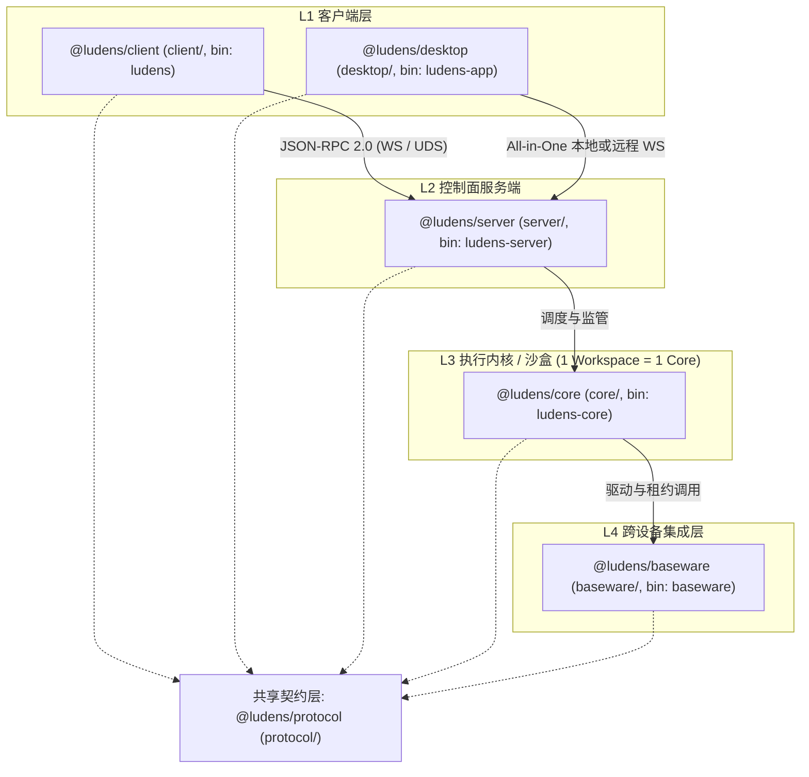

<p align="center">
  <picture>
    <source media="(prefers-color-scheme: dark)" srcset="client/public/brand/ludens-mark-dark.svg">
    
  </picture>
</p>

# Ludens

[English](README.md) · **简体中文**

**面向复杂多模态端到端任务的多模态、跨设备 Agent Harness —— 适用于机器人操控、安防巡检、桌面自动化与实时游戏等场景。**

Ludens 不把智能体限制在静态提示词或固定动作 Schema 里，而是把可编程的代码工作区直接接到真实硬件与软件目标上：
- **Ludens** 既是整套跨设备多模态 Harness，也是它的同名吉祥物人格。
- **Shiori** 严格担任 Ludens 的 **Agent 线程核心**（基于 OMP `18.22.2`），在持久化代码工作区内完成跨轮次推理与代码演化。
- **Baseware** 是 Ludens 的**跨设备集成层**，统一屏蔽异构设备驱动、传输协议与硬件控制租约。

---

## 为什么选择 Ludens

- **任意屏幕，任意设备（`Baseware`）** — 统一接入本机桌面（`cua`）、采集卡与 HID 硬件桥（如通过 SSH 或 TCP 桥接控制的机器设备与嵌入式主机）、仿真器或 MCP 端点；单个工作区支持并发挂载多个受控节点并按需路由。
- **代码即感知（`perception.py`）** — 常驻 Python 进程将实时画面录制为可检索的 30 Hz fMP4 时间轴，同时在内存中运行并热重载智能体自己编写的视觉检测器与闭环状态机。
- **可自验证的能力演化（`@capability` 与 `ludens workspace eval`）** — 将反复试错的动作流程沉淀为带类型的 Python 能力函数，搭配离线代理环境（`@eval_env`）与评测断言（`@eval_capability`），在秒级内离线完成回归验证后再下发真机执行。
- **统一控制台、自主循环与逐帧回放** — 一套同构 Vite 静态 SPA（`@ludens/client`）与 JSON-RPC 2.0（`ludens-server`）覆盖零端口 **Ludens 桌面应用**（`ludens-app`）、托管 Web **控制台**、远程 `wss://` 与移动端四种工况：一键启停工作区、开启**自主运行**、经由双向 `EventHub` 异步协作、在推理中途紧急插话纠偏（`ludens steer`）、随时一键**收回控制权**（`ludens auto off`），并对照模型完整轨迹拖拽 30 Hz 录像回放。*（可选附带系统托盘**桌宠**小组件。）*

## 30 秒看懂工作流

在工作区（`~/.ludens/workspaces/<name>`）中，智能体编写普通 Python 模块，即可同时对接真实 Baseware 设备与离线代理环境：

```python
# skills/visual_guard.py
from ludens_tools import Client, capability, eval_capability, eval_env

@capability
def act_on_alert() -> dict:
    """监听 30 Hz 感知时间轴，在检测到异常帧的瞬间触发执行动作。"""
    client = Client()
    for _ in range(30):
        records = client.observe()["records"]
        if records and records[-1]["data"].get("event") == "anomaly":
            client.call("controller/relay.trigger", {"channel": 1})
            return {"triggered": True}
    return {"triggered": False}

@eval_env
class WatchdogEnv:
    """离线代理监控流：前 4 帧正常，第 5 帧出现异常告警。"""
    def __init__(self) -> None:
        self.tick, self.triggered = 0, False

    def observe(self, query=None) -> list[dict]:
        self.tick += 1
        return [{"data": {"event": "anomaly" if self.tick == 5 else "nominal"}}]

    def call(self, id: str, args: dict) -> dict:
        self.triggered = (id == "controller/relay.trigger" and self.tick == 5)
        return {"ok": True}

@eval_capability(act_on_alert, env=WatchdogEnv)
def eval_act_on_alert() -> dict:
    """无需触碰真实硬件，离线验证闭环响应时机。"""
    with WatchdogEnv() as env:
        act_on_alert()
    return {"passed": env.triggered, "rewards": {"accuracy": 1.0 if env.triggered else 0.0}}
```

随时在终端或控制台 **能力** 页（`?view=caps`）一键运行离线验证：

```sh
ludens workspace eval run --all
# 或在 Core 沙盒内执行：
ludens-core eval run --all
```

## 快速开始

环境需准备 **Bun 1.4+**、**Node.js 22.13+**、**Python 3.12+**、**uv**，以及已配置好的模型认证凭据。

### 1. 安装与构建

```sh
git clone https://github.com/Arkevo-Lab/Ludens.git && cd Ludens
bun install --frozen-lockfile
uv sync --project core/python --frozen
bun run build
export PATH="$PWD/baseware/bin:$PWD/core/bin:$PWD/server/bin:$PWD/client/bin:$PWD/desktop/bin:$PATH"
```

### 2. 四种启动方式

Ludens 基于同构的 React 19 + Vite 静态 SPA（`@ludens/client`，`client/dist`）、纯 RPC 命令行客户端（`ludens`）、All-in-One Electron 桌面壳（`@ludens/desktop`，`ludens-app`）与统一 JSON-RPC 2.0 控制面服务端（`@ludens/server`，`ludens-server`）提供四种运行工况：

- **桌面端应用（`ludens-app` —— All-in-One 零 TCP 端口本地模式）**：执行一次 `bun run build`（或 `bun run build:desktop`）后运行 `ludens-app --show-window`（或执行 `bun run pack:desktop` / `bun run dist:desktop` 打包原生 macOS `.dmg` / Windows `.exe` 安装包）。桌面壳自包含 `client + server + core + baseware` 本地开箱即用，按 `LUDENS_HOME` 通过 Unix Domain Socket（`app-server.sock`）通信（**0 个监听 TCP 端口**，`ludens-app://console/`、`ludens-media://local/media?...`、`window.ludens.rpc`），也支持一键切连远程 `ludens-server`。关闭主窗口（`×`）时最小化至托盘与可选桌宠；退出（`⌘Q` / 托盘 **Quit**）时，若无活跃 Core 则直接退出并保留后台服务，若有活跃 Core 则弹出三选一确认（**后台继续运行 / 停止所有 Core 并退出 / 取消**）。
- **托管 Web / 远端服务端（`ludens-server`）**：开源控制面服务端，支持本地、自托管或云端部署。单进程同时提供静态 SPA 控制台、WebSocket JSON-RPC `/rpc` 与 HMAC capability ticket 鉴权的 `/media` 端点：执行 `ludens-server start --listen ws://127.0.0.1:3015 --auth token --token-env LUDENS_APP_TOKEN --static-dir "$PWD/client/dist"`（或直接运行 `bun run start:selfhost` 启动单机/VPS 自托管前台服务 `ludens-server serve --static-dir client/dist`；非回环地址必须启用 `--auth token`；页面加载 `http(s)://host:port/#token=...` 后会立即通过 `history.replaceState` 擦除 URL 中的 token）。使用 `ludens-server <start|stop|restart|status>` 监管后台服务。
- **纯 RPC CLI（`ludens` —— 本地 UDS 与 `--remote`）**：面向人的纯 RPC 操作者 CLI（`@ludens/client`，零 Core/Server/Baseware 运行时依赖）。既可直连本地 `app-server.sock`，也可传入 `--remote ws(s)://... [--token ...]` 统一接入远端 `ludens-server`（接入外部驱动包 `--driver-package` 或远程 SSH / 桥接节点详见[设备与驱动准备](docs/zh/tutorials/devices.md)）：

```sh
ludens workspace init --name my-agent --driver cua
cd "$HOME/.ludens/workspaces/my-agent"
ludens workspace up
```

  其他工作区与高频遥控命令：`ludens workspace <list|open|forget|import|down|services|eval>`、`ludens config ...`、`ludens <status|auto|steer|consolidate|stop|model|logs>`。如需脱离控制面直接运行单工作区内核，可使用 `ludens-core run` 及沙盒内工具 `ludens-core <controller|perception|event|machine|eval>`。

- **移动端与多目标切换**：在手机、平板或桌面浏览器打开同一套同构响应式 Vite SPA（`@ludens/client`），可通过连接切换弹窗在 `electron-local`（桌面端 IPC UDS）、`same-origin`（托管同源 WS `/rpc`）与 `remote`（`ws://` / `wss://` + Token）之间无缝切换。

### 3. 开发调试、构建打包与全仓质检

所有开发调试、构建打包与全仓质检均通过仓库根目录总控脚本统一调度。开发命令默认隔离在 `~/.ludens-dev`，传入 `--real-home` 或使用 `:real` 后缀即可挂载真实 `~/.ludens`：

- **开发调试（默认隔离 `~/.ludens-dev`，`:real` / `--real-home` 挂载真实 `~/.ludens`）**：
  - `bun run dev`（或 `bun run dev:web` / `bun run dev:web:real`）—— Web 全栈开发联调（受管 `ludens-server --dev` + Vite HMR）
  - `bun run dev:desktop`（或 `bun run dev:desktop:real`）—— Electron 桌面端开发联调（Vite HMR + Electron 原生 UDS）
  - `bun run dev:client` —— 纯异源前端开发（直连远程/云端 `ludens-server`）
  - `bun run dev:server`（或 `bun run dev:server:real`）—— 独立启动开发态 `ludens-server`
- **生产构建、打包与全仓质检**：
  - `bun run build` —— 一键构建全套产物（`client/dist`、`server/dist`、`core/dist`、`baseware/dist`、`desktop/dist`），也可按产线拆分为 `bun run build:client` / `build:server` / `build:sandbox` / `build:desktop`
  - `bun run pack:desktop` / `bun run dist:desktop` —— 打包 All-in-One Electron 桌面端
  - `bun run start:selfhost` —— 单机/VPS 自托管生产运行（`ludens-server serve --static-dir client/dist`）
  - `bun run typecheck` / `bun run test` —— 一键跑通 6 包类型检查与测试

### 4. 开启自主运行、收回控制权与异步协作

在桌面应用或已连接的 Web 控制台**运行（`?view=live`）**页点击**启动自主运行**，或通过终端命令行（本地或搭配 `--remote`）操控：

```sh
ludens auto on --message "探索目标环境并沉淀经验证的 Python 能力函数"
ludens steer "立刻暂停触发动作"
ludens auto off
```

## 工程结构

Ludens 采用 **6 包 + 4 层正交架构**，由零运行时依赖的共享契约层统一连接：



| 架构层级 | 子包 | 路径与命令 | 职责 |
| --- | --- | --- | --- |
| **L1 客户端** | [`@ludens/client`](client/README.md) | `client/` · `ludens` | Web 与手机端同构 Vite SPA 控制台（`client/dist`），独立发版、异源一等公民（仅依赖 `@ludens/protocol`），以及面向人的纯 RPC CLI `ludens`。 |
| **L1 桌面壳** | [`@ludens/desktop`](desktop/README.md) | `desktop/` · `ludens-app` | All-in-One Electron 桌面壳，自包含 `client + server + core + baseware` 实现零端口本地开箱即用（`ludens-app://` / `ludens-media://`）、多目标连接弹窗与可选桌宠，也可一键切连远程 `ludens-server`。 |
| **L2 控制面** | [`@ludens/server`](server/README.md) | `server/` · `ludens-server` | 开源控制面服务端（支持本地、自托管或云端部署）：统一提供 JSON-RPC 2.0、`EventHub`、HMAC `/media`、查询引擎与 Core 运行环境调度。 |
| **L3 执行内核** | [`@ludens/core`](core/README.md) | `core/` · `ludens-core` | `1 Workspace = 1 Core` 执行沙盒，承载 **Shiori**（OMP `18.22.2`）、常驻 `perception.py`、`loop.py` 与工作区代码/自验证，提供 `ludens-core run` 及沙盒内 `ludens-core <controller\|perception\|event\|machine\|eval>`。 |
| **L4 设备集成** | [`@ludens/baseware`](baseware/README.md) | `baseware/` · `baseware` | 跨设备集成层：独立硬件/模拟器/桌面驱动、Controller 契约、`epoch` 控制租约仲裁与 MCP。 |
| **共享契约** | [`@ludens/protocol`](protocol/README.md) | `protocol/` | 零运行时依赖的强类型协议（`@ludens/protocol/app-rpc`）、事件信封、连接传输策略与跨端 DTO。 |

## 文档导航

完整文档以中英双语同步维护（[`docs/zh/`](docs/zh/) 与 [`docs/en/`](docs/en/)），也可在控制台 `?view=docs` 中实时阅读：

- **[核心概念](docs/zh/concepts/index.md)** — [系统概览与四层架构](docs/zh/concepts/overview.md) · [自主循环与控制周期](docs/zh/concepts/loop-and-control.md) · [编码即感知与能力自验证](docs/zh/concepts/self-verification.md)
- **[教程](docs/zh/tutorials/index.md)** — [快速开始](docs/zh/tutorials/quickstart.md) · [设备与驱动准备](docs/zh/tutorials/devices.md) · [工作区与能力编程](docs/zh/tutorials/workspace.md) · [常驻感知状态机](docs/zh/tutorials/perception-and-action.md) · [控制台与调试验证](docs/zh/tutorials/console-and-debugging.md)
- **[参考](docs/zh/reference/index.md)** — [系统架构](docs/zh/reference/architecture.md) · [CLI 命令参考](docs/zh/reference/cli.md) · [Baseware 契约](docs/zh/reference/baseware.md) · [Driver Bridge 协议](docs/zh/reference/driver-bridge-protocol.md) · [日志体系](docs/zh/reference/logging.md)
- **[洞察](docs/zh/insights/index.md)** — [后台投机压缩](docs/zh/insights/omp-compaction.md) · [WebSocket 增量恢复](docs/zh/insights/ws-recovery.md) · [单通道轮次注入](docs/zh/insights/omp-injection.md) · [感知参数推演](docs/zh/insights/perception-parameters.md)

> **安全提示**：智能体会在宿主机直接执行 Shell 与 Python 代码，且运行归档包含视觉录制。处理不受信任的目标时请配合虚拟机或容器隔离；任何时刻执行 `ludens auto off`（或在控制台点击**收回控制权**）均可立即吊销设备动作权限。

## 开源许可

[MIT](LICENSE)
