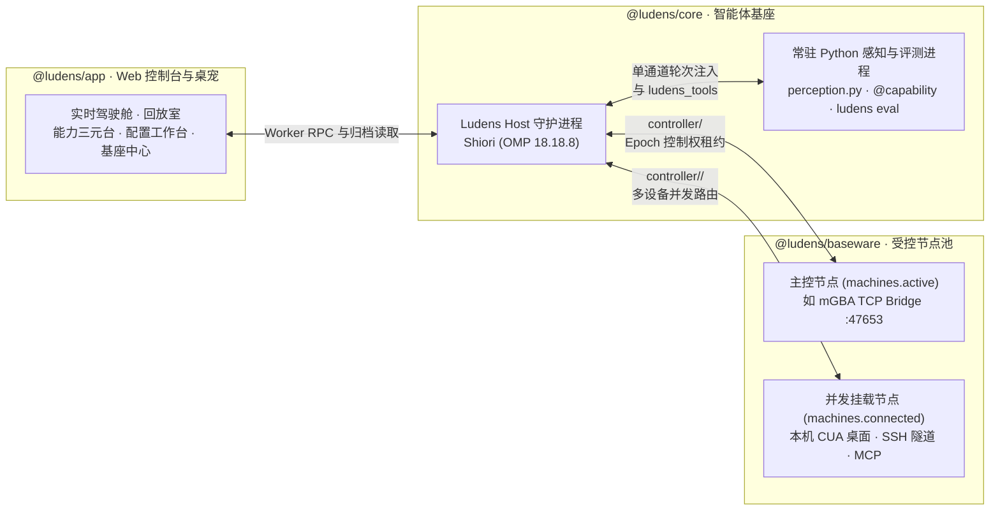

# Ludens

[English](README.md) · **简体中文**

**面向复杂实时环境、通过工作区内生自适应（Self-Adaptation）与自演化（Self-Improvement）持续进化的多模态智能体基座（Agent Harness）。**

Ludens 将编码智能体连接到任意 PC 桌面、游戏模拟器与远程受控设备，为其提供一个持久化的软件工程工作区。面对陌生的交互界面与长周期任务，Ludens 智能体不再依赖静态提示词或写死的动作空间，而是直接在工作区中用 Python 编写并演进自己的**常驻感知—动作状态机（`perception.py`）**、**可复用技能函数（`@capability`）**以及**离线代理评测环境（`@eval_capability` / `@eval_env`）**。

**实时电子游戏（Games）**是我们攻坚的第一类旗舰级长周期多模态任务——涵盖本地桌面游戏与主机模拟器——由多设备受控节点池、全链路可观测控制台与可验证的能力自演化闭环共同支撑。

[核心特性](#核心特性) · [30 秒看懂工作流](#30-秒看懂-ludens-工作流) · [系统架构](#系统架构) · [快速开始](#快速开始) · [Web 控制台导览](#web-控制台导览) · [文档目录](#文档目录)

---

## 核心特性

- **受控节点池与多设备并发挂载（`@ludens/baseware`）**：在 `~/.ludens/machines.json` 中统一管理本机 `stdio` 驱动、模拟器 TCP 桥接（如 mGBA `:47653` 预设）、远程 `ssh` CUA 隧道以及 `http`/`sse` MCP 端点。支持单个工作区并发挂载多台设备，并随时在运行期一键切换主控或定向调用（`ludens machine use | connect | disconnect`）。
- **常驻内存的热重载感知状态机（`perception.py`）**：独立常驻的 Python 工作进程跨轮次保持视觉模型、状态机变量与高频 fMP4/H.264 时间轴采样，无需重启智能体宿主；修改 `perception.py` 或工作区模块即可热重载生效。
- **可验证的能力三元闭环（`Capability – Eval – Env`）**：智能体将高频交互模式沉淀为带类型契约的 `@capability` 函数，编写配套的 `@eval_capability` 断言与 `@eval_env` 离线代理环境，通过 `ludens eval` 持续追踪每次代码演进后的评分轨迹。
- **长周期多模态传输韧性**：基于 **Shiori**（内核搭载 **OMP `18.18.8`**），原生支持有状态 WebSocket 增量传输（`previous_response_id`，内置 60 秒断连冷却自愈与 `15 MiB` 单帧超限压缩后解封）、无状态 HTTP 前缀 KV 缓存保护（`appendOnlyContext`）以及基于 SHA-256 去重的图片外链卸载（`blob-broker`）。
- **全链路实时驾驶舱与毫秒级回放台（`@ludens/app`）**：在浏览器控制台中实时查看多设备画面流、中途插话纠偏（`steer`）、按 30 秒分片毫秒级回放历史证据、一键启停后台服务与触发能力评测，或搭配可选的 **Ludens Pet** 桌面伴侣使用。

---

## 30 秒看懂 Ludens 工作流

在每个独立的 Ludens 工作区（默认位于 `~/.ludens/workspaces/<name>`）中，智能体通过 `ludens_tools` 操控已挂载设备，并编写可自验证的技能代码：

```python
# skills/dialogue.py — 智能体自主编写的能力函数与离线自验证闭环
import ludens_tools
from ludens_tools import capability, eval_capability, eval_env

@capability
def advance_dialogue(machine: str | None = None) -> dict:
    """在目标设备（默认主控设备，也可指定任意已挂载节点）上按 A 键推进对话框。"""
    frame = ludens_tools.call("controller/screen.capture", {}, machine=machine)
    ludens_tools.call(
        "controller/pad.play",
        {"inputs": [{"atMs": 0, "durationMs": 80, "state": {"A": 1}}], "wait": True},
        machine=machine,
    )
    return {"advanced": True, "width": frame["width"]}

@eval_env
def dialogue_box_fixture() -> list[dict]:
    """回放已录制的对话框状态切片，构造毫秒级离线代理评测环境。"""
    return [{"dialogue_open": True}, {"dialogue_open": False}]

@eval_capability(capability="advance_dialogue", env="dialogue_box_fixture")
def eval_advance_dialogue(env_data: list[dict]) -> dict:
    passed = env_data[0]["dialogue_open"] and not env_data[-1]["dialogue_open"]
    return {"passed": passed, "rewards": {"pass_rate": 1.0 if passed else 0.0}}
```

随时在命令行或控制台能力页（`?view=caps`）一键运行离线评测：

```sh
ludens eval --all
```

---

## 系统架构

Ludens 将**控制面（Control Plane）**、**工作区代码（Workspace）**、**设备面（Device Plane）**与**可观测控制台（Console）**彻底解耦：



### 四柱工程结构（Four-Pillar Monorepo）

| 子包 | 核心职责 |
| --- | --- |
| [`@ludens/protocol`](protocol/README.md) | 零依赖契约层：跨包共享的 RPC Schema、运行事件信封、内容寻址归档格式（`.ludens/archive/`）与控制台/桌宠 DTO。 |
| [`@ludens/baseware`](baseware/README.md) | 独立设备基座服务：驱动加载器、`Controller` JSON Schema 参数校验、`epoch` 控制权租约仲裁，以及 CLI / API / MCP 统一入口。 |
| [`@ludens/core`](core/README.md) | 自适应智能体基座：`launchd` 后台服务编排、Shiori（`OMP 18.18.8`）会话运行时、常驻 Python `perception.py` 进程、多机路由与 `ludens eval` 评测引擎。 |
| [`@ludens/app`](app/README.md) | 浏览器优先的 Next.js 16 可观测与控制工作台（`http://127.0.0.1:3015`），内置可选的 Electron **Ludens Pet** 桌面伴侣。 |

### 工作区目录结构

每个任务运行在仓库外部的独立工作区目录中（默认位于 `~/.ludens/workspaces/<name>`）：

```text
my-workspace/
├── ludens.json          # 模型、预算、多模态传输策略、驱动与受控节点池绑定配置
├── baseware.json        # 从当前挂载设备导出的控制器接口（Controller Interfaces）快照
├── perception.py        # 智能体自主编写、支持热重载的常驻感知与动作状态机
├── skills/              # 智能体沉淀的 @capability、@eval_capability 与 @eval_env 模块
├── MEMORY.md & memory/  # 跨会话持久化的长期记忆、环境规律与策略笔记
└── .ludens/             # Shiori 会话记录、fMP4/H.264 时间轴媒体归档与评测运行记录
```

---

## 快速开始

### 1. 环境要求与安装

需要 **macOS**（用于 `launchd` 守护服务管理）、**Bun 1.4+**、**Python 3.12+**、**Node.js 22.13+ / 24+**、**uv**，以及已配置的本地 **OMP 模型凭据**（默认模型：`openai-codex/gpt-6.1-sol`）。

```sh
git clone https://github.com/Arkevo-Lab/Ludens.git
cd Ludens

bun install --frozen-lockfile
uv sync --project core/python --frozen
(cd app && npm run build)

export PATH="$PWD/baseware/bin:$PWD/core/bin:$PATH"
```

### 2A. 路径 A — 接管本机 PC 桌面（`CUA` 驱动）

创建并启动一个接管本机桌面的工作区（需安装上游 CUA 驱动二进制并授予 macOS“屏幕录制”与“辅助功能”权限，详见[设备与驱动配置](docs/zh/tutorials/devices.md#cua)）：

```sh
ludens init --name my-desktop-task --driver cua
cd "$HOME/.ludens/workspaces/my-desktop-task"
ludens up
ludens controller list
ludens auto on
```

### 2B. 路径 B — 接管 GBA 游戏模拟器（`mGBA` TCP Bridge）

使用仓库内置脚本一键启动加载了 Lua 桥接脚本（`:47653`）的 mGBA 模拟器并挂载工作区：

```sh
./scripts/run-gba.sh /path/to/your/rom.gba /Applications/mGBA.app
```

也可以直接打开 Web 控制台的**基座视图**（[`http://127.0.0.1:3015/?view=baseware`](http://127.0.0.1:3015/?view=baseware)），点击 **+ 新增节点** 一键填入 mGBA `:47653` 预设并点击 **设为主控**。

### 3. 常用 CLI 命令速查

| 命令 | 说明 |
| --- | --- |
| `ludens up` / `ludens down` | 启动或停止工作区托管的后台服务（`emulator`、`baseware`、`host`、`dashboard`、`pet`）。 |
| `ludens down --keep-emulator && ludens up` | 在保留模拟器进程不断开的前提下，热重载 Host 与 Baseware 服务。 |
| `ludens auto on [goal]` / `ludens auto off` | 授予智能体设备控制权租约并启动自主循环，或立即收回控制权。 |
| `ludens steer "<message>"` | 在自主循环运行中紧急打断当前轮次进行插话纠偏，不中断当前设备租约。 |
| `ludens event <list\|send\|reply\|ack>` | 读写工作区双向事件池（`--direction`、`--status`、`--limit`、`--title`、`--message`）；在线经宿主 Socket、离线直接读写 `.ludens/event-pool.json`。 |
| `ludens machine list \| use \| connect \| disconnect` | 查看受控节点池、切换主控设备（`use`），或并发挂载/断开多台辅助设备（`connect` / `disconnect`）。 |
| `ludens perception reload` | 热重载常驻 Python 进程中的 `perception.py` 及工作区模块。 |
| `ludens eval [<capability_id> \| --all]` | 运行 `@eval_capability` 离线评测套件并将评分写入 `.ludens/evals/runs/`。 |

---

## Web 控制台导览

启动后访问 [`http://127.0.0.1:3015`](http://127.0.0.1:3015)（开发与日常使用均无需启动 Electron）：

| 视图 | 路由 | 核心功能 |
| --- | --- | --- |
| **运行（Live）** | `?view=live` | 顶部 **Shiori 循环驾驶舱**（一键 `auto on`、紧急轮内插话 `steer`、`auto off`、记忆整理）、工作区双向**事件池（Event Pool）**输入框与出站求助／通知托盘（`event_pool` / `ludens event`）、多设备画面流切换器（`[machineId]`）与实时活动证据流。 |
| **回放（Replay）** | `?view=replay` | 30 秒分片 fMP4 视频流精准拖拽、毫秒级时间跳转、全归档事件搜索与模型输入原始证据检查器。 |
| **性能（Performance）** | `?view=perf` | 单次请求延迟拆解（`fetchToHeadersMs`、流式输出、工具执行）、Token 与缓存命中遥测、上下文压缩时间线分析。 |
| **能力（Capabilities）** | `?view=caps` | **Capability – Eval – Env** 三元拓扑图、源码短 `codeSHA` 三向过期归因、自演化评分轨迹曲线，以及一键**运行全部评测** / **运行评测**。 |
| **配置与服务（Studio）** | `?view=perception` | 五合一工作区工作台：**模型与预算**、**连接与多模态传输**、**后台服务与会话**（一键 `up` / `reload` / `down`、Shiori 会话切换、内联 `MEMORY.md` 编辑）、**感知录制参数**与**上下文容量推演**。 |
| **基座（Baseware）** | `?view=baseware` | 左列表右详情（Master-Detail）**受控节点中心**：管理 `~/.ludens/machines.json` 节点池、一键**设为主控 (`use`)** / **并发挂载 (`connect`)** / **断开连接 (`disconnect`)**、连通性探活与**控制器接口**目录。 |

---

## 边界与安全

- **受信任的本地执行环境**：智能体直接在宿主机上执行 Shell 命令与 Python 代码（使用 CUA 时共享桌面）。若需运行不受信任的任务，请使用独立的操作系统账户、容器或虚拟机隔离。
- **显式 Epoch 控制权租约**：任何改变设备状态的输入操作均需持有有效租约（`ludens auto on`）。执行 `ludens auto off`（或在控制台/桌宠点击**交还控制**）会立即吊销当前 `epoch` 并释放所有按住的按键或触控状态。
- **隐私提示**：本地时间轴归档（`.ludens/timeline/`）与模型请求日志中包含屏幕截图与桌面状态，对外分享运行目录前请务必审阅。

---

## 文档目录

项目文档采用中英双语镜像维护（[`docs/zh/`](docs/zh/) 与 [`docs/en/`](docs/en/)），也可直接在控制台 `?view=docs` 中阅读：

- **[教程（`docs/zh/tutorials/`）](docs/zh/tutorials/index.md)**
  - [安装与工作区生命周期](docs/zh/tutorials/quickstart.md)
  - [设备、驱动与受控节点池](docs/zh/tutorials/devices.md)
  - [工作区与 Capability–Eval–Env 能力编程](docs/zh/tutorials/workspace.md)
  - [常驻感知与动作状态机](docs/zh/tutorials/perception-and-action.md)
  - [控制台调试与验证](docs/zh/tutorials/debugging-and-verification.md)
- **[参考（`docs/zh/reference/`）](docs/zh/reference/index.md)**
  - [系统架构与边界](docs/zh/reference/architecture.md)
  - [Baseware 设计理念与受控节点池契约](docs/zh/reference/baseware.md)
  - [Driver Bridge 协议规范](docs/zh/reference/driver-bridge-protocol.md)
  - [日志体系与调用链追踪](docs/zh/reference/logging.md)
  - [Dashboard UI 与交互契约](docs/zh/reference/dashboard-ui.md)
- **[工程洞察（`docs/zh/insights/`）](docs/zh/insights/index.md)**
  - [OMP 后台投机压缩重构](docs/zh/insights/omp-compaction.md)
  - [WebSocket 增量传输与离线故障恢复矩阵](docs/zh/insights/ws-recovery.md)
  - [单通道轮次注入演进](docs/zh/insights/omp-injection.md)

---

## 开源许可

本项目基于 [MIT License](LICENSE) 开源。
