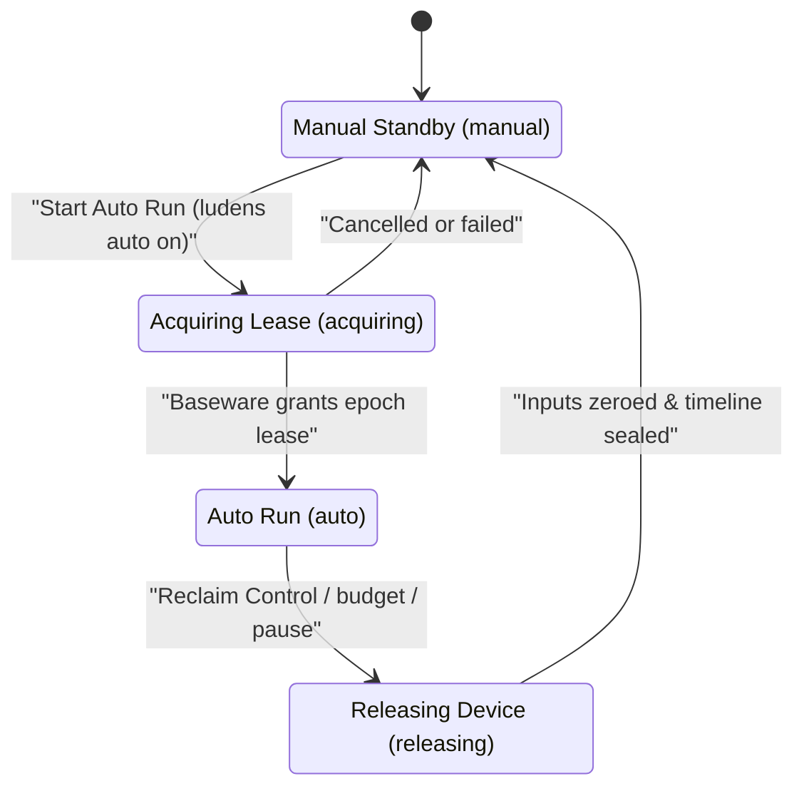

# Control Cycles, Perception Loop & Collaboration

Ludens coordinates real-time hardware targets and slower multimodal model reasoning by separating continuous sensing from turn-based planning, guarding actuation with monotonic `epoch` leases, and giving operators non-blocking collaboration channels alongside an instant safety cutoff.

## The Four-Phase Autonomous Loop

Inside a workspace, progress moves through four distinct phases across turns and cycles:

| Phase | Owner | What Happens |
| --- | --- | --- |
| **1. Observe** | Resident `perception.py` + Shiori | Under an active control lease, `Perception.sample()` samples up to `30 Hz` into `.ludens/timeline/`. At the start of each turn (when auto-injection is `on`), Shiori attaches newly arrived primary-channel records and sampler state changes once per prompt; mid-turn inspection uses explicit `observe` calls. |
| **2. Reason** | Shiori (`Agent Thread Core`) | The vision-capable model evaluates recent observations alongside `skills/`, `MEMORY.md`, `memory/current.md`, and `baseware.json` to choose between direct controller actions, fast Python `@capability` execution, or code updates. |
| **3. Act & Eval** | Python `@capability` + Baseware + `ludens eval` | Sub-second closed loops execute inside Python rather than waiting on multi-second LLM turns. New or modified capabilities are verified offline against `@eval_env` surrogates with `ludens eval run` before running on physical or software targets. |
| **4. Consolidate** | Shiori (`consolidate`) | In a file-only turn (`read`, `write`, `edit` only, with device access disabled), Shiori promotes `verified` capabilities into `skills/`, prunes `unverified`, `stale`, `adapting`, or `failed` entries, and updates `memory/current.md`. |

Because Shiori appends automatic observations only once at turn start (`ludens perception inject on`) and never pads tool outputs with extra screenshots, the conversation prefix stays cache-friendly across long multi-turn runs. When the model needs a fresh check mid-turn, it calls `observe` or `ludens observe` explicitly on demand.

## Auto Run, Manual Standby & Reclaim Control

Every Ludens host cleanly separates human control from autonomous execution through explicit operating modes:

- **Manual Standby (`manual`)**: Every workspace host (`ludens up` or `ludens run`) starts in **Manual Standby**. The operator retains direct control of the target device, the resident `perception.py` worker stays warm for read-only `ludens observe` queries, and offline `ludens eval` checks or paused-only `ludens model` switches can run freely.
- **Start Auto Run (`auto`)**: Clicking **Start Auto Run** in Console **Live** (`?view=live`) or running `ludens auto on [--message <text>] [--seconds <n>]` transitions the host to **Auto Run**, opening a fresh **Control Cycle** (`epoch`). Continuous 30 Hz sampling activates and Shiori executes autonomous turns until stopped or a budget expires.
- **Reclaim Control (`manual`)**: Clicking **Reclaim Control** in Console or running `ludens auto off` triggers immediate release regardless of what the model is doing. Shiori aborts the current turn, closes the model-call gate so no further inference starts, stops continuous perception sampling while sealing active fMP4 video segments, drains in-flight calls, and instructs Baseware to release the target and reset held keys, contacts, or actuators back to neutral.

To keep provenance unambiguous within every Control Cycle, switching models, serving tiers, or reasoning effort (`ludens model` or Console model picker) is allowed only during **Manual Standby** with no active turn or consolidation in progress.

## Control Leases (`epoch`) & Dual Budgets

Hardware safety and cost bounds are enforced structurally by Baseware and Shiori rather than by prompt instructions alone.

### Monotonic `epoch` Leases

Each time **Auto Run** begins, Shiori mints a unique UUID **`epoch`** and acquires the lease over a persistent connection to Baseware. Shiori injects `BASEWARE_EPOCH` into workspace shells and subprocesses for that cycle:

- **Lease enforcement**: Any Baseware `Controller` marked `requiresControl` — as well as workspace `python/...` CLI invocations — checks the supplied `epoch`. Calls carrying an expired or missing `epoch` are rejected (`STALE_EPOCH`), preventing delayed background scripts from touching hardware after **Reclaim Control** or cycle expiration.
- **Hot-reload without dropping the cycle**: When `perception.py` or one of its imported modules is edited during **Auto Run** (or on `ludens perception reload`), the host increments `inputGeneration`, immediately cancels and zeros active workspace device inputs, and swaps in the new resident code while preserving the active `epoch`, remaining budgets, and Shiori session.

### Time and Request Budgets

Each Control Cycle tracks two independent limits:

- **Time budget (`--seconds <n>`)**: Optional wall-clock duration for a Control Cycle. When `--seconds` is omitted on `ludens auto on` (or set to unbounded in Console), the cycle runs without a timer (`null`) until explicit **Reclaim Control** or request exhaustion. You can update or clear the countdown in place during **Auto Run** using `ludens auto timer <seconds|off>` (or the Console timer menu) without minting a new `epoch` or interrupting the active turn.
- **Request budget (`--requests <n>`)**: Caps how many model requests Shiori may issue inside a single Control Cycle (default `50` on `ludens run`). Once reached, the model gate blocks further requests and cleanly releases control back to **Manual Standby**.

## Duplex Collaboration: Event Pool vs. Live Steer

Human operators do not have to stop **Auto Run** just to share context, answer a question, or correct a bad assumption. Ludens provides two distinct collaboration channels with clear guarantees:

| Channel | Mechanism & Persistence | When to Use | Effect on Active Cycle |
| --- | --- | --- | --- |
| **Event Pool** | Duplex queue in `.ludens/event-pool.json` (`ludens event`, `event_pool` tool, Console **Live** dock). Survives across cycles and **Manual Standby**. | Non-urgent guidance, asynchronous operator replies, or agent status updates (`notice`) and non-blocking questions (`help_request`). | Non-blocking by default (`pause: false`). Only `pause: true` pauses **Auto Run** into `awaiting human` and releases device control until resumed. |
| **Live Steer** | Direct mid-turn injection (`ludens steer <message>`, Console **Steer Now**). Active only during **Auto Run**. | Urgent mid-turn course correction when the agent is heading down the wrong path right now. | Queues straight into the running turn without starting a new `epoch` or entering the Event Pool. |

### How the Event Pool Works Without Bloating Context

- **Human side**: Run `ludens event send "..."` or `ludens event reply <event-id> "..."` (or use the Event Pool composer in Console **Live**). Commands work whether the host is online or stopped — messages left during **Manual Standby** are waiting as soon as the next Control Cycle starts. Unread inbound messages can also be withdrawn with `ludens event ack`.
- **Shiori side**: At the start of each turn, Shiori injects a compact inbound digest **only** when pending inbound items exist; an idle Event Pool adds zero bytes, preserving the provider KV cache prefix. When ready, the agent calls `event_pool({ action: "read" })` to fetch full text (or `ack: false` to defer while busy) and `event_pool({ action: "emit" })` to post `notice` updates or `help_request` prompts back to the operator.

Use **Event Pool** for durable asynchronous coordination, **Live Steer** for immediate in-turn redirection, and **Reclaim Control** whenever physical or software actuation must stop right now.

## Next Steps

- Continue to [Code-First Perception & Self-Verification](self-verification.md) to learn how `@capability`, `@eval_env`, and `@eval_capability` close the verification loop.
- See these controls in action in [Console & Debugging](../tutorials/console-and-debugging.md) and [CLI Reference](../reference/cli.md).
- For implementation internals on turn injection and session assembly, read [Architecture and Boundaries](../reference/architecture.md) and [Single-Channel Turn Injection](../insights/omp-injection.md).
