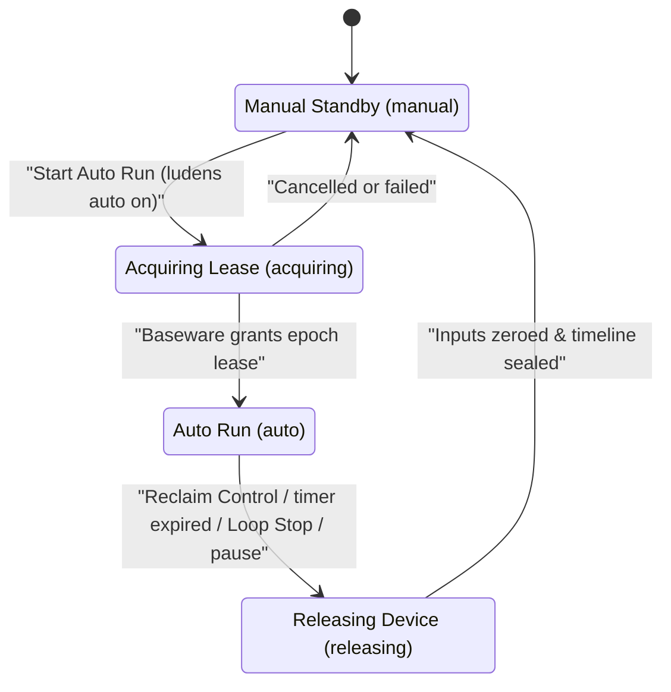

# Control Cycles, Perception Loop & Collaboration

Ludens coordinates real-time hardware targets and slower multimodal model reasoning by separating continuous sensing from turn-based planning, guarding actuation with monotonic `epoch` leases, and giving operators non-blocking collaboration channels alongside an instant safety cutoff.

## The Four-Phase Autonomous Loop

Inside a workspace, progress moves through four distinct phases across turns and cycles:

| Phase | Owner | What Happens |
| --- | --- | --- |
| **1. Observe** | Resident `perception.py` + Shiori / `loop.py` | Under an active control lease, `Perception.sample()` samples up to `30 Hz` into `.ludens/timeline/`. At the start of each turn (when auto-injection is `on`), Shiori attaches newly arrived lean primary-channel records and state changes to the turn-start observation context (`observation_context`, customizable via `loop.py:Loop.inject`); mid-turn inspection uses explicit `observe` calls. |
| **2. Reason** | Shiori (`Agent Thread Core`) | The vision-capable model evaluates recent observations alongside `skills/`, `MEMORY.md`, `memory/current.md`, and `baseware.json` to choose between direct controller actions, fast Python `@capability` execution, or workspace code updates (including `perception.py` and `loop.py`). |
| **3. Act & Eval** | Python `@capability` + Baseware + `ludens-core eval` | Sub-second closed loops and routine inter-turn state transitions (`loop.py:Loop.step`) execute inside Python without spending multi-second LLM round-trips or tokens. New or modified capabilities are verified offline against `@eval_env` surrogates with `ludens-core eval run` (or `ludens workspace eval run`) before running on physical or software targets. |
| **4. Consolidate** | Shiori (`consolidate` / `Consolidate()`) | In a file-only turn (`read`, `write`, `edit` only, with device access disabled), Shiori promotes `verified` capabilities into `skills/`, prunes `unverified`, `stale`, `adapting`, or `failed` entries, and updates `memory/current.md`. |

Because Shiori appends automatic observations only once at turn start (`ludens-core perception inject on`) and never pads tool outputs with extra screenshots, the conversation prefix stays cache-friendly across long multi-turn runs. When the model needs a fresh check mid-turn, it calls `observe` or `ludens-core perception observe` explicitly on demand.

## Lean Perception Payload Contract

Across both turn-start auto-injection (`observation_context`) and explicit `observe` tool calls, Ludens dehydrates perception payloads (`perceptionInput`) so model context carries clean domain signals rather than runtime telemetry noise:

- **Routine latest reads (turn-start injection and unfiltered `observe`)**: Return `{ ok: true, records: [{ id, sequence, recordedAt, capability?, text?, data?, space?, effect?, transition? }] }`. `id`, `sequence`, and `recordedAt` are always included; `capability` appears only when it differs from the default primary channel (`python/perception.py:Perception.sample`); non-empty `text` plus defined `data`, `space`, `effect`, and `transition` fields are preserved intact; internal telemetry bloat (`queryId`, `generation`, 64-char `codeSHA`, monotonic `sampling`, `sampledAt`, raw Baseware `sources`, and `media[*].id`) is omitted.
- **Historical, filtered, or paginated queries (explicit `observe` with `id`, `at`, `start`, `end`, `after`, `limit`, or `capability`)**: Return `{ ok: true, query, records, hasMore, nextAfter?, availability? }`, preserving cursor pagination and timeline availability bounds.
- **Failed or unavailable reads (`!ok`)**: Return `{ ok: false, error?, availability? }` so sampler errors and availability state remain explicit.

## Programmable Outer Loop (`loop.py`)

When `loop.py` is absent from the workspace root, Shiori runs the built-in default outer loop: reading the latest lean perception payload plus vision frames and issuing `Prompt()` into the next model turn. Whenever routine polling waits, periodic maintenance, or deterministic `@capability` transitions do not need an LLM round-trip, both humans and Shiori can create or edit `loop.py` (`class Loop(ludens_tools.Loop):`, or a standalone `class Loop:` defining `step` and/or `inject`). Each inter-turn boundary supplies a `TurnContext` (`turn`, `llm_turns`, `initial_message`, `default_prompt`, `steered`, `perception`, `perception_state`, `event_pool`, `last_turn`, `remaining_seconds`, `fault`, plus `ctx.default_inject()`):

- **`inject(self, ctx: TurnContext) -> TurnInjection | dict | str | None`**: Customizes the turn-start observation payload (recorded on `observation_context`) before a `Prompt` turn. Calling `inj = ctx.default_inject()` returns a mutable `TurnInjection` (for example, set `inj.attach_images = False` to omit vision frames on code-focused turns, or `inj.extra.append(...)` to attach domain summaries in `structured` mode). You can also return a custom `dict` (`custom_json`), `str` (`custom_text`), or `None` (`none` mode, omitting turn-start observation text and vision frames for that turn).
- **`step(self, ctx: TurnContext) -> Prompt | Consolidate | Wait | Stop`**: Runs a single scheduling step under the active `epoch` lease and `trace` scope — `Client().call(...)` and `Client().observe(...)` inside `step()` inherit `epoch` automatically, enabling zero-token `@capability` execution before returning one of four control actions:

| Returned Action | Effect |
| --- | --- |
| `Prompt(prompt=None, injection=...)` | Starts the next LLM turn (passing `prompt` overrides `ctx.default_prompt`; omitting `injection` calls `self.inject(ctx)` automatically) |
| `Consolidate(prompt=None)` | Runs an in-cycle file-only consolidation turn (`read`, `write`, `edit` only, no device access), then continues the outer loop |
| `Wait(seconds=1.0, reason=None)` | Sleeps deterministically without spending LLM tokens or model turns; wakes immediately on **Reclaim Control** or human `steer` |
| `Stop(reason="completed")` | Ends the active Control Cycle cleanly with stop reason `loop: <reason>`, releasing the `epoch` lease back to **Manual Standby** |

- **Inter-turn hot-reload and fault isolation (`loop_fault`)**: `LoopRuntime` tracks source hashes for `loop.py` and its imported workspace `.py` modules, hot-reloading automatically between turns. Syntax, import, or runtime exceptions in `load`, `step`, or `inject` never crash the worker or deadlock the cycle: the host emits `loop_fault` (`fallback: "default_loop"`), falls back safely to the built-in default `Prompt` turn, and surfaces `loopFault` in the next observation payload (`observation_context`) so Shiori or the operator can fix `loop.py` live. Once a clean reload succeeds, `loopFault` clears automatically.
- **Urgent human `Steer` preemption**: Human `steer` always outranks `loop.py`. Arrival of a pending `steer` aborts any in-flight `Wait(seconds)` immediately and bypasses `Loop.step()` on the next iteration, forcing an immediate `Prompt` turn (`ctx.steered = True`) so deterministic loops can never block operator intervention.
- **1:1 Console observability**: In Console **Live** (`?view=live`), each model call's Input Inspector renders `deliveredPayload` 1:1 after `Loop.inject`, while inter-turn `loop_step`, `loop_fault`, `loop_status`, and model-free inter-turn `@capability` calls group into a collapsible **Loop steps** disclosure (auto-expanded whenever a `loop_fault` is present).

## Auto Run, Manual Standby & Reclaim Control

Every Ludens host cleanly separates human control from autonomous execution through explicit operating modes:

- **Manual Standby (`manual`)**: Every workspace host (`ludens workspace up` or `ludens-core run`) starts in **Manual Standby**. The operator retains direct control of the target device, the resident `perception.py` worker stays warm for read-only `ludens-core perception observe` queries, and offline `ludens workspace eval` / `ludens-core eval` checks or paused-only `ludens model` switches can run freely.
- **Start Auto Run (`auto`)**: Clicking **Start Auto Run** in Console **Live** (`?view=live`) or running `ludens auto on [--message <text>] [--seconds <n>]` transitions the host to **Auto Run**, opening a fresh **Control Cycle** (`epoch`). Continuous 30 Hz sampling activates and Shiori executes autonomous turns until stopped or an active timer expires.
- **Reclaim Control (`manual`)**: Clicking **Reclaim Control** in Console or running `ludens auto off` triggers immediate release regardless of what the model is doing. Shiori aborts the current turn, closes the model-call gate so no further inference starts, stops continuous perception sampling while sealing active fMP4 video segments, drains in-flight calls, and instructs Baseware to release the target and reset held keys, contacts, or actuators back to neutral.

To keep provenance unambiguous within every Control Cycle, switching models, serving tiers, or reasoning effort (`ludens model` or Console model picker) is allowed only during **Manual Standby** with no active turn or consolidation in progress.

## Control Leases (`epoch`) & Optional Cycle Timer

Hardware safety and cycle bounds are enforced structurally by Baseware and Shiori rather than by prompt instructions alone.

### Monotonic `epoch` Leases

Each time **Auto Run** begins, Shiori mints a unique UUID **`epoch`** and acquires the lease over a persistent connection to Baseware. Shiori injects `BASEWARE_EPOCH` into workspace shells and subprocesses for that cycle:

- **Lease enforcement**: Any Baseware `Controller` marked `requiresControl` — as well as workspace `python/...` CLI invocations and `Client().call(...)` calls inside `loop.py:Loop.step` — checks the supplied `epoch`. Calls carrying an expired or missing `epoch` are rejected (`STALE_EPOCH`), preventing delayed background scripts from touching hardware after **Reclaim Control** or cycle expiration.
- **Hot-reload without dropping the cycle**: When `perception.py` or one of its imported modules is edited during **Auto Run** (or on `ludens-core perception reload`), the host increments `inputGeneration`, immediately cancels and zeros active workspace device inputs, and swaps in the new resident perception code; editing `loop.py` or its imported modules reloads the outer loop automatically between turns — both preserve the active `epoch`, active timer, and Shiori session.

### Optional Cycle Timer

Each Control Cycle runs unbounded (`null`) by default until explicit **Reclaim Control**, unless an explicit timer is set:

- **Cycle timer (`--seconds <n>`)**: Optional wall-clock duration for a Control Cycle. When `--seconds` is omitted on `ludens auto on` (or left unbounded in Console), the cycle runs without a timer (`null`) until explicit **Reclaim Control** or `Loop.step` `Stop`. You can set, update, or clear the countdown in place during **Auto Run** using `ludens auto timer <seconds|off>` (or the Console timer menu) without minting a new `epoch` or interrupting the active turn; when a timer expires, the model gate blocks further requests and cleanly releases control back to **Manual Standby**.

## Duplex Collaboration: Event Pool vs. Live Steer

Human operators do not have to stop **Auto Run** just to share context, answer a question, or correct a bad assumption. Ludens provides two distinct collaboration channels with clear guarantees:

| Channel | Mechanism & Persistence | When to Use | Effect on Active Cycle |
| --- | --- | --- | --- |
| **Event Pool** | Duplex queue in `.ludens/event-pool.json` (`ludens-core event`, `event_pool` tool, Console **Live** dock). Survives across cycles and **Manual Standby**. | Non-urgent guidance, asynchronous operator replies, or agent status updates (`notice`) and non-blocking questions (`help_request`). | Non-blocking by default (`pause: false`). Only `pause: true` pauses **Auto Run** into `awaiting human` and releases device control until resumed. |
| **Live Steer** | Direct mid-turn injection and loop preemption (`ludens steer <message>`, Console **Steer Now**). Active only during **Auto Run**. | Urgent mid-turn course correction or breaking out of a deterministic `loop.py` wait without revoking device control. | Queues straight into the active turn (immediately waking any `loop.py` `Wait` and preempting `step` into a `Prompt` turn) without starting a new `epoch` or entering the Event Pool. |

### How the Event Pool Works Without Bloating Context

- **Human side**: Run `ludens-core event send "..."` or `ludens-core event reply <event-id> "..."` (or use the Event Pool composer in Console **Live**). Commands work whether the host is online or stopped — messages left during **Manual Standby** are waiting as soon as the next Control Cycle starts. Unread inbound messages can also be withdrawn with `ludens-core event ack`.
- **Shiori side**: At the start of each turn, Shiori injects a compact inbound digest **only** when pending inbound items exist; an idle Event Pool adds zero bytes, preserving the provider KV cache prefix. When ready, the agent calls `event_pool({ action: "read" })` to fetch full text (or `ack: false` to defer while busy) and `event_pool({ action: "emit" })` to post `notice` updates or `help_request` prompts back to the operator.

Use **Event Pool** for durable asynchronous coordination, **Live Steer** for immediate in-turn redirection, and **Reclaim Control** whenever physical or software actuation must stop right now.

## Next Steps

- Continue to [Code-First Perception & Self-Verification](self-verification.md) to learn how `@capability`, `@eval_env`, and `@eval_capability` close the verification loop.
- See these controls in action in [Console & Debugging](../tutorials/console-and-debugging.md) and [CLI Reference](../reference/cli.md).
- For implementation internals on turn injection and session assembly, read [Architecture and Boundaries](../reference/architecture.md) and [Single-Channel Turn Injection](../insights/omp-injection.md).
