# What Is Ludens & System Architecture

**Ludens** is a multimodal, cross-device Agent Harness for solving complex end-to-end tasks across robotics control, security and vision monitoring, desktop and software automation, and real-time games. **Ludens** names both the overall Harness and its personified mascot.

## Why a Code-First Harness Instead of a Static Wrapper

Most agent frameworks wrap a vision-language model in a fixed loop: send a screenshot, wait several seconds for a prediction, emit one low-level click or keystroke, and repeat. That pattern breaks down on real-world targets for three reasons:

- **Latency mismatch**: Every LLM round-trip takes seconds, whereas robotic visual servoing, camera anomaly gating, modal software popups, and real-time game cues unfold in tens of milliseconds.
- **Amnesia across runs**: Prompt-only wrappers have nowhere to store calibrated detectors, coordinate transforms, reusable multi-step procedures, or regression test suites.
- **Unsafe hardware boundaries**: Without an explicit control lease, background scripts or delayed tool calls can still actuate hardware after a human operator intervenes.

Ludens replaces static action wrapping with a **code-first multimodal closed loop**. Instead of guessing every single frame from scratch, the agent works inside a persistent coding workspace: it writes resident perception detectors, composes typed Python capabilities, verifies them against offline surrogate environments, and runs high-frequency closed loops locally while reserving model inference for strategy, adaptation, and recovery.

## The Four System Layers

Ludens separates device plumbing, workspace code, agent scheduling, and human observability into four distinct layers:

```mermaid
flowchart LR
    U["Operator (Desktop / Web / Mobile / CLI --remote)"] --> Con["Console (Vite SPA app/out) & ludens CLI"]
    Con -->|"UDS app-server.sock / WS /rpc"| Srv["ludens app-server (JSON-RPC 2.0 + EventHub + HMAC /media)"]
    Srv --> Sh["Shiori (Agent Thread Core)"]
    Sh --> Ws["Workspace & Resident Perception (30 Hz Timeline / Skills)"]
    Ws --> Cat["Unified Catalog (ludens controller)"]
    Sh --> Cat
    Cat --> Bw["Baseware (Cross-Device Integration & Epoch Leases)"]
    Bw --> Nodes["Controlled Nodes (stdio / bridge / ssh / http / sse)"]
    Nodes --> Targets["Robotics / Cameras / Desktops / Simulators"]
```

### 1. Baseware — Cross-Device Integration Layer

**Baseware** (`@ludens/baseware`) is the standalone cross-device integration and compatibility layer that isolates hardware and software protocols from agent code:

- **Faithful native semantics**: Every connected driver exposes its capabilities as JSON-Schema **Controller** tools (including sensors that capture frames or telemetry and actuators that execute inputs). A desktop CUA target keeps native mouse/keyboard actions, a camera or relay node keeps its sensor and trigger endpoints, a robotic rig exposes its joint or bridge commands, and a simulator exposes its native inputs — nothing is coerced into a lowest-common-denominator fake device.
- **Multi-node transport pool**: Baseware mounts local and remote controlled nodes over five transports (`stdio`, `bridge`, `ssh`, `http`, and `sse`). One workspace can connect multiple nodes concurrently and route actions explicitly by node ID (`controller/<machineId>/<tool>`).
- **Control lease (`epoch`) arbitration**: Baseware enforces a monotonic `epoch` lease on every side-effecting call (`requiresControl`). When a Control Cycle ends or the operator triggers **Reclaim Control**, Baseware revokes the `epoch`, aborts in-flight actions, and resets active inputs immediately.
- **Independent device fact logs**: Baseware records hardware commands, control transitions, and sampling diagnostics directly under `logs/baseware/`.

### 2. Workspace & Resident Perception

A **Workspace** (`~/.ludens/workspaces/<name>` or any registered directory) is an ordinary coding project evolved jointly by the agent and the operator:

- **Workspace artifacts**: `ludens.json` holds launch and budget configuration; `baseware.json` caches the exported device schema snapshot; `perception.py` defines the resident `Perception` worker; `skills/<name>/SKILL.md` stores reusable procedures; `MEMORY.md` holds durable environment knowledge; and `memory/current.md` tracks active goals and next steps.
- **30 Hz resident perception**: Under an active control lease, `perception.py:Perception.sample()` executes continuously up to `30 Hz` (configurable ceiling, backpressuring slow samples without overlap). Recorded results and segmented fMP4 video flow into `.ludens/timeline/`, the single source of truth for observation queries (`ludens observe` and `Client().replay()`).
- **Hot-reload and in-process closed loops**: Editing `perception.py` or imported `.py` modules automatically reloads the resident worker with a fresh `inputGeneration`, releasing stale device inputs while keeping the active `epoch` and session intact. When **Manual Standby** is active, the resident worker remains warm to serve read-only timeline queries without sampling.
- **Unified capability catalog**: Top-level Python functions decorated with `@capability` merge with Baseware's device tools under `ludens controller`, allowing both shell commands and Python callers (`ludens_tools.Client`) to discover and invoke capabilities uniformly.

### 3. Shiori — Agent Thread Core

**Shiori** is strictly Ludens's **Agent Thread Core** — the execution and scheduling kernel inside `@ludens/core`, not a conversational chatbot persona:

- **Control Cycle governance**: Shiori drives transitions between **Manual Standby** and **Auto Run**, acquires and holds each cycle's `epoch` against Baseware, enforces per-cycle wall-clock and model-request budgets, and guarantees clean device release before returning to **Manual Standby**.
- **Persistent workspace thread**: For model-driven runs, Shiori mounts its underlying agent-loop runtime (OMP) in a single resumable session per workspace under `.ludens/shiori/`. It provides native workspace tools (`read`, `write`, `edit`, `bash`, `wait`) alongside `observe` and `event_pool`, keeping device schemas out of the initial tool list so context stays lean and cache-friendly.
- **Paused-only model switching and consolidation**: Model, serving tier, and reasoning effort switches are allowed only in **Manual Standby** so every request inside a Control Cycle has clean provenance. File-only `consolidate` turns let Shiori maintain `skills/` and `memory/current.md` without device access.

### 4. Console — Observability & Control Plane

The **Console** (`@ludens/app`) is a single React 19 + Vite static SPA (`app/out`, zero Next.js server runtime) speaking JSON-RPC 2.0 (`@ludens/protocol/app-rpc`), `events/subscribe` real-time push (with `sinceSeq` catch-up), and dual-plane `MediaResolver` against `ludens app-server` across four surfaces:

- **Zero-port Desktop App (`ludens-app`)**: connects over Unix Domain Socket (`app-server.sock`, **0 listening TCP ports**) using `ludens-app://console/`, `ludens-media://local/media?...`, `window.ludens.rpc`, and `ActiveCoreQuitGuard`.
- **Hosted Web / Remote microservice**: `ludens app-server` / `ludens daemon start` (`--listen ws://HOST:PORT --auth token`) serves `app/out`, WS `/rpc`, and HMAC-signed `/media` (`#token=` scrubbed via `history.replaceState`).
- **Unified CLI (`ludens`)**: manages the singleton daemon (`ludens daemon`) and runs operator commands uniformly over local `app-server.sock` or `--remote ws(s)://...`.
- **Mobile & Multi-Target browser SPA**: switches cleanly between `electron-local`, `same-origin`, and `remote` targets via `<ConnectionTargetDialog>`.

Archive indexing runs in isolated background query workers inside `ludens app-server` so the interface stays responsive even across long multi-hour recordings.

The Console organizes workspace operations across ten views:

| View | Query Param | Primary Purpose |
| --- | --- | --- |
| **Live** | `?view=live` | Trigger **Start Auto Run** or **Reclaim Control**, adjust timers, send **Event Pool** messages or mid-turn `steer`, switch node viewports, and watch live traces |
| **Replay** | `?view=replay` | Scrub synchronized 30 Hz fMP4 video frames, device actions, and model calls along one shared wall-clock timeline |
| **Performance** | `?view=perf` | Inspect per-request transport latency, prompt-cache hit rates, compaction events, and explicit observation chains |
| **Capabilities** | `?view=caps` | Browse the **Capability – Eval – Env** triad topology, inspect stale or adapting statuses, and trigger offline `ludens eval` runs |
| **Config** | `?view=perception` | Manage model, budgets, target device, multimodal transport, one-click service lifecycle, `MEMORY.md`, perception storage, and loop estimation |
| **Devices** | `?view=baseware` | Manage Baseware driver packages, configure controlled nodes across transports, bind workspace machine pools, and inspect `Controller` schemas |
| **Workspaces** | `?view=workspaces` | Configure the workspace root, register or move local workspaces, and switch active projects |
| **Docs** | `?view=docs` | Read the live bilingual documentation rendered directly from `docs/` |
| **Settings** | `?view=settings` | Set Console language, new-workspace global defaults, default multimodal transport, and optional add-on preferences |
| **Developer** | `?view=dev` | Experiment with context-delivery simulations in Loop Lab without affecting live runs |

As a minor optional add-on, the Desktop App can also show a compact system-tray **Desktop Pet** widget that mirrors live workspace activity.

## How a Multi-Domain Task Flows End-to-End

Whether automating a multi-window desktop software suite, guarding a camera stream, calibrating a robotic arm bridge, or mastering a real-time game, every Ludens task follows the same lifecycle:

1. **Connect targets in Baseware**: Register a local desktop (`cua`), hardware/simulator bridge (`bridge` / `ssh`), or remote endpoint (`http` / `sse`) in **Devices** (`?view=baseware`) or `ludens init`.
2. **Launch in Manual Standby**: Run `ludens up` (or start the workspace from **Config**, `?view=perception`). The host exports `baseware.json` and starts the warm `perception.py` worker while keeping hardware under operator control.
3. **Start Auto Run**: Click **Start Auto Run** in **Live** (`?view=live`) or run `ludens auto on --message "..."`. Shiori acquires a fresh `epoch` lease, starts 30 Hz timeline capture, and begins the Observe → Reason → Act & Eval loop.
4. **Code, verify offline, and execute**: Instead of issuing fragile per-frame clicks, Shiori writes `@capability` functions paired with `@eval_env` surrogates and `@eval_capability` checks, validates them locally with `ludens eval run`, and deploys fast closed-loop logic into `perception.py` or `skills/`.
5. **Collaborate or intervene at any instant**: Send asynchronous instructions via the **Event Pool** (`ludens event send`), redirect a running turn with `ludens steer`, or click **Reclaim Control** (`ludens auto off`) to halt actuation immediately and drop back to **Manual Standby**.
6. **Inspect and consolidate**: Review synchronized video and model traces in **Replay** (`?view=replay`) and run `ludens consolidate` to keep `skills/` and `memory/current.md` clean for the next run.

## Next Steps

- Continue to [Control Cycles, Perception Loop & Collaboration](loop-and-control.md) to see how `epoch` leases, budgets, **Event Pool**, and `steer` work together.
- Read [Code-First Perception & Self-Verification](self-verification.md) to understand the **Capability – Eval – Env** triad and failure-frame adaptation.
- Ready to build? Start with [Quick Start](../tutorials/quickstart.md) and [Devices & Drivers](../tutorials/devices.md), or inspect full component contracts in [Architecture and Boundaries](../reference/architecture.md) and [Baseware Capability Contracts](../reference/baseware.md).
