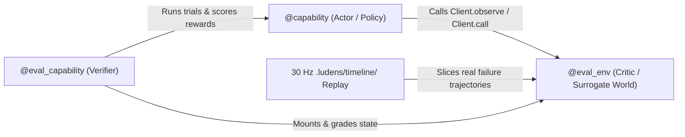

# Code-First Perception & Self-Verification

Ludens turns an agent from a slow screenshot-clicker into a workspace engineer. Instead of relying on turn-by-turn model inference for every millisecond decision, the agent writes Python perception pipelines and typed capabilities, records continuous 30 Hz ground truth, and verifies fixes offline against surrogate environments before deploying to live hardware or software targets.

## Why Code-First Perception Beats Fragile Raw Clicks

Every multimodal model turn (`observe` → inference → tool call) takes seconds. That multi-second latency makes raw turn-by-turn actions brittle on real tasks:

- **Sub-second windows**: Visual servoing on a robotic rig, catching a transient frame in a security camera feed, dismissing a timed software dialog, or reacting to an action cue in a real-time game all expire faster than a single model round-trip.
- **Noisy visual baselines**: Sensor jitter, lighting changes, UI animation delays, and background motion fool one-off pixel heuristics unless measured across consecutive frames.
- **Repetitive workflows**: Multi-step calibration, menu traversal, or data extraction wastes context and request budget if re-predicted every turn instead of encapsulated in code.

In Ludens, Shiori treats the workspace as a programmable control surface: fast `observe -> detect -> act` loops execute locally in Python, while the model focuses on strategy, fault diagnosis, and test-driven refinement.

## Resident Perception State Machine & 30 Hz Timeline

Each workspace runs a persistent Python worker defined by `perception.py:Perception`:

- **Continuous lease-scoped sampling**: During **Auto Run**, `Perception.sample()` is scheduled continuously up to `30 Hz` (configurable via `LUDENS_PERCEPTION_SAMPLE_HZ`; slow samples apply backpressure without overlapping). In **Manual Standby**, sampling pauses and the worker stays warm to serve read-only timeline queries.
- **Three core decorators**: `@capability` registers a typed, docstringed Python function into the unified `ludens controller` catalog; `@record` persists returned observation envelopes (`text`, `data`, `media`, `sampledAt`, `sources`, `space`, `effect`, `transition`) into `.ludens/timeline/`; `@observe` designates the workspace's single primary observation channel (typically `Perception.sample`).
- **In-process state machine & hot-reload**: Capabilities inside the resident worker can emit optional `effect` (immediate capability calls) and `transition` (next state target and args) fields to run closed-loop state machines in memory. Inspect or switch states live via `ludens perception state` / `ludens perception transition <target>` (or `Client().state()` / `Client().transition(...)`). Editing `perception.py` or imported `.py` modules automatically reloads the worker while safely zeroing active device inputs.
- **Unified timeline store**: `.ludens/timeline/` retains `@record` metadata, SHA-256-deduplicated media, and segmented fMP4 video (`video/`), powering `ludens observe`, `Client().observe()`, `Client().replay(...)`, and synchronized scrubbing in Console **Replay** (`?view=replay`).

## The Capability – Eval – Env Triad

To keep code evolution reliable without risking physical equipment or wasting live runs, Ludens pairs every testable Python capability with an offline evaluator and a surrogate environment:



1. **Capability (Actor)**: A `@capability` function implementing sensing, parsing, or closed-loop control via `Client().observe()` and `Client().call("controller/...", {...})`.
2. **Env (Critic / Surrogate World Model)**: A docstringed top-level class or factory decorated with `@eval_env`. During offline evaluation, `with MyEnv(...) as env:` (or `with eval_env(env):`) intercepts `Client().observe(query)` via `env.observe(query)` and `Client().call(...)` via `env.call(id, args)`, advancing latent state in virtual time or replaying real 30 Hz timeline slices without touching Baseware.
3. **Eval (Verifier)**: A synchronous, zero-required-argument function decorated with `@eval_capability(fn, env=MyEnv)` (with a docstring) that runs randomized or replay-backed trials and returns flat numeric rewards (`{"pass_rate": 1.0}`) or `{"rewards": {...}, "details": {...}, "passed": bool}`.

Here is a compact example verifying a closed-loop alert responder offline:

```python
from ludens_tools import Client, capability, eval_capability, eval_env

@capability
def settle_and_trigger(target_channel: int = 1) -> dict:
    """Confirm two consecutive anomaly frames before triggering the relay."""
    client = Client()
    streak = 0
    for _ in range(10):
        records = client.observe()["records"]
        state = records[-1]["data"].get("event") if records else None
        streak = streak + 1 if state == "anomaly" else 0
        if streak >= 2:
            client.call("controller/relay.trigger", {"channel": target_channel})
            return {"triggered": True}
    return {"triggered": False}

@eval_env
class WatchdogEnv:
    """Surrogate stream: rejects single-frame flicker, triggers only on sustained anomalies."""
    def __init__(self) -> None:
        self.events = ["nominal", "anomaly", "nominal", "anomaly", "anomaly"]
        self.index, self.triggers = 0, []

    def observe(self, query=None) -> list[dict]:
        event = self.events[min(self.index, len(self.events) - 1)]
        self.index += 1
        return [{"data": {"event": event}}]

    def call(self, id: str, args: dict) -> dict:
        self.triggers.append((self.index, id, args.get("channel")))
        return {"ok": True}

@eval_capability(settle_and_trigger, env=WatchdogEnv)
def eval_settle_and_trigger() -> dict:
    """Verify two-frame debounce blocks flicker and fires exactly once on sustained anomaly."""
    with WatchdogEnv() as env:
        result = settle_and_trigger(target_channel=2)
    passed = result["triggered"] and env.triggers == [(5, "controller/relay.trigger", 2)]
    return {"passed": passed, "rewards": {"accuracy": 1.0 if passed else 0.0}}
```

Running `ludens eval run --all` (or clicking **Run All Evals** in Console **Capabilities**, `?view=caps`) strips all live device sockets and `epoch` leases, executes every bound evaluator against `.ludens/timeline/` or `@eval_env`, and writes immutable records to `.ludens/evals/`.

## Status Gates, Co-Evolution & the `adapt` Failure-Frame Loop

Static discovery and `.ludens/evals/latest.json` assign every `@capability` one of six statuses visible in `ludens eval list` and Console **Capabilities** (`?view=caps`):

| Status | Meaning |
| --- | --- |
| `missing` | No `@eval_capability` bound to this `@capability` |
| `unverified` | Eval bound, but never executed |
| `stale` | Capability, eval, or bound `@eval_env` source changed since the last run |
| `adapting` | Marked for revision after a live failure; blocked until the eval or env source changes and passes |
| `failed` | Last eval raised an error, returned empty rewards, or reported `passed=False` |
| `verified` | Latest eval passed against the exact current `codeSHA` of capability, eval, and env |

Neither a closed-loop policy (**Actor**) nor its surrogate world (**Critic**) is accurate on the first draft. Ludens treats them as a **co-evolving pair** grounded in 30 Hz recordings:

1. **Bootstrap `v0` and probe live**: Write a minimal `@capability` and `@eval_env`, then run a live attempt inside `with record_window() as win:` (or a `@record @capability` probe) while 30 Hz `Perception.sample()` records the whole interaction.
2. **Gate failures with `adapt`**: Whenever a `verified` capability misbehaves on a real target, mark the regression explicitly with the failing timeline record ID:
   ```sh
   ludens eval adapt python/skills/watchdog.py:settle_and_trigger --reason "False trigger during backlight shift" --record <record-id>
   ```
   `adapt` pins the hash of both the eval module (`evalCodeSHA`) and the bound `@eval_env` module (`envCodeSHA`). Re-running an unchanged suite stays `failed` / `adapting`.
3. **Upgrade the Critic first, then the Actor**: Slice the 30 Hz timeline around the failure with `Client().replay(around=record_id, before_seconds=2.0, after_seconds=2.0)` or `Client().replay(win)`. Measure real frame timing and negative distractors, update `@eval_env` until the old Actor fails (`passed=False`), and then iterate the `@capability` until `ludens eval run <id>` returns `verified`.

## Long-Term Consolidation: `skills/`, `memory/current.md` & `MEMORY.md`

Verified behavior outlives individual sessions through three complementary workspace artifacts:

- **`skills/<name>/SKILL.md`**: Reusable task workflows with `name` and `description` YAML frontmatter. During `ludens consolidate` (a file-only turn with device control disabled), Shiori promotes or keeps capabilities whose bound eval is `verified` for their current `codeSHA`, and removes `unverified`, `stale`, `adapting`, or `failed` entries from `skills/` until they pass again.
- **`memory/current.md`**: Active operational state, pending `adapting` counterexample records, and concrete next steps updated at consolidation boundaries.
- **`MEMORY.md`**: Workspace-root long-term memory capturing durable environment mechanics, invariants, and proven strategies (editable directly or in Console **Config**, `?view=perception`).

Historical versions of skills and memory are snapshot under `.ludens/skill-versions/`, keeping all learned behavior self-contained inside the workspace directory.

## Next Steps

- Practice writing capabilities and surrogate environments in [Workspaces & Capability Programming](../tutorials/workspace.md) and [Resident Perception-and-Action State Machine](../tutorials/perception-and-action.md).
- Inspect eval topology and replay alignment in [Console & Debugging](../tutorials/console-and-debugging.md).
- See exact flags and data formats in [CLI Reference](../reference/cli.md) and [Why Perception Parameters Are Stratified Across Three Layers](../insights/perception-parameters.md).
