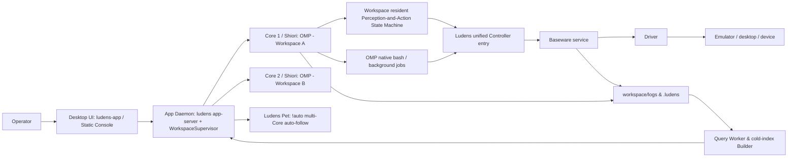

# Architecture and Boundaries

Ludens (RSA, Recursive Self-Adaptation) adopts a **4-layer concurrent architecture** — `Desktop UI` / `App Daemon` / `Core` / `Baseware` — decoupling UI interaction, multi-workspace supervision, the agent execution kernel, and device drivers: Desktop UI handles the console and pet companion, App Daemon supervises multiple concurrent workspace Cores, each workspace Core (built on Shiori and OMP) independently governs its control cycles and session scheduling, Baseware owns hardware and emulator interfaces, and perception modeling, action composition, and experience accumulation are defined and evolved entirely by workspace code (Workspace).

## Components and Processes

| Layer / Component | Process Shape and Core Responsibilities |
| --- | --- |
| **Desktop UI** (`app/` & `app/desktop/`) | **First-class Desktop App & Static Console Bundle (`ludens-app` / `@ludens/app`, `app/out`)**: static React/Next export served directly by App Daemon (`ludens app-server`) in production (zero Next.js server runtime; `npm run dev` proxies `/api/*` to a background `ludens app-server` for HMR). `ludens-app` spawns and supervises `ludens app-server --port 0 --parent-watchdog --static-dir <app/out>` via `AppServerHost`, loads the full console in its main window (featuring the sidebar **Active Cores** list, 0-run zero-barrier Live entry, and device contention modal), and drives the transparent **Ludens Pet** companion and system tray. Closing the window (`×`) hides to Tray + Pet; explicit **Quit** (`⌘Q` / tray **Quit** / `stdin` EOF watchdog) cleanly tears down `App Daemon` and **only** Cores launched by that App instance, leaving `CLI`-launched headless Cores untouched. |
| **App Daemon** (`core/src/server/` & `core/src/daemon/`) | **Unified Multi-Workspace Daemon & Local HTTP Server (`ludens app-server` / `ludens serve`)**: serves `/api/*` routes, the static frontend bundle (`app/out`), pure-TypeScript cross-platform `WorkspaceSupervisor`, query/replay projection Workers, Event Pool APIs, physical device contention arbitration (`409 DEVICE_BUSY` + `preempt`), and shared Pet `!auto` multi-Core resolution in one process, orchestrating multiple workspace Cores concurrently (`1 Workspace = 1 Core`) while tracking `launchedBy: "app" \| "cli"`. |
| **Core** (`core/`, `ludens run`) | **Per-Workspace Execution Kernel (`@ludens/core`)**: replaces the legacy "Host" terminology; each workspace runs an isolated Core process hosting the sole execution kernel **Shiori** (mounting **OMP 18.18.8** in agent mode; plain evaluation programs, Verifiers, and Metrics share the same lifecycle without starting a model), the resident perception-and-action (`perception.py`) Python subprocess, capability discovery and routing, workspace-native capability evaluation (`ludens eval`), and run-log archiving. Core spawns on demand when sending a message in Live or clicking `▶`, and remains in **Warm Standby** when paused. |
| **Baseware** (`baseware/`) | **Standalone device service**: loads built-in or external Drivers, provides a unified Controller capability catalog, control-lease (`epoch`) arbitration, input cancellation, and device fact logs; exposed via CLI, TS/Python APIs, and MCP. |



Each component has its own `package.json` / `pyproject.toml` and lockfile. Ludens Core depends only on Baseware's client and type contracts and never imports any concrete Driver implementation directly; **App Daemon** (`ludens app-server`, handling UI on-demand spawning and workspace service control) and headless `ludens up` share the same pure-TypeScript `WorkspaceSupervisor` in `core/src/daemon/` to orchestrate local processes without Python background-launcher scripts.

## Source Layout and Layering

The repository is organized as a Bun workspace with `@ludens/protocol` as the zero-dependency contract layer:

| Package / Directory | Layer and Responsibility |
| --- | --- |
| `protocol/` (`@ludens/protocol`) | **Contract foundation**: RPC schemas, run-event types, Timeline / Archive formats, and Dashboard activity projections; consumed by every other package via workspace imports only. |
| `core/src/core/shiori/` | **Control kernel**: `epoch` control leases, time/request budgets, program execution, and cancellation; no dependency on OMP, CLI, or sockets. |
| `core/src/core/storage/` | **Workspace and fact storage**: `.ludens/` identity and state, `logs/<run-id>/` event streams and archives. |
| `core/src/core/subsystems/` | **Workspace resident and device subsystems**: Python perception/action workers, `@capability` discovery, Baseware device sessions. |
| `core/src/core/agent-omp/` | **OMP AgentRunner implementation**: OMP session assembly, the Ludens extension, and model-trace recording behind a narrow `ExtensionHost` interface for Core runtime capabilities. |
| `core/src/core/query/` | **Query and projection engine**: log/run/operation indexes, native TypeScript Worker & cold-build subprocesses, multi-Core summaries (`ProjectCoreSummary`), contention types (`DeviceContentionConflict`), and activity/replay/telemetry/pet (`PET_AUTO_TARGET`) projections consumed by App Daemon and Ludens Pet. |
| `core/src/server/`, `core/src/daemon/`, `core/src/perf/`, `core/src/cli/` | **App Daemon & Surfaces**: unified `ludens app-server` (`/api/*` routes, static `app/out` server, `--parent-watchdog`), Unix Socket RPC daemon and pure-TS `WorkspaceSupervisor` (managing multi-Core concurrency, launch origins, and device arbitration), subsystem performance baselines (`perf`), and the headless CLI front end. |
| `app/shell/` + `app/features/` + `app/lib/` + `app/perf/` | **Desktop UI views, lifecycle hooks, and app perf** (loop workbench in `shell/`, unified `useWorkspaceService` hook in `lib/`, `index-memory` baseline in `perf/`): the shell (`console-shell`, sidebar Active Cores, selection context) plus vertical feature slices (`live`, `replay`, `capabilities`, `workspaces`, `pet`, `docs`) over shared primitives in `app/components/ui/`. |


## Devices and Unified Capabilities

1. **Unified Controller abstraction**: all capabilities a Driver exposes are collectively called **Controllers** (including controllers that execute inputs and sensors that capture frames/state). Each capability follows the CUA-native tool structure: `name`, `description`, `inputSchema`, optional `outputSchema` / `annotations`, and an MCP `CallToolResult` return value. See [Baseware Philosophy and Capability Contracts](baseware.md) for the design rationale and [baseware/src/contracts.ts](../../../baseware/src/contracts.ts) / [baseware/src/catalog.ts](../../../baseware/src/catalog.ts) for the type definitions.
2. **Dual-namespace aggregation with on-demand discovery**: Ludens merges device capabilities (`controller/<id>`) and workspace Python decorator capabilities (`python/<path>:<fn>`) into the `ludens controller` directory. To avoid blowing up model context, no device capability or MCP tool is injected into OMP's model tool list by default; instead the Agent discovers and invokes them on demand via `baseware.json`, `ludens controller`, or `ludens_tools.Client`.
3. **Pure hardware boundary**: a Driver only faithfully maps hardware interfaces (e.g. independent per-screen captures `screen.top.capture` / `screen.bottom.capture`, native touchscreen coordinates `touch.down / move / up`); cross-screen image stitching, coordinate transforms, and game strategy all live in workspace code.

## Control and Lifecycle

### 1. Multi-Core Concurrency and Codex-Style On-Demand Lifecycle

Ludens enforces **1 Workspace = 1 Core** isolation, with **App Daemon** managing multiple workspace Core processes concurrently (`Project.core` / `ProjectCoreSummary`), eliminating legacy single-global-host assumptions:

- **On-Demand Spawn & Zero-Barrier 0-Run Live**: selecting any workspace (even with zero historical runs) opens Live directly, displaying preset model and budget defaults from `Project.defaults`; sending a goal prompt or clicking `▶` in Live automatically spawns the workspace's Core and Baseware on demand via App Daemon (`spawned: true`), without running `ludens up` in a terminal first.
- **Warm Standby**: when explicitly paused (`auto off`) or when control budgets run out, the Core exits its `auto` loop and stays resident in **Warm Standby** (`manual` mode): the Baseware device connection and Shiori OMP session remain warm and ready for instant resumption or model switching while continuous sampling and recording pause.
- **Launch Origin & Teardown Boundary (`launchedBy: "app" | "cli"`)**: every running Core records its `ServiceLaunchOrigin` (`"app"` or `"cli"`) and optional `appInstanceId`, surfaced in the desktop sidebar **Active Cores** list alongside an inline stop button (`■`). Closing the main desktop window (`×`) hides to the system tray and Pet; explicitly quitting the desktop app (`⌘Q` / tray **Quit**) instructs App Daemon to cleanly tear down **only Cores launched by that App instance (`launchedBy === "app"`)**, leaving headless `CLI`-launched Cores (`launchedBy === "cli"`) running untouched in the background.
- **Physical Device Contention Arbitration (`409 DEVICE_BUSY` + `preempt`)**: workspaces bound to distinct physical devices or ports run completely concurrently. When multiple workspaces target the same physical device or port:
  - If the holding Core is in **Warm Standby (`manual` mode)**, it yields automatically, releasing its device lease so the requesting workspace can take over.
  - If the holding Core is running an active **`Auto`** loop, App Daemon returns HTTP `409` (`code: "DEVICE_BUSY"` with a `DeviceContentionConflict` payload), and Desktop UI opens a device contention modal letting the operator cancel, switch to the holding workspace, or **Preempt** (`preempt`: cleanly stop the holder's Core and release its device lease, then start the requested workspace).

### 2. Control Leases (`epoch`) and Permission Checks

- Each `ludens auto on [--seconds <n>]` opens a new control cycle, minting a unique **`epoch`** and resetting the cycle's model-request (`requests`) budget. Takeover duration (`seconds`) is optional: when omitted (`null`), the lease and runtime loop run continuously without a timer until explicit handover (`ludens auto off`); when provided, both Baseware and Shiori enforce that per-cycle deadline.
- `ludens auto timer <seconds|off>` updates Baseware's `lease_duration` and Shiori's active stop timer in place, recording `control_budget` without minting a new `epoch`.
- Core holds that `epoch` against Baseware over a persistent connection and injects `BASEWARE_EPOCH` into the workspace process environment.
- Capability-catalog queries and `--help` need no control rights; whether a concrete capability requires control is declared by its `requiresControl` property (some read-only state queries also require a valid `epoch`). Invoking workspace `python/...` capabilities via CLI likewise requires an active control cycle.
- On human handover (`ludens auto off`), budget exhaustion, Core disconnect, or device disconnect, Baseware immediately revokes the old `epoch`, aborts in-flight actions, and performs device release (zeroing keys and touch contacts); once cleanup completes it returns to the `manual` state.

### 3. Gamepad Async Timeline (`pad.play`)

Emulator gamepads uniformly use the relative-timeline instruction `pad.play`, whose `inputs` parameter is an array of `{atMs, durationMs, state}`:

```sh
ludens controller controller/pad.play --args '{"inputs":[{"atMs":0,"durationMs":500,"state":{"LEFT":1}},{"atMs":0,"durationMs":300,"state":{"B":1}}]}'
```

- **Channel merge rule**: spans on different button/stick channels may overlap freely; spans on the same channel must not overlap. Adjacent spans switch the merged state directly at the boundary, and the whole timeline returns to neutral automatically when it ends.
- **Async lifecycle**: `pad.play` returns an `actionId` immediately after submission by default (the action belongs to the current control `epoch`; exiting the short-lived CLI connection does not interrupt a submitted action); passing `"wait": true` or calling `pad.wait / status / cancel` (with `{"actionId": "<id>"}`) waits on, queries, or cancels the action. Only one timeline executes per device at a time; submitting a new timeline while one is in flight returns `BUSY`.
- **Hardware clock semantics**: time parameters are in milliseconds; poll-driven bridges advance on the monotonic wall clock at input-poll points (minimum span 16ms), while frame-driven bridges round up to frames at the emulated frame rate.

### 4. Resident State Machine and Input Reset

The unified resident `perception.py` state machine adopts Core's current control `epoch` on takeover and a new `inputGeneration` on each reload. When the generation rotates on auto-reload or an explicit `ludens perception reload` occurs inside an `auto` cycle, the system immediately cancels and releases all of this workspace's current inputs through Baseware (including concurrent CLI inputs), bumps `inputGeneration` to reject stale calls from the old instance, and keeps the current `epoch`, remaining budget, and OMP session. The resident is subordinate to this cycle: continuous sampling and fMP4 video recording run only while the control lease is active, and `Runtime.stop()` awaits the perception lease revocation — stopping the sampler, flushing its final `perception_stats`, and sealing active video segments — before recording the cycle's `control(manual)` handback; in `manual` standby the resident stays warm and serves timeline reads without sampling. See [core/src/core/shiori/runtime.ts](../../../core/src/core/shiori/runtime.ts).

## Session and Loop

### 1. OMP Superset Assembly and Outer Turn Continuation

Core reuses a single OMP session per workspace (persisted under `.ludens/shiori/sessions/`) and, on top of `Settings.isolated()`, applies the **minimal-override (Superset Shell) principle**:

- Keeps OMP's native system prompt (a workspace `AGENTS.md`, if present, is injected via native `contextFiles`).
- Explicitly enables the OMP-native tools `read`, `write`, `edit`, `bash`, `wait`, and registers the custom tool `observe`.
- Overrides only what the Core contract requires: disabling `retry.modelFallback` (keeps the chosen vision model sticky), disabling `title.refreshOnReplan` and `cacheWarming` (keeps every model request strictly attributed to its control cycle), setting `PROVIDER_IMAGE_BUDGETS` to `Infinity` (retains history images before compaction so mid-run image drops don't break the Prompt Cache prefix), applying the effective OMP serving tier via `tier.openai` (`priority` for Fast, `ultrafast` for Ultra, `none` for Standard) and authoritative reasoning effort via `defaultThinkingLevel` + `session.setThinkingLevel(..., false)`, plus the optional `compactionThreshold`. See [core/src/core/agent-omp/session.ts](../../../core/src/core/agent-omp/session.ts).
- Discovers image-capable OMP models and switches the session model strictly while paused: `availableModels` (see [dashboard-protocol.ts](../../../core/src/core/query/dashboard-protocol.ts)) inspects OMP's `ModelRegistry` and `discoverAuthStorage` (scoped to a workspace or falling back to global `defaults`) to return only image-capable (`input.includes("image")`) models ordered with authenticated providers first, each carrying model-specific `supportedServiceTiers` derived from OMP's `shouldSendServiceTier` plus `supportedEfforts` and `defaultEffort` derived from `model.thinking` (never a hardcoded model list; OMP's `"auto"` classifier mode is intentionally omitted so no out-of-band LLM calls occur). Both the catalog and the Shiori session build their registry through `createOmpModelRegistry` ([models.ts](../../../core/src/core/agent-omp/models.ts)), which also loads the `openai-codex` `/models` discovery cache (refetching only when OMP's cache is stale): Codex advertises `ultrafast` per model through `service_tiers`, and without that row Ultra is never offered and a persisted `ultrafast` silently runs as Standard. Selecting a model in `ModelPickerDialog` expands an inline Effort + Speed drawer inside that model card offering only the efforts and Standard/Fast/Ultra speed lanes the selected model supports, then `Runtime.setModel` (exposed via `ludens model [<provider/id>] [--service-tier none|priority|ultrafast] [--effort none|minimal|low|medium|high|xhigh|max]` and Dashboard `set_model` in [runtime-control.ts](../../../core/src/core/query/runtime-control.ts)) applies model plus optional speed tier and reasoning effort atomically, rejecting switches unless `mode === "manual"` with no active turn, consolidation, or in-flight calls — disallowing mid-run hot-switching while `auto` is active — then applies `{ ...found, imageCountBudget: Infinity }` and `setThinkingLevel` on the OMP session and records a `shiori` `session` event so `Runtime.status()` reports the actual effective tier and effort (downgraded to Standard / model default when unsupported) and live run/activity projections update immediately (Dashboard `set_model` also persists `model`, `serviceTier`, and `effort` to `ludens.json` whether Core is online in `manual` mode or offline; Fast/Ultra are premium tiers and may increase usage charges).

Inside an `auto` control cycle, the outer loop runs as follows:

1. **Open a turn**: issues an OMP `prompt` using [continue.md](../../../core/prompts/continue.md) (on first takeover with `auto on --message`, a one-shot reminder is appended).
2. **The resident runs alongside model reasoning**: the environment keeps running while the model reasons — under the cycle's control lease the resident `Perception.sample()` samples continuously at the Core-configured rate (`LUDENS_PERCEPTION_SAMPLE_HZ`, default `30` Hz) into `.ludens/timeline/`, and its in-process capabilities continuously read the spacetime axis and execute high-frequency closed-loop control in the same process; see [Why Perception Parameters Are Stratified Across Three Layers](../insights/perception-parameters.md).
3. **Automatic context delivery**: the Ludens extension hooks OMP's `before_agent_start` hook (see [extension.ts](../../../core/src/core/agent-omp/extension.ts)). When auto-injection is on (default `inject on`), it automatically appends the latest undelivered primary-channel perception records plus sampler state transitions (`state / codeSHA / error`) at the start of each prompt; tool results are never appended with observations, the `tool_result` hook only records delivery receipts for native tool images, and mid-turn observation is composed explicitly by the model via `observe`. The former end-of-batch channel was removed on 2026-10-29; see [Injection converges to a single per-turn channel](../insights/omp-injection.md).
4. **Continue or hand over**: when a single `prompt` ends and budget remains, the next turn starts automatically; on human handover or budget exhaustion, the `addBeforeModelCall` gate immediately blocks new model requests and releases device control.

### 2. Context Compaction and Transport Recovery

- **Background predictive compaction**: reuses OMP's native two-phase compaction; the trigger threshold follows the model catalog by default (overridable via `ludens.json` or `--compaction-threshold`). See [OMP Background Compaction Retrofit](../insights/omp-compaction.md) for the patches made for the 30Hz realtime control loop.
- **WebSocket incremental transport and recovery**: OpenAI Codex uses WebSocket `auto` mode by default; see [WS Recovery Test Rationale](../insights/ws-recovery.md) for disconnect classification, cooldown backoff, and the SSE recovery policy for unfinished tool calls.

## Workspace Event Pool

Humans and Shiori exchange asynchronous messages and requests through a duplex, workspace-scoped **Event Pool**: events survive outside an agent cycle and are never tied to a device lease.

- **Store and concurrency**: `.ludens/event-pool.json` is a versioned document with a monotonic `seq`. Every read-modify-write acquires a cross-process lock directory (`event-pool.json.lock`, 5s acquisition deadline, 15s stale-lock recovery) and publishes through temp-file + `rename`, so the CLI, Core, Query Worker, and Desktop UI never read a torn file. Pending events are never trimmed; only the newest 200 handled events are retained.
- **Contract**: directions `inbound` (`message`, `reply`) and `outbound` (`help_request`, `notice`); statuses `pending` / `handled`; actors `shiori` / `human`. Each event carries `id`, `seq`, `text`, optional `title`, `replyTo`, `pauseRequested`, `runId` / `epoch`, and `createdAt` / `handledAt` / `handledBy`. A human reply to a pending outbound event marks that request handled (`handledBy: "human"`) in the same locked write.
- **CLI**: `ludens event list [--direction inbound|outbound] [--status pending|handled] [--limit <n>]`, `ludens event send [--title <text>] [--message <text> | <text>]`, `ludens event reply <event-id> [...]`, and `ludens event ack <event-id>...`. Commands route through Core's socket while Core is online and otherwise write `.ludens/event-pool.json` directly, so a message left during `manual` standby or with Core stopped is picked up by the next cycle. Mutations are human-only: inside an agent cycle (`BASEWARE_EPOCH` present) they are rejected and the agent is directed to the `event_pool` tool.
- **Shiori tool**: `event_pool({ action: "read" | "ack" | "emit" })`. `read` returns pending inbound messages/replies (all, or selected `ids`; `includeHandled` for history) and acknowledges them unless `ack: false` defers while busy. `ack` marks inbound events handled explicitly. `emit` posts an outbound `help_request` (default) or `notice`; `pause` defaults to `false`, keeping gameplay asynchronous, and only `pause: true` — reserved for a fully blocked agent — stops the auto cycle as `awaiting human` and hands device control back until a human resumes.
- **Round-start digest**: `before_agent_start` appends a compact inbound digest only when `pendingInbound > 0`: each item's `id`, `seq`, `kind`, optional `title`, and a 72-character single-line preview. An idle pool adds zero bytes, preserving the provider prefix KV cache; full text is fetched on demand with `event_pool({ action: "read" })`.
- **Surfaces**: Desktop UI reads and mutates the same store through App Daemon's `GET/POST /api/event-pool`, driving the outbound tray, stream cards, header pending badges, and reply composer; per-workspace `pendingOutbound` counts also aggregate into the sidebar **Active Cores** list and drive `!auto` `🆘` priority routing for Ludens Pet. CLI and console are peer writers over the same locked file.
- **Dual chronological projection and overview**: each lifecycle projects as two stream messages. Message 1 (the human message or `outbound_event` card) is anchored strictly at `createdAt` (`T_send` / `T_emit`) and is never appended to the stream tail. Message 2 (`pool_receipt`) is projected from `pool_event` `action: "handled"` and anchored at `handledAt` (`T_read`). A human can withdraw an unread pending inbound message with `ack` and `actor: "human"`, shown as withdrawn rather than read. The Live Workbench Right Inspector Dock switches between `Stage & Telemetry` and `Event Pool` in a segmented header; the dedicated Event Pool overview lists the retained events, a thread-header quick trigger opens it, and each entry's locate-in-stream action jumps to its stream position.

Urgent mid-turn interruption remains `ludens steer <message>`, which queues straight into the running agent instead of entering the pool.

## Verifiable Run Facts

- **Decoupled multi-source facts**: Baseware independently persists device control and execution facts (`logs/baseware/`), Core records model calls, tool executions, capability invocations, and perception deliveries (`logs/<run-id>/`), and Shiori mounts a scoped OpenTelemetry provider recording `agentLoop` telemetry.
- **Isolated Dashboard reads**: App Daemon (`ludens app-server`) keeps archive parsing and index maintenance in a dedicated Worker thread (`core/src/core/query/`); cold history directories are built by a globally-single-instance throttled temporary Builder subprocess and atomically published to `.dashboard-index/`; `/api/*` handlers in `core/src/server/` and Ludens Pet only read projected results over bounded RPC, with zero Next.js server runtime in production. See [Logging and Call Chains](logging.md#consumption-and-metric-interpretation).

## TypeScript and Python

Ludens consists of a TypeScript Core / App Daemon (`core/src/`) plus a Python toolkit (`core/python/ludens_tools/`):

- **TypeScript side**: owns the Shiori runtime, control leases, OMP session extensions, unified App Daemon (`ludens app-server` serving `/api/*` + static UI), pure-TS cross-platform `WorkspaceSupervisor` (managing multi-Core concurrency, `launchedBy` cleanup boundaries, and `--parent-watchdog` teardown), cross-process RPC, and CLI orchestration.
- **Python side**: owns `@capability` static discovery and dynamic execution, the unified resident `Perception` state machine, PyAV video-segment encoding, and on-demand cold-frame decoding. Continuous perception ingests Baseware's spooled media references (`_StreamMediaRef`) directly from disk without inline Base64 IPC round-trips, automatically binds device observation `sources` provenance onto the timeline record, and short-circuits unchanged latest-frame `Client().observe()` polls via `ifNoneMatchSequence`. Video encode/decode happens inside the resident perception process without introducing a separate streaming service.

## Capability Persistence Boundaries

Global `LUDENS_HOME` (default `~/.ludens`) stores application configuration, the `registry/<id>.json` workspace index, driver caches, and shared pet state. Registrations contain only `{id, workspace, name, updatedAt}`; `.ludens/workspace.json` holds each workspace's stable identity, and `ludens workspace open` updates the index after a move. Sessions and history remain inside the workspace; the registry can be rebuilt. See [the two-level directory layout](../tutorials/workspace.md#1-workspace-directory-layout).

Registry creation, relocation, removal, and pet target selection share per-workspace locking. When both locks are required, the registry lock precedes the pet-target lock. Removal reads the current registration, clears only its matching raw pet target, then unlinks the registration; an unreadable or unwritable target blocks removal before unlink. Re-registering cannot revive that cleared target. Unrelated targets, consumer heartbeat files, workspace contents, and running Cores are untouched. Normal pet-state polling stays read-only; only a stored target's relocation requires a locked re-read and update. Dashboard mutation receipts report committed configuration or the removed registration independently of later catalog/consumer reads.

By default, Ludens Pet uses **`!auto` (`PET_AUTO_TARGET`) multi-Core auto-follow mode** (`targetConfigured === false` and `autoFollowing: true`): whenever Cores are active, the desktop app automatically follows the highest-priority Core in order — any online Core with pending `🆘` outbound help requests (`pendingOutbound > 0`) first → otherwise the focused window's online Core → otherwise a background Core running `Auto` (or the sole active Core) — and enters a graceful idle state (`autoWaiting`) when all Cores stop. Users can still pin a single workspace or choose **Stop following** explicitly (`null`). Pet target PUT and consumer heartbeat POST return their committed `{ target }` and `{ consumer }` independently. A state GET preserves the saved target if the consumer record is unreadable (`connected: null` with `consumerError`), rather than claiming disconnection. Offline, missing, or identity-mismatched registrations retain the saved target with `targetUnavailable: true`; desktop consumers temporarily stop that source without clearing the choice. Consumer `targetRevision` identifies the attempted target; `revision` identifies a loaded source. Application failures are attributed only to a matching attempt, and following requires a matching loaded revision. A state read waits for target writes already accepted by that worker to settle, so a queued write cannot complete after its recovery read has reported the old selection. `targetConfigured` distinguishes an unset target file (defaulting to `!auto` auto-follow) from an explicit saved stop (`null`); only the latter prevents automatic selection on startup.

The state stores inside a workspace each have their own role and never redundantly duplicate each other:

| Store Location | Ownership and Contents |
| --- | --- |
| `.ludens/timeline/` | **Sole originals of capability observations and media**: maintained by the single-writer resident perception process; holds `@record` record metadata, segmented fMP4 video (`video/`, five minutes per segment by default, finalized after ten seconds idle), and SHA-256-deduplicated non-video media (`objects/`). |
| `.ludens/archive/` | **Structured text archive of models and tools**: deduplicated cross-request and cross-run by content hash into `objects/<sha256>.json.gz` plus streaming payloads; all embedded media reference `.ludens/timeline/` by reference. |
| `logs/<run-id>/` | **Single-Core run event stream**: holds `manifest.json`, `events.jsonl`, and `streams/`; links Baseware, Archive, and Timeline via `eventSources` and content references. |
| `.ludens/shiori/` | **OMP-native session store**: holds `sessions/*.jsonl` and the current resume pointer, managed by the OMP SessionManager. |
| `.ludens/event-pool.json` | **Duplex human-agent Event Pool**: holds pending and recently handled inbound messages/replies and outbound help requests/notices across runs and offline standby. |
| `.ludens/skill-versions/` | **Skill and memory snapshots**: content versions recorded during runs remain inside the workspace and move with its directory. |

## Unified Spacetime Axis and Replay

Perception sampling, resident actions, model inference, and device execution share the workspace's absolute wall-clock time origin and are precisely correlated through `recordId`, event sequence numbers, `modelCallId`, `toolCallId`, `actionId`, and the `trace` tree. The Dashboard player renders the full continuous sampling frames from `.ludens/timeline/` (including intermediate frames the model never consumed), action time spans, and model call details under one shared time cursor; history replay is a pure read-only projection — it never triggers device operations nor changes Ludens Pet's realtime follow target.
