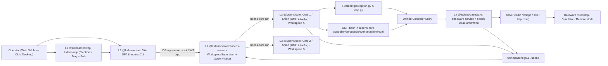

# Architecture and Boundaries

Ludens is a multimodal, cross-device Harness for complex end-to-end tasks (robotics control, security/surveillance, desktop/software workflows, real-time games) built on an orthogonal **4-Layer Role × 6 Physical Packages** concurrent architecture — cleanly decoupling **Client Surfaces (L1: Client & Desktop)**, the **Control-Plane Server (L2: Server)**, the **Per-Workspace Execution Kernel / Sandbox (L3: Core)**, and the **Cross-Device Integration Layer (L4: Baseware)** atop a zero-dependency **Shared Contract Foundation (Protocol)**:

- **L1 Clients (`@ludens/client` `client/` + All-in-One Desktop Distribution `@ludens/desktop` `desktop/`)**: `@ludens/client` delivers an isomorphic Web and mobile responsive Vite static SPA (`client/dist`) ready for standalone online deployment as a first-class cross-origin client, alongside the human-facing pure-RPC CLI `ludens` (**strictly depending only on `@ludens/protocol`**, with zero `@ludens/core`, `@ludens/server`, `@ludens/baseware`, or `electron` dependencies; automatically waking `ludens-server start` from `PATH` on demand when the local server socket is not running); `@ludens/desktop` (`ludens-app`) assembles `client/dist` (`Resources/client` when packaged) + local `server/dist` + `core/dist` + `baseware/dist` into a zero-TCP-port Electron desktop application (complete with system tray, `ActiveCoreQuitGuard`, optional Desktop Pet, and instant switching to any remote `ludens-server`).
- **L2 Control-Plane Server (`@ludens/server` `server/`, bin `ludens-server`)**: open-source server runnable locally (UDS-only `app-server.sock` by default), self-hosted, or in the cloud (`--listen ws://HOST:PORT --auth token`), providing unified JSON-RPC 2.0 (including `capabilities/eval*`, `workspaces/import`, and `logs/*`), real-time `EventHub` push, HMAC capability-ticket `/media`, query/cold-index Workers, and multi-workspace Core process supervision (`WorkspaceSupervisor` / `Launcher`). **Zero `@ludens/client` or `@ludens/desktop` dependencies**.
- **L3 Per-Workspace Execution Kernel / Sandbox (`@ludens/core` `core/`, bin `ludens-core`)**: enforces **1 Workspace = 1 Core** isolation; each workspace runs an isolated Core process hosting **Shiori** (Agent Thread Core on OMP `18.22.2`), the resident perception-and-action state machine (`perception.py`), optional programmable outer loop (`loop.py`), workspace code, and offline self-verification (`ludens-core eval`). **Zero `@ludens/server`, `@ludens/client`, or `@ludens/desktop` dependencies**.
- **L4 Cross-Device Integration Layer (`@ludens/baseware` `baseware/`, bin `baseware`) + Shared Contract Foundation (`@ludens/protocol` `protocol/`)**: Baseware independently manages hardware, simulator, and desktop drivers, the unified Controller catalog, `epoch` control-lease arbitration, and MCP interfaces; Protocol provides zero-Node/Bun/OMP-dependency JSON-RPC 2.0 wire contracts, cross-surface DTO types, and pure browser-safe projection helpers.

## Four Layers and Six Physical Packages

| Layer / Package | Binaries and Process Shape | Core Responsibilities and Dependency Boundaries |
| --- | --- | --- |
| **Shared Contract Layer**<br>`protocol/` (`@ludens/protocol`) | Library package (zero external dependencies) | **Cross-surface typed contract foundation**: defines `@ludens/protocol/app-rpc` JSON-RPC 2.0 contracts (including `viewport/*`, `capabilities/evalHistory`, `capabilities/evalAdapt`, `workspaces/import`, `logs/events`, `logs/read`), pure browser-safe Device Viewport contracts & binary frame codec (`@ludens/protocol/viewport`), driver/machine/event-pool/timeline schemas, cross-surface DTOs and projection utilities consumed by the SPA, and host path contracts (`@ludens/protocol/app-server-paths`, `@ludens/protocol/browser-host-paths`) shared by CLI/Server/Desktop/Baseware. Zero third-party or OMP runtime dependencies. |
| **L1 Client (Web / Mobile SPA + Pure-RPC CLI)**<br>`client/` (`@ludens/client`) | `ludens` (pure-RPC operator CLI)<br>+ Vite static SPA (`client/dist`) | **First-class cross-origin client & human operator entry point**: **strictly depends only on `@ludens/protocol`** (zero `@ludens/core`, `@ludens/server`, `@ludens/baseware`, or `electron` dependencies). Contains: (1) React 19 + Vite responsive SPA featuring the unified `<DeviceViewport />` and resizable 3-mode right workbench (`browser \| computer \| observe`), deployable standalone and connecting to local or cross-origin remote `ludens-server` instances via `<ConnectionTargetDialog>` or `?server=`; (2) human-facing pure-RPC CLI `ludens` (`ludens config ...`, `ludens workspace <init\|list\|open\|forget\|import\|up\|down\|services\|eval>`, and top-level remote controls `ludens <status\|auto\|steer\|consolidate\|stop\|model\|logs>`), supporting local `app-server.sock` (auto-waking `ludens-server start` from `PATH` when offline) and `--remote ws(s)://... [--token ...]`. |
| **L1 All-in-One Desktop Shell**<br>`desktop/` (`@ludens/desktop`) | `ludens-app` (Electron desktop host) | **Self-contained local desktop distribution**: assembles each package's autonomous `dist/` artifacts — `client/dist` (`Resources/client` when packaged) + `server/dist` + `core/dist` + `baseware/dist`. Starts or attaches to a per-`LUDENS_HOME` singleton `ludens-server` over Unix Domain Socket (`app-server.sock`, **0 listening TCP ports**) via `AppServerHost` / `ensureLocalAppDaemon`; hosts the zero-port local UDS `BrowserHost` (`browser-host.sock` + `browser-host.json`) managing per-workspace isolated `WebContentsView` spaces and native `window.ludens.viewport` attachment; registers `ludens-app://console/` and `ludens-media://local/media?...` (over UDS `media/resolve` with HTTP `206 Range`); provides `DesktopUdsRpcRelay` (`window.ludens.rpc`), system tray, `ActiveCoreQuitGuard` 3-choice quit protection, and optional Desktop Pet (`PetSessionCoordinator`), while allowing seamless switching to a remote `ludens-server`. |
| **L2 Control-Plane Server**<br>`server/` (`@ludens/server`) | `ludens-server` (`<serve\|start\|stop\|restart\|status>`) | **Multi-workspace control plane & JSON-RPC 2.0 server**: depends on `@ludens/protocol`, `@ludens/core`, and `@ludens/baseware` (**zero `@ludens/client` or `@ludens/desktop` dependencies**). Defaults to UDS-only (`app-server.sock`) or binds `--listen ws://HOST:PORT` (non-`--dev` `ws://` listeners require `--auth token`). Serves JSON-RPC 2.0 over UDS NDJSON and WebSocket `/rpc`, real-time `EventHub` push (`events/subscribe` + `sinceSeq` catch-up over a 1024-event ring buffer), HMAC capability-ticket `/media` (`mt=`, `206 Range`) and `/viewport` binary WebSocket frame stream, `/health`, and static `client/dist`; probes local `BrowserHost` at runtime to dynamically inject `builtin:browser` / `builtin-browser`; hosts `WorkspaceSupervisor` (spawning workspace sandboxes via `ludens-core run`), `DashboardWorker` query and cold-index builders, Event Pool arbitration, physical device contention (`CONFLICT -32009 DEVICE_BUSY` + `preempt`), runtime profiles (`desktop` / `remote` / `web-dev`), and shared Desktop Pet state. |
| **L3 Per-Workspace Execution Kernel / Sandbox**<br>`core/` (`@ludens/core`) | `ludens-core` (`run` and sandbox `<controller\|perception\|event\|machine\|eval>`) | **Per-workspace execution sandbox (`1 Workspace = 1 Core`)**: depends only on `@ludens/protocol`, `@ludens/baseware`, and `@oh-my-pi/*` (**zero `@ludens/server`, `@ludens/client`, or `@ludens/desktop` dependencies**). Each workspace runs an isolated Core process hosting **Shiori** (Agent Thread Core mounting **OMP 18.22.2**), the resident `perception.py` state machine, optional `loop.py` outer loop, capability discovery and routing, workspace-native capability evaluation (`ludens-core eval`), and run-log archiving. Prepends `core/bin` to the sandbox `PATH` so Shiori invokes `ludens-core <controller\|perception\|event\|machine\|eval>` directly (using `ludens-core perception observe`). |
| **L4 Cross-Device Integration Layer**<br>`baseware/` (`@ludens/baseware`) | `baseware` (`serve` / `driver` / `controller` / `machine` / `mcp`) | **Standalone Cross-Device Integration Layer**: loads built-in (`browser`, `cua`) or external Drivers, provides a unified Controller capability catalog, generic `Viewport` capability (`viewport.describe / action / input / subscribe`), control-lease (`epoch`) arbitration, input cancellation, and independent device fact logs (`logs/baseware/`), exposed via CLI, TS/Python APIs, and MCP. |



### Four Orthogonal CLIs and Desktop Entry Point

The six-package architecture partitions command-line entry points into 4 orthogonal CLIs + 1 desktop application by audience and runtime boundary:

1. **`ludens` (`@ludens/client`, human-facing pure-RPC operator CLI)**:
   - Global configuration: `ludens config [show | set <field> <value>]`
   - Workspace lifecycle & evaluation: `ludens workspace <init|list|open|forget|import|up|down|services|eval>`
   - Top-level live remote control & log inspection: `ludens <status|auto|steer|consolidate|stop|model|logs>`
   - 100% pure JSON-RPC: connects directly to a remote `ludens-server` when `--remote <ws(s)://...>` is supplied; otherwise connects to local `$LUDENS_HOME/run/app-server.sock`, automatically running `ludens-server start` from `PATH` on demand if the local daemon is not yet running.
2. **`ludens-server` (`@ludens/server`, control-plane server and daemon supervisor CLI)**:
   - `ludens-server serve [--listen <unix://...|ws://HOST:PORT>]... [--auth <none|token>] [--token <secret>|--token-env <VAR>] [--static-dir <dir>] [--trusted-origin <origin>] [--parent-watchdog] [--dev]`
   - `ludens-server <start|stop|restart|status> [--keep-cores|--stop-cores] [--listen ...]`
3. **`ludens-core` (`@ludens/core`, per-workspace sandbox kernel and in-sandbox Shiori tool CLI)**:
   - Start a single-workspace Core sandbox: `ludens-core run [--workspace <path>] [--baseware-socket <path>] [--device-only] [--model <id>] ...`
   - Sandbox-internal tools (talking to the workspace `core.sock` or running offline): `ludens-core controller ...`, `ludens-core perception <status|state|reload|stop|transition|inject|observe>` (the legacy duplicate top-level `observe` alias is removed in favor of `ludens-core perception observe`), `ludens-core event <list|send|reply|ack>`, `ludens-core machine <list|use|connect|disconnect>`, and `ludens-core eval <list|run|history|adapt|<capability-id>>`.
4. **`baseware` (`@ludens/baseware`, cross-device driver and machine CLI)** and **`ludens-app` (`@ludens/desktop`, All-in-One Electron desktop app)**.

### Four Operating Surfaces

One `@ludens/client` Vite SPA (`client/dist`) and one `@ludens/server` JSON-RPC 2.0 server (`ludens-server`) span four operating modes:

1. **Local Electron Desktop (`ludens-app`, `desktop` profile, zero listening TCP ports)**: `AppServerHost` runs `ensureLocalAppDaemon` per `LUDENS_HOME` to connect to singleton `<home>/run/app-server.sock` (falling back to `/tmp/ludens-app-<uid>-<sha256_12>.sock` when reaching `APP_SERVER_SUN_PATH_LIMIT = 96` bytes). Custom schemes load the packaged SPA (`ludens-app://console/` from `client/dist`, packaged as `Resources/client`) and local media (`ludens-media://local/media?...` via UDS `media/resolve` with `206 Range`); preload IPC (`window.ludens.rpc`) and `PetSessionCoordinator` share the UDS link; `ActiveCoreQuitGuard` handles Quit cleanly.
2. **Hosted Web / Self-Hosted Remote Server (`bun run start:selfhost` or `ludens-server serve` / `ludens-server start`, `remote` profile)**: `--listen ws://HOST:PORT --auth token [--token ... | --token-env ...] [--static-dir client/dist]` serves WebSocket JSON-RPC `/rpc`, HMAC capability-ticket `/media` (`mt=`, `DEFAULT_MEDIA_TICKET_TTL_MS = 4h`, `206 Range`), `/health`, and optional same-origin static SPA assets (while also supporting `--trusted-origin` for standalone cross-origin `@ludens/client` deployments). The `remote` profile enforces token authentication and `managed-sandbox` capability boundaries; `#token=...` URL bootstraps are immediately stripped via `history.replaceState`.
3. **Pure-RPC Operator CLI (`ludens`)**: Operators manage workspaces (`ludens workspace ...`), control live runs (`ludens auto / steer / model / stop`), run capability evals (`ludens workspace eval ...`), and inspect archived logs (`ludens logs ...`) identically over local `app-server.sock` (with on-demand `ludens-server start` auto-wake) or `--remote ws(s)://... [--token ...]`.
4. **Standalone Web / Mobile & Multi-Target Switching (including isolated `web-dev` preview)**: `@ludens/client` can be deployed independently to any static host or CDN; any mobile or desktop browser loads the responsive SPA and switches between `electron-local`, `same-origin`, and cross-origin `remote` (`ws://` / `wss://` + token) targets via `<ConnectionTargetDialog>` (or `?server=`). Root full-stack dev (`bun run dev` / `bun run dev:web`) runs under the `web-dev` profile (`LUDENS_HOME` isolated to `~/.ludens-dev` by default so your daily `~/.ludens` daemon is never disturbed), while `bun run dev:client` runs a zero-backend cross-origin Vite frontend against any remote server.

All UI surfaces share event-driven updates (`events/subscribe` + `sinceSeq` replay over `EventHub`'s `1024`-entry ring buffer) and dual-plane media resolution (`MediaResolver`, where `observation` events are pushed after disk write confirmation).

## Source Layout and Six-Package Layering

The repository is organized as a 6-package Bun workspace (`["protocol", "baseware", "core", "server", "client", "desktop"]`):

| Package / Directory | Layer and Responsibility |
| --- | --- |
| `protocol/` (`@ludens/protocol`) | **Shared Contract Layer (zero runtime dependencies)**: JSON-RPC 2.0 wire contracts (`app-rpc.ts`), connection/driver/machine/event-pool schemas, run-event types, Timeline / Archive formats, cross-surface query DTO types (`types.ts`, `replay-types.ts`, `activity-view.ts`, `run-identity.ts`, `initial-selection.ts`, `pet.ts`, `transport.ts`, etc.), and pure browser-safe projection helpers. |
| `baseware/` (`@ludens/baseware`) | **L4 Cross-Device Integration Layer**: CUA and external Bridge/SSH/HTTP/SSE driver loading, unified Controller catalog, `epoch` control-lease arbitration, bounded media stream spool (`ObservationStreamSpool`), independent device logs, and `baseware` CLI / MCP. |
| `core/` (`@ludens/core`) | **L3 Per-Workspace Execution Kernel / Sandbox**: `core/src/core/shiori/` (Agent Thread Core control kernel), `core/src/core/agent-omp/` (OMP `18.22.2` session assembly, extension, and model trace), `core/src/core/subsystems/` (resident Python `perception.py` / `loop.py` workers, `@capability` discovery, Baseware sessions), `core/src/core/storage/` (`.ludens/` and `logs/<run-id>/` storage), `core/python/ludens_tools/`, `core/patches/`, `core/prompts/`, `core/templates/`, and the `ludens-core` CLI. **Zero `@ludens/server`, `@ludens/client`, or `@ludens/desktop` dependencies**. |
| `server/` (`@ludens/server`) | **L2 Control-Plane Server**: `server/src/server/` (`app-server.ts`, `rpc-router.ts`, `event-hub.ts`, HMAC `media-ticket.ts`, `http-routes.ts`), `server/src/daemon/` (`app-daemon.ts`, `app-server-paths.ts`, `supervisor.ts`, `launcher.ts`, `process-manager.ts`, `device-arbitration.ts`), `server/src/query/` (`DashboardWorker`, archive index & cold-build subprocesses, `available-models.ts`, `runtime-control.ts`, etc.), and the `ludens-server` CLI. **Zero `@ludens/client` or `@ludens/desktop` dependencies**. |
| `client/` (`@ludens/client`) | **L1 Responsive Web/Mobile SPA & Pure-RPC CLI**: React 19 + Vite Console frontend (`client/app/`, `client/shell/`, `client/features/`, `client/components/`, `client/lib/`, `client/messages/`, single-package build emitting `client/dist`) and the human-facing pure-RPC CLI `ludens` (`client/cli/`, `client/bin/ludens`). **Strictly depends only on `@ludens/protocol`**, with zero cross-package `server`/`desktop` spawning logic. |
| `desktop/` (`@ludens/desktop`) | **L1 Electron All-in-One Desktop Shell**: Electron main process and zero-port UDS bridges (`desktop/src/main.ts`, `custom-protocols.ts`, `rpc-bridge.ts`, `quit-guard.ts`, `pet-session.ts`, `companion.ts`), single-package shell build script (`desktop/scripts/build-electron.mjs` outputting only `desktop/dist/electron` without compiling sibling packages), and the `ludens-app` launcher assembling each package's `dist/` outputs and coordinating local `@ludens/server`. |

### Root Orchestration and Autonomous Package `dist/` Build Architecture

The repository follows a **"Root Orchestration + Autonomous Package `dist/`"** development and production script architecture:

- **Standardized `dist/` output per package**: Every buildable package owns its own atomic single-package build emitting self-contained artifacts — `client/dist` (pure static SPA, packaged as `Resources/client` in Electron), `server/dist`, `core/dist`, `baseware/dist`, and `desktop/dist/electron`. Each sub-package `package.json` exposes only atomic single-package scripts (`build`, `typecheck`, `test`, etc.), and `desktop/scripts/build-electron.mjs` compiles only Electron main/preload without reaching into `../server`, `../core`, or `../baseware`.
- **4 Root Development Modes** (orchestrated by root `scripts/dev.mjs`; all modes except pure frontend isolate `LUDENS_HOME` to `~/.ludens-dev` by default, while `--real-home` or `:real` aliases mount your real `~/.ludens`):
  - `bun run dev` / `bun run dev:web` (`bun run dev:web:real`): managed loopback `ludens-server --dev` + Vite HMR dev server;
  - `bun run dev:desktop` (`bun run dev:desktop:real`): builds the desktop shell and launches pure Vite HMR + Electron native UDS-managed local `ludens-server` (never spawning a duplicate TCP `ludens-server`);
  - `bun run dev:client`: pure cross-origin Vite frontend (zero local backend, connecting to a remote or cloud `ludens-server`);
  - `bun run dev:server` (`bun run dev:server:real`): standalone foreground dev `ludens-server`.
- **Root Production Pipelines & Monorepo Verification**:
  - `bun run build` (plus per-pipeline targets `bun run build:client`, `bun run build:server`, `bun run build:sandbox`, and `bun run build:desktop`);
  - `bun run pack:desktop` / `bun run dist:desktop` (builds all package `dist/` outputs and assembles local unpacked Electron or `.dmg` / `.exe` installers);
  - `bun run start:selfhost` (via root `scripts/selfhost.mjs`, verifying or building `client/dist` and launching production `ludens-server serve --static-dir client/dist`);
  - `bun run typecheck` and `bun run test` (runs typecheck and test suites across all 6 workspace packages).

## Devices and Unified Capabilities

1. **Unified Controller abstraction**: all capabilities a Driver exposes are collectively called **Controllers** (including controllers that execute inputs and sensors that capture frames/state). Each capability follows the CUA-native tool structure: `name`, `description`, `inputSchema`, optional `outputSchema` / `annotations`, and an MCP `CallToolResult` return value. See [Baseware Philosophy and Capability Contracts](baseware.md) for the design rationale and [baseware/src/contracts.ts](../../../baseware/src/contracts.ts) / [baseware/src/catalog.ts](../../../baseware/src/catalog.ts) for the type definitions.
2. **Dual-namespace aggregation with on-demand discovery**: Ludens merges device capabilities (`controller/<id>`) and workspace Python decorator capabilities (`python/<path>:<fn>`) into the `ludens-core controller` directory. To avoid blowing up model context, no device capability or MCP tool is injected into OMP's model tool list by default; instead the Agent discovers and invokes them on demand via `baseware.json`, `ludens-core controller`, or `ludens_tools.Client`.
3. **Pure hardware boundary**: a Driver only faithfully maps hardware interfaces (e.g. independent per-screen captures `screen.top.capture` / `screen.bottom.capture`, native touchscreen coordinates `touch.down / move / up`); cross-screen image stitching, coordinate transforms, and task logic and domain strategy all live in workspace code.

## Control and Lifecycle

### 1. Multi-Core Concurrency and On-Demand Lifecycle

Ludens enforces **1 Workspace = 1 Core** isolation, with **`@ludens/server` (`ludens-server`)** managing multiple workspace Core processes concurrently (`Project.core` / `ProjectCoreSummary`):

- **On-Demand Spawn & Zero-Barrier 0-Run Live**: selecting any workspace (even with zero historical runs) opens Live directly, displaying preset model defaults from `Project.defaults`; sending a goal prompt or clicking **Start Auto Run** (`▶`) in Live automatically spawns the workspace's Core (`ludens-core run`) and Baseware on demand via `ludens-server` JSON-RPC (`runtime/control` / `eventPool/mutate`, `spawned: true`), without running `ludens workspace up` in a terminal first.
- **Warm Standby**: after an explicit **Reclaim Control** (`ludens auto off`) or when an active timer expires, the Core exits Auto Run and stays resident in **Warm Standby** (**Manual Standby**, `manual` mode): the Baseware device connection and Shiori OMP session remain warm and ready for instant resumption or model switching while continuous sampling and recording pause.
- **Launch Origin & `ActiveCoreQuitGuard` Boundary**: every running Core records its `ServiceLaunchOrigin` (`"app"` or `"cli"`) and optional `appInstanceId`, surfaced in the Console sidebar **Active Cores** list alongside an inline stop button (`■`). Closing the main desktop window (`×`) hides to the system tray and optional Desktop Pet. On explicit Quit (`⌘Q` / `before-quit` / tray **Quit**), `ActiveCoreQuitGuard` queries `daemon/status`: if 0 Cores are active, Electron quits immediately and automatically stops the local UDS-only `ludens-server` if this Electron instance spawned it (leaving externally started or TCP-listening daemons untouched); if active Cores exist, it presents a 3-choice confirmation (**Keep Running in Background**, **Stop All Cores & Quit** — which also reclaims an app-spawned local daemon, or **Cancel**).
- **Physical Device Contention Arbitration (`CONFLICT -32009 DEVICE_BUSY` + `preempt`)**: workspaces bound to distinct physical devices or ports run completely concurrently. When multiple workspaces target the same physical device or port:
  - If the holding Core is in **Warm Standby (`manual` Manual Standby)**, it yields automatically, releasing its device lease so the requesting workspace can take over.
  - If the holding Core is running an active **Auto Run** loop, `ludens-server` returns JSON-RPC error `-32009` (`APP_RPC_ERROR_CODES.CONFLICT`, `data.code: "DEVICE_BUSY"` with a `DeviceContentionConflict` payload), and Console opens a device contention modal letting the operator cancel, switch to the holding workspace, or **Preempt** (`preempt`: cleanly stop the holder's Core and release its device lease, then start the requested workspace).

### 2. Control Leases (`epoch`) and Permission Checks

- Each `ludens auto on [--seconds <n>]` opens a new control cycle, minting a unique **`epoch`**. Control cycle duration (`seconds`) is optional: when omitted (`null`), the lease and runtime loop run continuously without a timer until explicit Reclaim Control (`ludens auto off`); when provided, both Baseware and Shiori enforce that per-cycle timer.
- `ludens auto timer <seconds|off>` updates Baseware's `lease_duration` and Shiori's active stop timer in place, recording `control_timer` without minting a new `epoch`.
- Core holds that `epoch` against Baseware over a persistent connection and injects `BASEWARE_EPOCH` into the workspace process environment.
- Capability-catalog queries and `--help` need no control rights; whether a concrete capability requires control is declared by its `requiresControl` property (some read-only state queries also require a valid `epoch`). Invoking workspace `python/...` capabilities via `ludens-core controller` likewise requires an active control cycle.
- On Reclaim Control (`ludens auto off`), timer expiration, Core disconnect, or device disconnect, Baseware immediately revokes the old `epoch`, aborts in-flight actions, and performs device release (zeroing keys and touch contacts); once cleanup completes it returns to `manual` Manual Standby.

### 3. Gamepad Async Timeline (`pad.play`)

Emulator gamepads uniformly use the relative-timeline instruction `pad.play`, whose `inputs` parameter is an array of `{atMs, durationMs, state}`:

```sh
ludens-core controller controller/pad.play --args '{"inputs":[{"atMs":0,"durationMs":500,"state":{"LEFT":1}},{"atMs":0,"durationMs":300,"state":{"B":1}}]}'
```

- **Channel merge rule**: spans on different button/stick channels may overlap freely; spans on the same channel must not overlap. Adjacent spans switch the merged state directly at the boundary, and the whole timeline returns to neutral automatically when it ends.
- **Async lifecycle**: `pad.play` returns an `actionId` immediately after submission by default (the action belongs to the current control `epoch`; exiting the short-lived CLI connection does not interrupt a submitted action); passing `"wait": true` or calling `pad.wait / status / cancel` (with `{"actionId": "<id>"}`) waits on, queries, or cancels the action. Only one timeline executes per device at a time; submitting a new timeline while one is in flight returns `BUSY`.
- **Hardware clock semantics**: time parameters are in milliseconds; poll-driven bridges advance on the monotonic wall clock at input-poll points (minimum span 16ms), while frame-driven bridges round up to frames at the emulated frame rate.

### 4. Resident State Machine and Input Reset

The unified resident `perception.py` state machine adopts Core's current control `epoch` on entering Auto Run and a new `inputGeneration` on each reload. When the generation rotates on auto-reload or an explicit `ludens-core perception reload` occurs inside an `auto` cycle, the system immediately cancels and releases all of this workspace's current inputs through Baseware (including concurrent CLI inputs), bumps `inputGeneration` to reject stale calls from the old instance, and keeps the current `epoch`, active timer, and OMP session. The resident is subordinate to this cycle: continuous sampling and fMP4 video recording run only while the control lease is active, and `Runtime.stop()` awaits the perception lease revocation — stopping the sampler, flushing its final `perception_stats`, and sealing active video segments — before recording the cycle's `control(manual)` transition; in Manual Standby (`manual`) the resident stays warm and serves timeline reads without sampling. See [core/src/core/shiori/runtime.ts](../../../core/src/core/shiori/runtime.ts).

## Session and Loop

### 1. OMP Superset Assembly and Outer Turn Continuation

Core reuses a single OMP session per workspace (persisted under `.ludens/shiori/sessions/`) and, on top of `Settings.isolated()`, applies the **minimal-override (Superset Shell) principle**:

- Keeps OMP's native system prompt (a workspace `AGENTS.md`, if present, is injected via native `contextFiles`).
- Explicitly enables the OMP-native tools `read`, `write`, `edit`, `bash`, `wait`, and registers the custom tools `observe` and `event_pool` (while prepending `core/bin` to the `bash` subprocess `PATH` so Shiori invokes `ludens-core` directly inside the sandbox).
- Overrides only what the Core contract requires: disabling `retry.modelFallback` and explicitly enabling `disableModelFallback`, `disableServerSideFallback`, and `suppressAutoPrewalk` in `createOmpSession` (preventing context-promotion, server-side fallback, or `prewalk.auto` from implicitly switching away from the chosen multimodal model at runtime), disabling `title.refreshOnReplan` and `cacheWarming` (keeps every model request strictly attributed to its control cycle), setting `PROVIDER_IMAGE_BUDGETS` to `Infinity` (retains history images before compaction so mid-run image drops don't break the Prompt Cache prefix), applying the effective OMP serving tier via `tier.openai` (`priority` for Fast, `ultrafast` for Ultra, `none` for Standard) and authoritative reasoning effort via `defaultThinkingLevel` + `session.setThinkingLevel(..., false)`, plus the optional `compactionThreshold`. See [core/src/core/agent-omp/session.ts](../../../core/src/core/agent-omp/session.ts).
- Discovers image-capable OMP models and switches the session model strictly during Manual Standby: `availableModels` (in `@ludens/server`'s query engine `server/src/query/available-models.ts`) inspects OMP's `ModelRegistry` and `discoverAuthStorage` (scoped to a workspace or falling back to global `defaults`) to return only image-capable (`input.includes("image")`) models ordered with authenticated providers first, each carrying model-specific `supportedServiceTiers` derived from OMP's `shouldSendServiceTier` plus `supportedEfforts` and `defaultEffort` derived from `model.thinking` (never a hardcoded model list; OMP's `"auto"` classifier mode is intentionally omitted so no out-of-band LLM calls occur). Both the catalog and the Shiori session build their registry through `createOmpModelRegistry` ([models.ts](../../../core/src/core/agent-omp/models.ts)), which also loads the `openai-codex` `/models` discovery cache (refetching only when OMP's cache is stale): Codex advertises `ultrafast` per model through `service_tiers`, and without that row Ultra is never offered and a persisted `ultrafast` silently runs as Standard. Selecting a model in `ModelPickerDialog` expands an inline Effort + Speed drawer inside that model card offering only the efforts and Standard/Fast/Ultra speed lanes the selected model supports, then `Runtime.setModel` (exposed via `ludens model [<provider/id>] [--service-tier none|priority|ultrafast] [--effort none|minimal|low|medium|high|xhigh|max]` and Console `set_model` in `server/src/query/runtime-control.ts`) applies model plus optional speed tier and reasoning effort atomically, rejecting switches unless in Manual Standby (`mode === "manual"`) with no active turn, consolidation, or in-flight calls — disallowing mid-run hot-switching while `auto` is active — then applies `{ ...found, imageCountBudget: Infinity }` and `setThinkingLevel` on the OMP session and records a `shiori` `session` event so `Runtime.status()` reports the actual effective tier and effort (downgraded to Standard / model default when unsupported) and live run/activity projections update immediately (Console `set_model` also persists `model`, `serviceTier`, and `effort` to `ludens.json` whether Core is online in `manual` mode or offline; Fast/Ultra are premium tiers and may increase usage charges).

Inside an `auto` control cycle, the outer loop runs as follows:

1. **Open a turn**: issues an OMP `prompt` using [continue.md](../../../core/prompts/continue.md) (when Auto Run starts with `auto on --message`, a one-shot reminder is appended).
2. **The resident runs alongside model reasoning**: the environment keeps running while the model reasons — under the cycle's control lease the resident `Perception.sample()` samples continuously at the Core-configured rate (`LUDENS_PERCEPTION_SAMPLE_HZ`, default `30` Hz) into `.ludens/timeline/`, and its in-process capabilities continuously read the spacetime axis and execute high-frequency closed-loop control in the same process; see [Why Perception Parameters Are Stratified Across Three Layers](../insights/perception-parameters.md).
3. **Automatic context delivery**: the Ludens extension hooks OMP's `before_agent_start` hook (see [extension.ts](../../../core/src/core/agent-omp/extension.ts)). When auto-injection is on (default `inject on`), it automatically appends the latest undelivered primary-channel perception records plus sampler state transitions (`state / codeSHA / error`) at the start of each prompt; tool results are never appended with observations, the `tool_result` hook only records delivery receipts for native tool images, and mid-turn observation is composed explicitly by the model via `observe`. The former end-of-batch channel was removed on 2026-10-29; see [Injection converges to a single per-turn channel](../insights/omp-injection.md).
4. **Continue or Reclaim Control**: when a single `prompt` ends and control remains active, the next turn starts automatically; on Reclaim Control or timer expiration, the `addBeforeModelCall` gate immediately blocks new model requests and releases device control.

### 2. Context Compaction and Transport Recovery

- **Background predictive compaction**: reuses OMP's native two-phase compaction; the trigger threshold follows the model catalog by default (overridable via `ludens.json` or `--compaction-threshold`). See [OMP Background Compaction Retrofit](../insights/omp-compaction.md) for the patches made for the 30Hz realtime control loop.
- **WebSocket incremental transport and recovery**: OpenAI Codex uses WebSocket `auto` mode by default; see [WS Recovery Test Rationale](../insights/ws-recovery.md) for disconnect classification, cooldown backoff, and the SSE recovery policy for unfinished tool calls.

## Workspace Event Pool

Humans and Shiori exchange asynchronous messages and requests through a duplex, workspace-scoped **Event Pool**: events survive outside an agent cycle and are never tied to a device lease.

- **Store and concurrency**: `.ludens/event-pool.json` is a versioned document with a monotonic `seq`. Every read-modify-write acquires a cross-process lock directory (`event-pool.json.lock`, 5s acquisition deadline, 15s stale-lock recovery) and publishes through temp-file + `rename`, so the CLI, Core, Query Worker, and client UI never read a torn file. Pending events are never trimmed; only the newest 200 handled events are retained.
- **Contract**: directions `inbound` (`message`, `reply`) and `outbound` (`help_request`, `notice`); statuses `pending` / `handled`; actors `shiori` / `human`. Each event carries `id`, `seq`, `text`, optional `title`, `replyTo`, `pauseRequested`, `runId` / `epoch`, and `createdAt` / `handledAt` / `handledBy`. A human reply to a pending outbound event marks that request handled (`handledBy: "human"`) in the same locked write.
- **CLI**: `ludens-core event list [--direction inbound|outbound] [--status pending|handled] [--limit <n>]`, `ludens-core event send [--title <text>] [--message <text> | <text>]`, `ludens-core event reply <event-id> [...]`, and `ludens-core event ack <event-id>...`. Commands route through Core's socket while Core is online and otherwise write `.ludens/event-pool.json` directly, so a message left during Manual Standby or with Core stopped is picked up by the next cycle. Mutations are human-only: inside an agent cycle (`BASEWARE_EPOCH` present) they are rejected and the agent is directed to the `event_pool` tool.
- **Shiori tool**: `event_pool({ action: "read" | "ack" | "emit" })`. `read` returns pending inbound messages/replies (all, or selected `ids`; `includeHandled` for history) and acknowledges them unless `ack: false` defers while busy. `ack` marks inbound events handled explicitly. `emit` posts an outbound `help_request` (default) or `notice`; `pause` defaults to `false`, keeping the control loop asynchronous, and only `pause: true` — reserved for a fully blocked agent — transitions to Manual Standby (`awaiting human`) and revokes device control until a human resumes Auto Run.
- **Round-start digest**: `before_agent_start` appends a compact inbound digest only when `pendingInbound > 0`: each item's `id`, `seq`, `kind`, optional `title`, and a 72-character single-line preview. An idle pool adds zero bytes, preserving the provider prefix KV cache; full text is fetched on demand with `event_pool({ action: "read" })`.
- **Surfaces**: Console clients (`@ludens/client`) read and mutate the same store through `ludens-server`'s `eventPool/read` and `eventPool/mutate` JSON-RPC methods while subscribing to live `eventPool` pushes via `events/subscribe`, driving the outbound tray, stream cards, header pending badges, and reply composer; per-workspace `pendingOutbound` counts also aggregate into the sidebar **Active Cores** list and drive `!auto` `🆘` priority routing for the optional **Desktop Pet**. CLI and Console are peer writers over the same locked file.
- **Dual chronological projection and overview**: each lifecycle projects as two stream messages. Message 1 (the human message or `outbound_event` card) is anchored strictly at `createdAt` (`T_send` / `T_emit`) and is never appended to the stream tail. Message 2 (`pool_receipt`) is projected from `pool_event` `action: "handled"` and anchored at `handledAt` (`T_read`). A human can withdraw an unread pending inbound message with `ack` and `actor: "human"`, shown as withdrawn rather than read. The Live Workbench Right Inspector Dock switches between `Stage & Telemetry` and `Event Pool` in a segmented header; the dedicated Event Pool overview lists the retained events, a thread-header quick trigger opens it, and each entry's locate-in-stream action jumps to its stream position.

Urgent mid-turn interruption remains `ludens steer <message>`, which queues straight into the running agent instead of entering the pool.

## Verifiable Run Facts

- **Decoupled multi-source facts**: Baseware independently persists device control and execution facts (`logs/baseware/`), Core records model calls, tool executions, capability invocations, and perception deliveries (`logs/<run-id>/`), and Shiori mounts a scoped OpenTelemetry provider recording `agentLoop` telemetry.
- **Isolated Console reads**: **`@ludens/server` (`ludens-server`)** keeps archive parsing and index maintenance in a dedicated Worker thread (`server/src/query/`); cold history directories are built by a globally-single-instance throttled temporary Builder subprocess and atomically published to `.dashboard-index/`; JSON-RPC handlers in `server/src/server/rpc-router.ts` and `PetSessionCoordinator` (`activity/get`, `events/subscribe`) only read projected results over bounded RPC, with zero `/api/*` REST handlers and zero Next.js runtime anywhere. See [Logging and Call Chains](logging.md#consumption-and-metric-interpretation).

## TypeScript and Python

Ludens consists of a six-package TypeScript workspace (`protocol/`, `baseware/`, `core/`, `server/`, `client/`, `desktop/`) plus a Python toolkit (`core/python/ludens_tools/`):

- **TypeScript side**: `@ludens/protocol` defines zero-dependency wire contracts and cross-surface projections; `@ludens/baseware` owns cross-device drivers and lease arbitration; `@ludens/core` owns the Shiori runtime, OMP session extensions, and per-workspace sandbox (`ludens-core`); `@ludens/server` owns the multi-workspace JSON-RPC control plane, `EventHub` push, HMAC `/media`, query engine, and `WorkspaceSupervisor` (`ludens-server`); `@ludens/client` delivers the pure-`@ludens/protocol`-dependent responsive Web/Mobile SPA and pure-RPC operator CLI (`ludens`); `@ludens/desktop` provides the zero-port Electron desktop host and Desktop Pet (`ludens-app`).
- **Python side**: owns `@capability` static discovery and dynamic execution, the unified resident `Perception` state machine, programmable `Loop` outer loop, PyAV video-segment encoding, and on-demand cold-frame decoding. Continuous perception ingests Baseware's spooled media references (`_StreamMediaRef`) directly from disk without inline Base64 IPC round-trips, automatically binds device observation `sources` provenance onto the timeline record, and short-circuits unchanged latest-frame `Client().observe()` polls via `ifNoneMatchSequence`. Video encode/decode happens inside the resident perception process without introducing a separate streaming service.

## Capability Persistence Boundaries

Global `LUDENS_HOME` (default `~/.ludens`) stores application configuration, the `registry/<id>.json` workspace index, driver caches, and shared pet state. Registrations contain only `{id, workspace, name, updatedAt}`; `.ludens/workspace.json` holds each workspace's stable identity, and `ludens workspace open` updates the index after a move. Sessions and history remain inside the workspace; the registry can be rebuilt. See [the two-level directory layout](../tutorials/workspace.md).

Registry creation, relocation, removal, and pet target selection share per-workspace locking. When both locks are required, the registry lock precedes the pet-target lock. Removal reads the current registration, clears only its matching raw pet target, then unlinks the registration; an unreadable or unwritable target blocks removal before unlink. Re-registering cannot revive that cleared target. Unrelated targets, consumer heartbeat files, workspace contents, and running Cores are untouched. Normal pet-state polling stays read-only; only a stored target's relocation requires a locked re-read and update. Console mutation receipts report committed configuration or the removed registration independently of later catalog/consumer reads.

By default, the optional **Desktop Pet** uses **`!auto` (`PET_AUTO_TARGET`) multi-Core auto-follow mode** (`targetConfigured === false` and `autoFollowing: true`): whenever Cores are active, the desktop app automatically follows the highest-priority Core in order — any online Core with pending `🆘` outbound help requests (`pendingOutbound > 0`) first → otherwise the focused window's online Core → otherwise a background Core in **Auto Run** (or the sole active Core) — and enters a graceful idle state (`autoWaiting`) when all Cores stop. Users can still pin a single workspace or choose **Stop following** explicitly (`null`). Desktop Pet calls `pet/setTarget` and `pet/recordConsumer` over UDS RPC to return committed `{ target }` and `{ consumer }` independently; media observations resolve through `ludens-media://local/media?...`. A `pet/getState` read preserves the saved target if the consumer record is unreadable (`connected: null` with `consumerError`), rather than claiming disconnection. Offline, missing, or identity-mismatched registrations retain the saved target with `targetUnavailable: true`; desktop consumers temporarily stop that source without clearing the choice. Consumer `targetRevision` identifies the attempted target; `revision` identifies a loaded source. Application failures are attributed only to a matching attempt, and following requires a matching loaded revision. A `pet/getState` read waits for target writes already accepted by that worker to settle, so a queued write cannot complete after its recovery read has reported the old selection. `targetConfigured` distinguishes an unset target file (defaulting to `!auto` auto-follow) from an explicit saved stop (`null`); only the latter prevents automatic selection on startup.

The state stores inside a workspace each have their own role and never redundantly duplicate each other:

| Store Location | Ownership and Contents |
| --- | --- |
| `.ludens/timeline/` | **Sole originals of capability observations and media**: maintained by the single-writer resident perception process; holds `@record` record metadata, segmented fMP4 video (`video/`, five minutes per segment by default, finalized after ten seconds idle), and SHA-256-deduplicated non-video media (`objects/`). |
| `.ludens/archive/` | **Structured text archive of models and tools**: deduplicated cross-request and cross-run by content hash into `objects/<sha256>.json.gz` plus streaming payloads; all embedded media reference `.ludens/timeline/` by reference. |
| `logs/<run-id>/` | **Single-Core run event stream**: holds `manifest.json`, `events.jsonl`, and `streams/`; links Baseware, Archive, and Timeline via `eventSources` and content references. |
| `.ludens/shiori/` | **OMP-native session store**: holds `sessions/*.jsonl` and the current resume pointer, managed by the OMP SessionManager. |
| `.ludens/event-pool.json` | **Duplex human-agent Event Pool**: holds pending and recently handled inbound messages/replies and outbound help requests/notices across runs and offline standby. |
| `.ludens/skill-versions/` | **Skill and memory snapshots**: content versions recorded during runs remain inside the workspace and move with its directory. |

## Unified Spacetime Axis and Replay

Perception sampling, resident actions, model inference, and device execution share the workspace's absolute wall-clock time origin and are precisely correlated through `recordId`, event sequence numbers, `modelCallId`, `toolCallId`, `actionId`, and the `trace` tree. The Console replay player renders the full continuous sampling frames from `.ludens/timeline/` (including intermediate frames the model never consumed), action time spans, and model call details under one shared time cursor; history replay is a pure read-only projection — it never triggers device operations nor changes Desktop Pet's realtime follow target.
