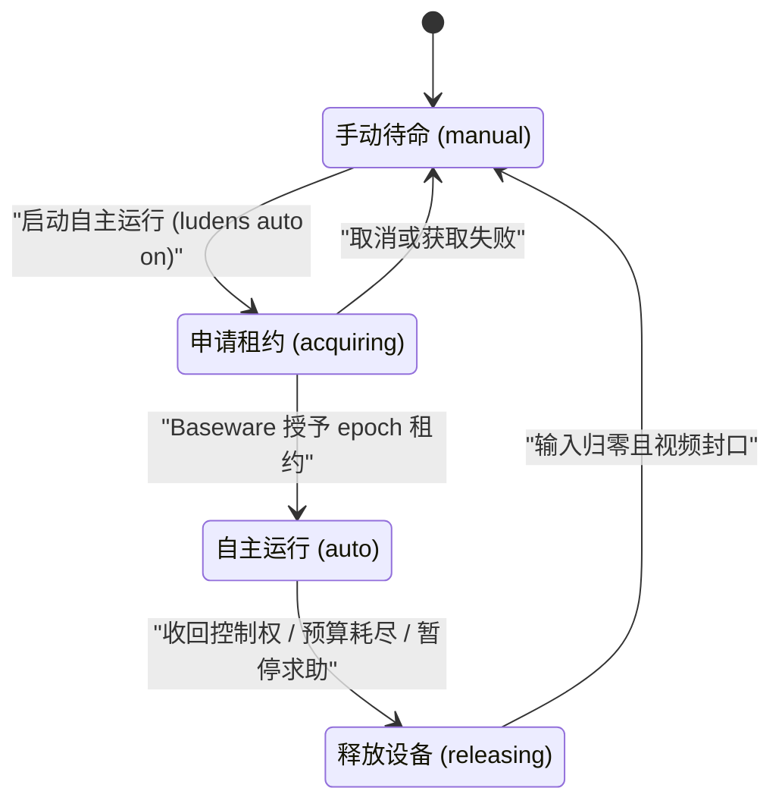

# 自主循环、控制租约与异步协作

Ludens 通过把高频连续感知与较慢的多模态模型推理拆分开来、用单调递增的 `epoch` 租约保护每一次设备动作，并为人工操作者提供非阻塞协作通道与即时安全急停开关，使复杂长程任务能够安全、稳定地推进。

## 四阶段自主闭环

在单个工作区内，任务沿着四个明确的阶段跨轮次、跨周期持续演进：

| 阶段 | 执行主体 | 核心动作 |
| --- | --- | --- |
| **1. Observe（感知）** | 常驻 `perception.py` + Shiori | 在活跃控制租约下，`Perception.sample()` 以最高 `30 Hz` 持续采样并写入 `.ludens/timeline/`。每轮开始时（默认开启 `inject on`），Shiori 仅把尚未交付的最新主通道记录与采样器状态变化附加到轮首上下文；轮内需要补看画面时显式调用 `observe`。 |
| **2. Reason（推理）** | Shiori（Agent 线程核心） | 视觉模型结合当前观测以及 `skills/`、`MEMORY.md`、`memory/current.md`、`baseware.json` 做出决策：直接调用设备控制器、执行高速 Python `@capability`，或编写与修改代码。 |
| **3. Act & Eval（执行与自检）** | Python `@capability` + Baseware + `ludens eval` | 亚秒级闭环直接在 Python 进程内完成，避免等待数秒一次的模型往返；新增或修改的能力先经 `ludens eval run` 在离线代理环境（`@eval_env`）中验证通过，再用于真实目标。 |
| **4. Consolidate（整理）** | Shiori（`consolidate`） | 在只开放文件工具（仅 `read`、`write`、`edit`，无设备控制权限）的维护轮次中，Shiori 按最新评测状态将 `verified` 能力保留或升格进 `skills/`，清理 `unverified`、`stale`、`adapting` 或 `failed` 条目，并刷新 `memory/current.md`。 |

由于自动观测仅在轮首交付一次（`ludens perception inject on`），且工具返回结果从不被追加额外截图，长程运行中的对话前缀保持稳定，有助于维持较高的服务端 KV 缓存命中率。

## 自主运行、手动待命与收回控制权

Ludens 宿主通过严格的状态机将人工操控与智能体自主执行隔离：

- **手动待命（`manual`）**：工作区启动（`ludens up` 或 `ludens run`）后默认处于**手动待命**态。此时设备归人工掌控，常驻 `perception.py` 保持热备以继续服务只读 `ludens observe` 查询，同时可自由执行离线 `ludens eval` 或在暂停态切换模型（`ludens model`）。
- **启动自主运行（`auto`）**：在控制台**运行**页（`?view=live`）点击**启动自主运行**，或执行 `ludens auto on [--message <text>] [--seconds <n>]`，宿主进入**自主运行**态并开启新的**控制周期**（`epoch`）。30 Hz 连续采样随之启动，Shiori 开始逐轮自主推进。
- **收回控制权（`manual`）**：任何时刻在控制台点击**收回控制权**或执行 `ludens auto off`，系统都会立即进入释放流程——不管模型当前是否正在推理。Shiori 立刻中断当前轮次、关闭模型调用门禁、停止连续采样并封口活跃 fMP4 视频分段、排空在途调用，同时通知 Baseware 释放设备并将按键、触点或执行器归零。

为确保每个控制周期内的模型来源完全一致，切换模型、服务档位或推理强度（`ludens model` 或控制台模型选择器）仅允许在**手动待命**且无进行中轮次或整理任务时执行。

## 控制租约（`epoch`）与双维度预算

硬件安全与推理开销上限由 Baseware 和 Shiori 在运行时层强制执行，而不依赖模型自觉遵守提示词。

### 单调控制租约（`epoch`）

每次**启动自主运行**都会生成一个新的 UUID **`epoch`**，由 Shiori 通过持久连接向 Baseware 持有，并作为环境变量 `BASEWARE_EPOCH` 注入工作区子进程与终端命令：

- **租约校验**：所有声明了 `requiresControl` 的 Baseware `Controller` 能力以及通过 CLI 调用的工作区 `python/...` 能力，都会校验传入的 `epoch`。缺少租约或携带过期租约的调用会被直接拒绝（`STALE_EPOCH`），彻底杜绝**收回控制权**后残留后台脚本误触设备。
- **周期内热重载**：在**自主运行**期间编辑 `perception.py` 或其导入模块（或手动执行 `ludens perception reload`），宿主会递进 `inputGeneration`、立刻取消并归零当前残留输入，然后热替换常驻工作进程——同时保留当前 `epoch`、剩余预算与 Shiori 会话。

### 时间与请求双预算

每个控制周期同时受两项独立预算约束：

- **时间预算（`--seconds <n>`）**：可选的周期墙钟时长上限。若执行 `ludens auto on` 时省略 `--seconds`（或在控制台设为不限时），控制周期不设倒计时（`null`），一直运行到人工**收回控制权**或请求预算耗尽。在**自主运行**期间，可通过 `ludens auto timer <seconds|off>`（或控制台计时器菜单）就地修改或取消倒计时，不会生成新的 `epoch`，也不会打断当前推理。
- **请求预算（`--requests <n>`）**：限制单次控制周期内允许发起的模型请求总次数（`ludens run` 默认为 `50`）。预算耗尽时，请求门禁立即阻断下一轮调用并有序退回**手动待命**。

## 人机双工协作：事件池与即时插话

操作者无需每次都打断**自主运行**来补充背景信息、回答问题或纠偏。Ludens 提供两条职责分明的协作通道：

| 协作通道 | 机制与持久性 | 适用场景 | 对当前控制周期的影响 |
| --- | --- | --- | --- |
| **双向事件池（Event Pool）** | 持久化在 `.ludens/event-pool.json` 的跨进程锁队列（`ludens event`、`event_pool` 工具、控制台**运行**页事件池面板）。跨周期、跨**手动待命**长期留存。 | 非紧急任务交代、异步回复智能体求助，以及智能体上报状态通知（`notice`）或求助（`help_request`）。 | 默认非阻塞（`pause: false`）。仅当遇到彻底阻塞时传 `pause: true`，停止**自主运行**进入 `awaiting human` 并释放控制权等待恢复。 |
| **即时插话（Live Steer）** | 轮内紧急插话（`ludens steer <message>`、控制台**即时插话**），仅在**自主运行**期间可用。 | 需要立刻纠正正在进行中的推理方向，但无需彻底**收回控制权**。 | 直接注入当前正在运行的轮次，不写入事件池，也不产生新的 `epoch`。 |

### 事件池如何在不浪费上下文的前提下工作

- **人工侧**：通过 `ludens event send "..."`、`ludens event reply <event-id> "..."` 或控制台**运行**页的事件池编辑器投递消息。即使宿主机当前处于离线或**手动待命**，消息也会安全持久化并在下一个控制周期启动时被拾取；未读的入站消息也可通过 `ludens event ack` 撤回。
- **Shiori 侧**：每轮开始时，仅当存在待处理的入站事件（`pendingInbound > 0`）时，Shiori 才注入一条紧凑摘要；事件池为空时不增加任何字节，从而完整保留模型的前缀 KV 缓存。智能体就绪后按需调用 `event_pool({ action: "read" })` 读取完整正文并确认（忙碌时可传 `ack: false` 暂缓确认），或调用 `event_pool({ action: "emit" })` 向人工发布 `notice` 通知或 `help_request` 求助。

需要异步留言与持久化协作时用**事件池**，需要轮内即时转向时用 **`steer`**，需要立刻切断一切设备执行时点击**收回控制权**。

## 继续阅读

- 前往[编码即感知与能力自验证体系](self-verification.md)，了解 `@capability`、`@eval_env` 与 `@eval_capability` 如何把试错转化为可验证能力。
- 在[控制台与调试验证](../tutorials/console-and-debugging.md)和[CLI 命令参考](../reference/cli.md)中查看实际操作命令与界面入口。
- 欲了解轮首单通道注入与会话组装细节，请阅读[系统架构与边界](../reference/architecture.md)与[单通道轮次注入](../insights/omp-injection.md)。
