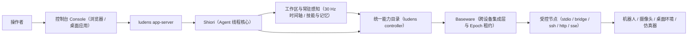

# 什么是 Ludens 与四层分工

**Ludens** 是面向复杂端到端任务的多模态、跨设备 Agent Harness，覆盖机器人操控、安防与视觉巡检、桌面与软件自动化以及实时游戏等场景。**Ludens** 既是整套系统，也是它的同名吉祥物人格。

## 为什么是 Harness，而不是静态动作包装

传统的视觉智能体框架通常采用固定循环：截一张图、等待数秒模型推理、发出一次点击或按键、再截下一张图。面对真实环境，这种模式存在三处根本瓶颈：

- **时间尺度失配**：LLM 单次推理往往需要数秒，而机器人视觉伺服、安防异常帧捕获、软件弹窗瞬时切换或实时游戏判定往往在几十毫秒内发生。
- **跨轮次失忆**：纯提示词包装没有地方沉淀校准好的视觉检测器、坐标映射逻辑、可复用操作流与回归测试集。
- **硬件控制权不安全**：缺少显式的租约隔离时，操作者人工介入后，后台脚本或延迟到达的工具调用仍可能误触发真实设备。

Ludens 用**代码优先的多模态闭环**取代静态动作包装。智能体不再每帧从零猜动作，而是在持久化代码工作区中工作：编写常驻感知检测器、封装带类型的 Python 能力函数、搭建离线代理环境与自检用例，将高频闭环留在本地进程毫秒级执行，把大模型算力集中用于策略规划、异常适配与经验沉淀。

## 四层系统分工

Ludens 将设备协议、工作区代码、智能体调度与人工观测面板解耦为四个职责清晰的层次：

### 1. Baseware —— 跨设备集成层

**Baseware**（`@ludens/baseware`）是独立的跨设备集成与兼容层，把异构硬件与软件协议隔离在工作区代码之外：

- **忠实保留原生语义**：每个驱动接入的能力统一抽象为带 JSON Schema 的 **Controller** 工具（既包括采集画面与遥测的传感器，也包括下发输入的控制器）。桌面端保留原生键鼠语义，摄像头或继电器节点保留抓拍与开关端点，机器人桥接保留关节与控制指令，仿真器保留各自原生输入，绝不强行伪装成同一种设备。
- **多节点传输池**：支持通过 `stdio`、`bridge`、`ssh`、`http`、`sse` 五种传输方式挂载本地或远程受控节点；单个工作区可并发连接多个节点，并按节点标识显式路由调用（`controller/<machineId>/<tool>`）。
- **控制租约（`epoch`）仲裁**：Baseware 对所有带副作用的调用（`requiresControl`）强制校验单调递增的 `epoch` 租约。当控制周期结束或人工执行**收回控制权**时，Baseware 立即废止旧 `epoch`、中断在途动作并清零设备输入。
- **独立设备事实日志**：Baseware 将设备调用、控制权切换与连续采样统计独立记录于 `logs/baseware/`。

### 2. 工作区与常驻感知层

**工作区（Workspace）**（默认位于 `~/.ludens/workspaces/<name>`，也可指定任意目录）是由智能体与开发者共同维护的普通代码目录：

- **工作区资产**：`ludens.json` 保存启动与预算配置；`baseware.json` 缓存当前设备能力快照；`perception.py` 定义常驻感知入口 `Perception`；`skills/<name>/SKILL.md` 沉淀可复用流程；`MEMORY.md` 保存长期环境机制与不变量；`memory/current.md` 记录当前目标与后续步骤。
- **30 Hz 常驻感知**：在控制租约激活期间，`perception.py:Perception.sample()` 按宿主配置的频率上限（默认 `30 Hz`）持续采样，并将结构化记录与分段 fMP4 视频写入 `.ludens/timeline/`，作为 `ludens observe` 与 `Client().replay()` 的唯一事实来源。
- **热重载与进程内闭环**：修改 `perception.py` 或其导入的 `.py` 模块会自动触发常驻进程热重载，递进 `inputGeneration` 并释放残留输入，同时保留当前 `epoch` 与会话上下文；处于**手动待命**时，常驻进程保持热备，可继续响应只读时间轴查询而不触发采样。
- **统一能力目录**：工作区中用 `@capability` 声明的顶层 Python 函数与 Baseware 设备能力共同汇入 `ludens controller` 目录，命令行与 Python 调用方（`ludens_tools.Client`）可统一发现并执行。

### 3. Shiori —— Agent 线程核心

**Shiori** 严格担任 Ludens 的 **Agent 线程核心**（`@ludens/core` 内的执行与调度内核），而非泛化的对话角色：

- **控制周期管控**：Shiori 负责驱动**手动待命**与**自主运行**之间的状态切换，向 Baseware 申请并持有当前周期的 `epoch` 租约，执行时间与模型请求数预算限制，处理即时 `steer` 与异步**事件池**通信，并在**收回控制权**时协调设备与录像的有序收尾。
- **持久化工作区线程**：挂载模型运行时，Shiori 基于底层智能体循环引擎（OMP）为每个工作区维护可续接的单线程会话（存于 `.ludens/shiori/`），开放文件与终端工具（`read`、`write`、`edit`、`bash`、`wait`）以及 `observe`、`event_pool`，不将庞杂的设备 Schema 预先塞满模型工具表。
- **暂停态切模与记忆整理**：模型、服务档位与推理强度仅允许在**手动待命**态切换，确保同一控制周期内请求归因清晰；`consolidate` 整理轮次仅开放文件读写，在不触碰设备的前提下清洗 `skills/` 与 `memory/current.md`。

### 4. 控制台 —— 观测、回放与人机协同面板

**控制台（Console）**（`@ludens/app`）由 `ludens app-server` 统一承载，既可在浏览器打开（默认 `http://127.0.0.1:3015`），也可通过原生 **Ludens 桌面应用**（`ludens-app`）运行。归档解析与索引维护隔离在后台查询 Worker 中，生产态不运行 Next.js 服务端进程。

控制台通过十个侧边栏视图提供完整的可观测与操控能力：

| 视图 | 查询参数 | 核心职责 |
| --- | --- | --- |
| **运行** | `?view=live` | **启动自主运行**、随时**收回控制权**、调整计时器、收发**事件池**消息、发送轮内 `steer`、切换多节点视口并查看实时事件流 |
| **回放** | `?view=replay` | 在同一条绝对时间轴上同步拖拽 30 Hz fMP4 视频帧、设备动作区间与模型调用详情 |
| **性能** | `?view=perf` | 追踪单次请求传输等待、Prompt 缓存命中率、上下文压缩节点与显式观测链路 |
| **能力** | `?view=caps` | 查看工作区 **Capability – Eval – Env** 三元拓扑、识别 `stale`/`adapting` 状态并一键运行 `ludens eval` |
| **配置** | `?view=perception` | 统一配置模型与预算、目标设备、多模态传输、一键启停服务、编辑 `MEMORY.md`、感知录制与循环仿真 |
| **设备** | `?view=baseware` | 管理 Baseware 驱动包、配置跨传输协议的受控节点、绑定工作区机器池并浏览 `Controller` 接口 |
| **工作区** | `?view=workspaces` | 设置默认工作区目录、登记或迁移已有工作区并切换当前项目 |
| **文档** | `?view=docs` | 直接读取并渲染仓库 `docs/` 下的中英双语文档 |
| **设置** | `?view=settings` | 配置控制台语言、新建工作区全局默认参数、默认传输策略与可选组件开关 |
| **开发者** | `?view=dev` | 在 Loop 实验室中本地测算不同上下文交付策略的开销，不影响真实运行 |

作为轻量的可选附加组件，桌面端还提供可停靠在系统托盘的**桌宠**小组件，用于实时反映工作区运行动态。

## 跨场景端到端执行流

无论目标是机器人硬件控制、安防摄像头值守、跨窗口桌面业务流程还是实时游戏交互，任务都沿同一套闭环推进：

1. **在 Baseware 挂载目标**：在**设备**视图（`?view=baseware`）或通过 `ludens init` 接入本机桌面（`cua`）、硬件/仿真器桥接（`bridge` / `ssh`）或远程端点（`http` / `sse`）。
2. **以手动待命启动**：执行 `ludens up`（或在控制台**配置**页一键启动），宿主导出 `baseware.json` 并启动热备的 `perception.py` 进程，此时设备仍归人工掌控。
3. **启动自主运行**：在**运行**页（`?view=live`）点击**启动自主运行**，或执行 `ludens auto on --message "..."`。Shiori 获取新 `epoch` 租约、开启 30 Hz 时间轴采集并进入自主循环。
4. **编码、离线验证与实机执行**：智能体编写 `@capability` 能力函数与配套的 `@eval_env` / `@eval_capability`，通过 `ludens eval run` 在毫秒级完成离线回归测试后再投入真实环境。
5. **随时异步协作或硬中断**：在**事件池**发送非阻塞指令（`ludens event send`），用 `ludens steer` 在推理中途即时纠偏，或点击**收回控制权**（`ludens auto off`）立即中止硬件执行并退回**手动待命**。
6. **回放归档与知识沉淀**：在**回放**页（`?view=replay`）对齐排查多模态录像与模型轨迹，并通过 `ludens consolidate` 整理 `skills/` 与 `memory/current.md`。

## 继续阅读

- 进入[自主循环、控制租约与异步协作](loop-and-control.md)，深入了解四阶段循环、`epoch` 租约、预算与双向协作通道。
- 进入[编码即感知与能力自验证体系](self-verification.md)，掌握常驻感知状态机、**Capability – Eval – Env** 三元体系与 `adapt` 闭环。
- 准备动手搭建环境，请前往[快速开始](../tutorials/quickstart.md)与[设备与驱动准备](../tutorials/devices.md)；需要查阅底层契约，请见[系统架构与边界](../reference/architecture.md)与[Baseware 设计理念与能力契约](../reference/baseware.md)。
