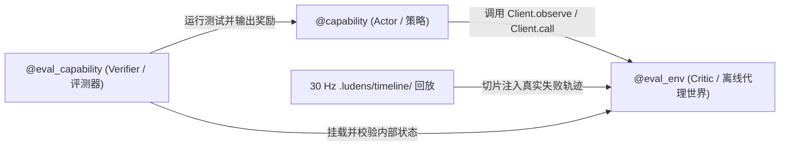

# 编码即感知与能力自验证体系

Ludens 把智能体从缓慢的“看图-点击”循环转变为工作区工程师：不把毫秒级决策寄托于数秒一次的模型往返，而是让智能体编写 Python 感知管线与带类型的能力函数，录制连续的 30 Hz 时空轴事实，并在投入真机或真实软件前用离线代理环境完成回归自检。

## 为什么“编码即感知”优于脆弱的逐帧点击

每一次完整的多模态模型轮次（观测 → 推理 → 工具调用）通常耗时数秒，这使得纯逐轮点击在真实任务中极易失效：

- **亚秒级响应窗口**：机器人视觉伺服微调、安防视频流中的瞬时异常帧、桌面软件一闪而过的弹窗或实时游戏判定，都远快于单次模型往返延迟。
- **视觉噪声干扰**：传感器抖动、光照变化、UI 动画过渡与背景干扰会让单帧启发式判断频繁误报，必须结合连续多帧动态特征做判定。
- **重复操作浪费预算**：多步设备校准、固定菜单流转或结构化读取如果每轮靠模型重新预测，会迅速耗尽上下文与请求预算。

在 Ludens 中，Shiori 把工作区当作可编程控制面：高频 `observe -> detect -> act` 闭环留在本地 Python 进程中高速运转，大模型则专注于策略规划、故障定位与测试驱动演化。

## 常驻感知状态机与 30 Hz 时间轴

每个工作区由 `perception.py:Perception` 承载一个常驻 Python 子进程：

- **租约作用域连续采样**：在**自主运行**期间，宿主按配置的频率上限（`LUDENS_PERCEPTION_SAMPLE_HZ`，默认 `30 Hz`）连续调度 `Perception.sample()`，若单次采样较慢则自动背压不重叠；退回**手动待命**时停止采样并保持热备，继续服务只读时间轴查询。
- **三个核心装饰器**：`@capability` 将带类型注解与文档字符串的 Python 函数注册进统一 `ludens controller` 目录；`@record` 将返回信封（`text`、`data`、`media`、`sampledAt`、`sources`、`space`、`effect`、`transition`）持久化至 `.ludens/timeline/`；`@observe` 声明整个工作区唯一的主观测通道（通常标在 `Perception.sample` 上）。
- **进程内状态机与热重载**：运行在常驻状态机中的能力可返回可选的 `effect`（立即触发设备或本地能力调用）与 `transition`（切换到下一个状态及参数），支持通过 `ludens perception state` / `ludens perception transition <target>`（或 `Client().state()` / `Client().transition(...)`）实时观测与切换状态。编辑 `perception.py` 或其导入的 `.py` 模块会自动触发热重载，并同步安全归零残留设备输入。
- **单一事实时间轴**：`.ludens/timeline/` 统一存放 `@record` 元数据、SHA-256 去重媒体与分段 fMP4 视频（`video/`），支撑 `ludens observe`、`Client().observe()`、`Client().replay(...)` 以及控制台**回放**页（`?view=replay`）的逐帧对照拖拽。

## Capability – Eval – Env 三元体系

为了在不损伤真实设备、不浪费真机运行时间的前提下持续迭代能力代码，Ludens 为每项可测试的 Python `@capability` 配套离线评测函数与代理环境：



1. **Capability（Actor / 策略）**：用 `@capability` 声明的 Python 函数，通过 `Client().observe()` 与 `Client().call("controller/...", {...})` 实现感知解析或高频闭环控制。
2. **Env（Critic / 离线代理世界）**：用 `@eval_env` 标记的顶层类或工厂函数（须附 docstring）。离线评测时，通过 `with MyEnv(...) as env:`（或 `with eval_env(env):`）拦截 `Client().observe(query)`（转发至 `env.observe(query)`）和 `Client().call(...)`（转发至 `env.call(id, args)`），在虚拟时间中推进隐状态或直接回放真实 30 Hz 时间轴切片，全程不触碰 Baseware 真机。
3. **Eval（Verifier / 评测断言）**：用 `@eval_capability(fn, env=MyEnv)` 标记的同步无必填参数函数（须附 docstring），执行随机试验或历史回放验证，返回扁平数值奖励（如 `{"pass_rate": 1.0}`）或 `{"rewards": {...}, "details": {...}, "passed": bool}`。

下面是一个离线验证带防抖的异常监控触发器的精简示例：

```python
from ludens_tools import Client, capability, eval_capability, eval_env

@capability
def settle_and_trigger(target_channel: int = 1) -> dict:
    """连续确认两帧异常状态后再触发继电器动作，避免单帧闪烁误报。"""
    client = Client()
    streak = 0
    for _ in range(10):
        records = client.observe()["records"]
        state = records[-1]["data"].get("event") if records else None
        streak = streak + 1 if state == "anomaly" else 0
        if streak >= 2:
            client.call("controller/relay.trigger", {"channel": target_channel})
            return {"triggered": True}
    return {"triggered": False}

@eval_env
class WatchdogEnv:
    """离线代理流：过滤第 2 帧单帧闪烁，仅在连续异常后触发一次。"""
    def __init__(self) -> None:
        self.events = ["nominal", "anomaly", "nominal", "anomaly", "anomaly"]
        self.index, self.triggers = 0, []

    def observe(self, query=None) -> list[dict]:
        event = self.events[min(self.index, len(self.events) - 1)]
        self.index += 1
        return [{"data": {"event": event}}]

    def call(self, id: str, args: dict) -> dict:
        self.triggers.append((self.index, id, args.get("channel")))
        return {"ok": True}

@eval_capability(settle_and_trigger, env=WatchdogEnv)
def eval_settle_and_trigger() -> dict:
    """离线验证防抖逻辑不会因单帧抖动误触发，且能在连续异常时准确动作一次。"""
    with WatchdogEnv() as env:
        result = settle_and_trigger(target_channel=2)
    passed = result["triggered"] and env.triggers == [(5, "controller/relay.trigger", 2)]
    return {"passed": passed, "rewards": {"accuracy": 1.0 if passed else 0.0}}
```

执行 `ludens eval run --all`（或在控制台**能力**页 `?view=caps` 点击**运行全部评测**）会自动剥离实时设备 Socket 与 `epoch` 租约，基于 `.ludens/timeline/` 或 `@eval_env` 执行全量验证，并将不可变运行记录持久化至 `.ludens/evals/`。

## 状态门禁、协同演化与 `adapt` 失败帧闭环

静态发现与 `.ludens/evals/latest.json` 会为每项 `@capability` 汇总出六种状态之一，同步呈现在 `ludens eval list` 与控制台**能力**页（`?view=caps`）：

| 状态 | 含义 |
| --- | --- |
| `missing` | 尚未绑定任何 `@eval_capability` |
| `unverified` | 已绑定评测，但尚未执行过 |
| `stale` | 自上次运行后，能力、评测或绑定的 `@eval_env` 源码已变更 |
| `adapting` | 真实运行暴露问题后被锁定为待适配状态；在更新评测或代理环境并通过前拒绝放行 |
| `failed` | 最近一次评测抛出异常、奖励为空或返回 `passed=False` |
| `verified` | 最近一次评测已针对当前能力、评测与代理环境的精确 `codeSHA` 验证通过 |

闭环策略（**Actor**）与代理环境（**Critic**）都不可能一次写成完美。Ludens 将两者视为依托 30 Hz 录像持续校对的**协同演化对**：

1. **构建最小 `v0` 并实机探针采样**：先写最小可用的 `@capability` 与 `@eval_env`，再用 `with record_window() as win:` 包裹一次真实尝试（或用 `@record @capability` 探针），同时让 30 Hz `Perception.sample()` 录下完整过程。
2. **用 `adapt` 锁定现实偏差**：一旦已 `verified` 的能力在真实环境中漏检或误触发，立即关联失败记录 ID 标记为待适配：
   ```sh
   ludens eval adapt python/skills/watchdog.py:settle_and_trigger --reason "背光切换导致误触发" --record <record-id>
   ```
   `adapt` 会同时钉住评测模块（`evalCodeSHA`）与绑定 `@eval_env` 模块（`envCodeSHA`）的哈希。若未修改二者源码而直接重跑，`ludens eval run` 仍维持失败与 `adapting` 状态。
3. **先升级 Critic，再迭代 Actor**：通过 `Client().replay(around=record_id, before_seconds=2.0, after_seconds=2.0)` 或 `Client().replay(win)` 切片调出 30 Hz 失败轨迹，校准真实时序与负样本干扰，先让 `@eval_env` 重现错误并使旧版策略失败（`passed=False`），随后再修改 `@capability` 并执行 `ludens eval run <id>` 直至恢复 `verified`。

## 长期经验沉淀：`skills/`、`memory/current.md` 与 `MEMORY.md`

经过验证的能力与经验通过三类工作区文件跨会话留存：

- **`skills/<name>/SKILL.md`**：带 `name` 与 `description` YAML Frontmatter 的可复用方法文档。在 `ludens consolidate` 整理轮次（仅开放文件读写、禁止设备控制）中，Shiori 仅保留或升格针对当前 `codeSHA` 处于 `verified` 状态的能力，并将 `unverified`、`stale`、`adapting` 或 `failed` 条目从 `skills/` 暂时移出直至重新通过评测。
- **`memory/current.md`**：记录当前阶段状态、待补齐的 `adapting` 反例记录与下一步行动，在每次整理边界刷新。
- **`MEMORY.md`**：位于工作区根目录的长期记忆文件，沉淀环境机制、已验证策略与系统不变量（支持智能体读写，也可在控制台**配置**页 `?view=perception` 直接编辑）。

技能与记忆的历史内容快照统一保存在 `.ludens/skill-versions/` 中，随工作区目录完整迁移。

## 继续阅读

- 动手编写带类型的能力函数与代理环境，请阅读[工作区与能力编程](../tutorials/workspace.md)和[常驻感知与动作状态机](../tutorials/perception-and-action.md)。
- 查看控制台能力拓扑、回放对齐与联调技巧，请前往[控制台与调试验证](../tutorials/console-and-debugging.md)。
- 查阅完整命令参数与感知分层原理，请见[CLI 命令参考](../reference/cli.md)与[为什么感知层参数要分成三层管理](../insights/perception-parameters.md)。
