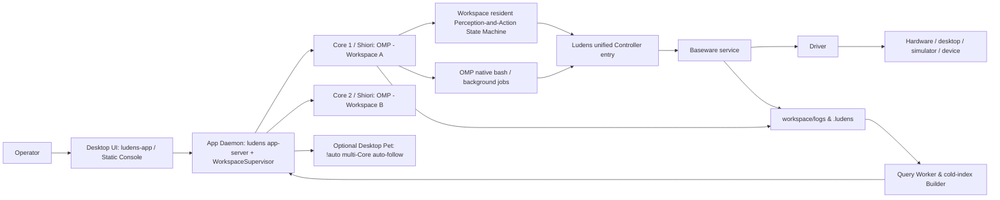

# 架构与边界

Ludens 是面向复杂端到端任务（如机器人操控、安防巡检、桌面与软件自动化、实时游戏等）的多模态跨设备 Harness，采用 **4 层并发架构**——`Desktop UI` / `App Daemon` / `Core` / `Baseware`——将界面交互、多工作区守护、Agent 执行内核与设备驱动解耦：**Desktop UI** 负责控制台与可选桌宠小组件，**App Daemon** 统一监管多个并发工作区的 **Core**，每个工作区的 **Core** 内部运行 **Shiori**（Agent 线程核心，基于 OMP 18.18.8）以独立治理控制周期与会话调度，**Baseware**（跨设备集成层）负责硬件、模拟器与各类设备接口，而具体的感知建模、动作组合与经验沉淀则完全由工作区代码（Workspace）定义与演进。

## 组件与进程

| 层级 / 组件 | 进程形态与核心职责 |
| --- | --- |
| **Desktop UI**（`app/` 与 `app/desktop/`） | **Electron 桌面应用与响应式 Vite 静态 SPA 控制台（`ludens-app` / `@ludens/app`，`app/out`）**：单一 React 19 + Vite 静态 SPA（零 Next.js 运行时；开发态 `npm run dev` 由 Vite 代理 `/rpc`、`/media` 与 `/health`）。本地桌面模式下，`ludens-app` 通过 `AppServerHost` / `ensureLocalAppDaemon` 按 `LUDENS_HOME` 拉起或复用单例 `ludens app-server` 并走 Unix Domain Socket（`app-server.sock`）通信（**0 个监听 TCP 端口**）；注册 `ludens-app://console/`（打包 SPA）与 `ludens-media://local/media?...`（经 UDS `media/resolve` 返回本地媒体并支持 HTTP `206` `Range`）；渲染进程与 `PetSessionCoordinator` 通过 `DesktopUdsRpcRelay`（`window.ludens.rpc`）走 UDS RPC。关闭主窗口（`×`）时隐藏至托盘与可选桌宠；退出（`⌘Q` / `before-quit` / 托盘 **Quit**）走 `ActiveCoreQuitGuard`（无活跃 Core 时直接退出并保留后台守护进程；存在活跃 Core 时弹出三选一确认：**后台继续运行 / 停止所有 Core 并退出 / 取消**）。同一套 SPA 也可通过 `<ConnectionTargetDialog>` 在 `same-origin`、`remote`（`ws://`/`wss://` + Token）及移动端浏览器中无缝切换。 |
| **App Daemon**（`core/src/server/` 与 `core/src/daemon/`） | **统一多工作区守护与 JSON-RPC 2.0 服务端（`ludens app-server` / `ludens serve`，由 `ludens daemon` 监管）**：默认纯 UDS（`app-server.sock`，零 TCP 端口），也支持显式绑定 `--listen ws://HOST:PORT`（非回环地址强制 `--auth token`）。在同一进程内提供 UDS NDJSON 与 WebSocket `/rpc` JSON-RPC 2.0（`@ludens/protocol/app-rpc`）、`EventHub` 实时推送（`events/subscribe` + 基于 1024 条环形缓冲的 `sinceSeq` 增量补齐，并在确认媒体落盘后推送 `observation` 事件）、HMAC capability ticket 鉴权的 `/media`（`mt=`、`206 Range`）、`/health` 以及静态 `app/out`（`/api/*` 返回 `404`）；内部承载 `WorkspaceSupervisor`、查询/回放投影 Worker、事件池读写、物理设备冲突仲裁（`CONFLICT -32009 DEVICE_BUSY` + `preempt`）与桌宠状态协调（`1 Workspace = 1 Core`）。 |
| **Core**（`core/`，`ludens run`） | **单工作区执行内核（`@ludens/core`）**：替代旧称「宿主（Host）」，每个工作区对应一个独立 Core 进程，内部承载 **Shiori**（**Agent 线程核心**，挂载 **OMP 18.18.8**，普通评测程序、Verifier 与 Metric 共用同一生命周期而不启动模型）、工作区常驻感知与动作状态机（`perception.py`）Python 子进程、能力发现与路由、工作区内生能力评估（`ludens eval`）以及运行日志归档。Core 支持在运行页发消息或点击 **启动自主运行** 时按需拉起，并在收回控制权后以 **Warm Standby**（手动待命，`manual`）形态常驻待命。 |
| **Baseware**（`baseware/`） | **独立跨设备集成层服务**：加载内置或外部 Driver，提供统一 Controller 能力目录、控制权租约（`epoch`）仲裁、输入取消与设备事实日志，对外暴露 CLI、TS/Python API 与 MCP 接口。 |



各组件拥有独立的 `package.json` / `pyproject.toml` 与锁文件。Ludens Core 仅依赖 Baseware 的客户端与类型契约，不直接导入任何具体 Driver 实现；**App Daemon**（`ludens app-server`，响应前端按需拉起与 `runtime/control`）与 `ludens up`（本地 UDS 或 `--remote`）共用 `core/src/daemon/` 中的纯 TypeScript `WorkspaceSupervisor` 编排进程。

### 四工况拓扑与接入方式

同一份 Vite 静态 SPA（`app/out`）与 `@ludens/protocol/app-rpc` JSON-RPC 2.0 服务（`ludens app-server`）统一覆盖四种运行工况：

1. **本地 Electron 桌面端（`ludens-app`，零监听 TCP 端口）**：`AppServerHost` 按 `LUDENS_HOME` 执行纯 Node `ensureLocalAppDaemon`，复用或拉起单例 `<home>/run/app-server.sock`（路径接近 96 字节 `APP_SERVER_SUN_PATH_LIMIT` 时自动回退至 `/tmp/ludens-app-<uid>-<sha256_12>.sock`）。通过自定义协议 `ludens-app://console/` 加载打包静态资源、`ludens-media://local/media?...` 走 UDS `media/resolve` 返回本地媒体并支持 `206` `Range`；渲染层 Preload IPC（`window.ludens.rpc`）与 `PetSessionCoordinator` 共用该 UDS 链路；退出流程由 `ActiveCoreQuitGuard` 保护。
2. **托管 Web / 远端微型服务（`ludens app-server` / `ludens daemon start`）**：使用 `--listen ws://HOST:PORT --auth token [--token ... | --token-env ...] --static-dir app/out` 同时对外提供同源 Vite SPA、WebSocket JSON-RPC `/rpc`、HMAC capability ticket 鉴权的 `/media`（`mt=`、`DEFAULT_MEDIA_TICKET_TTL_MS = 4h`、`206 Range`）与 `/health`。非回环地址缺少 `--auth token` 时拒绝启动；浏览器打开 `#token=...` 后会立即通过 `history.replaceState` 擦除 URL 中的凭据。
3. **统一 CLI（`ludens`）**：通过 `ludens daemon status|start|stop|restart` 管理后台 App-Server 守护进程（`stop` 默认同时停止 Core，除非传入 `--keep-cores`）。操作者命令（`config`、`workspace list|open|forget`、`init`、`up`、`services`、`down`、`status`、`auto`、`steer`、`consolidate`、`stop`、`model`）既可直连本地 `app-server.sock`，也可通过 `--remote ws(s)://... [--token ...]` 统一接入远端 App-Server；Shiori 运行时内部调用（`LUDENS_SOCKET` -> `core.sock`）继续直连对应 Core。
4. **移动端与多目标切换**：任意手机或桌面浏览器加载响应式 SPA 后，可在 `<ConnectionTargetDialog>` 中切换 `electron-local`、`same-origin` 与 `remote`（`ws://` / `wss://` + Token）目标，底层契约保持干净以兼容未来的 Outbound Relay 扩展。

所有界面均以事件驱动推送（`events/subscribe` + 基于 `1024` 环形缓冲的 `sinceSeq` 增量补齐）与双平面媒体解析（`MediaResolver`，且 `observation` 事件保证在媒体落盘验证后再推送）保持同步。

## 源码目录与分层

仓库组织为 Bun workspace，以零依赖的 `@ludens/protocol` 作为契约层：

| 包 / 目录 | 分层与职责 |
| --- | --- |
| `protocol/`（`@ludens/protocol`） | **共享契约层**：JSON-RPC 2.0 协议契约（`app-rpc`）、连接/驱动/机器/事件池 Schema、运行事件类型、Timeline / Archive 格式与控制台活动投影；其余包只通过 workspace 导入消费。 |
| `core/src/core/shiori/` | **Agent 线程核心控制内核**：`epoch` 控制租约、时间/请求预算、程序执行与取消；不依赖 OMP、CLI 或 Socket。 |
| `core/src/core/storage/` | **工作区与事实存储**：`.ludens/` 身份与状态、`logs/<run-id>/` 事件流与归档。 |
| `core/src/core/subsystems/` | **工作区常驻与设备子系统**：Python 感知/动作 Worker、`@capability` 发现、Baseware 设备会话。 |
| `core/src/core/agent-omp/` | **OMP AgentRunner 实现**：OMP 会话组装、Ludens 扩展与模型 Trace 记录，通过窄接口 `ExtensionHost` 暴露 Core 运行时能力。 |
| `core/src/core/query/` | **查询与投影引擎**：日志/运行/操作索引、原生 TypeScript Worker 与冷构建子进程、多 Core 摘要（`ProjectCoreSummary`）、设备冲突类型（`DeviceContentionConflict`）及活动/回放/遥测/桌宠（`PET_AUTO_TARGET`）投影，供 **App Daemon** 与 `PetSessionCoordinator` 消费。 |
| `core/src/server/`、`core/src/daemon/`、`core/src/perf/`、`core/src/cli/` | **App Daemon 与多端接入层**：统一 `ludens app-server`（`rpc-router.ts`、`event-hub.ts`、HMAC `media-ticket.ts`、`http-routes.ts` 承载 `/health`、`/media` 与静态 `app/out`，`/api/*` 返回 `404`）、`app-daemon.ts`（`ensureLocalAppDaemon`）与 `app-server-paths.ts`（`app-server.sock`）、纯 TS `WorkspaceSupervisor`、`ludens daemon` 与 `--remote` 操作者 RPC 客户端（`operator-rpc.ts`、`app-rpc-client.ts`）、子系统性能基线（`perf`）与 CLI 前端。 |
| `app/shell/`、`app/features/`、`app/lib/`、`app/desktop/`、`app/perf/` | **控制台 Vite SPA 与 Electron 桌面壳**：RPC 客户端与 Hooks（`lib/ludens-rpc.tsx`、`lib/connection-target.ts`、`lib/media-resolver.ts`、`components/connection-target-dialog.tsx`）、外壳（`console-shell`、侧边栏「活跃 Core」）、垂直业务切片（`live`、`replay`、`capabilities`、`workspaces`、`pet`、`docs`）、Electron 零端口桌面宿主（`desktop/main.ts`、`custom-protocols.ts`、`rpc-bridge.ts`、`quit-guard.ts`、`pet-session.ts`）与 `index-memory` 性能基线。 |


## 设备与统一能力

1. **统一 Controller 抽象**：Driver 对外暴露的所有能力统称为 **Controller**（包括执行输入的控制器与采集画面/状态的传感器）。每项能力遵循 CUA 原生工具结构：`name`、`description`、`inputSchema`、可选 `outputSchema` / `annotations` 以及 MCP `CallToolResult` 返回值。设计依据见 [Baseware 设计理念与能力契约](baseware.md)，类型定义见 [baseware/src/contracts.ts](../../../baseware/src/contracts.ts) 与 [baseware/src/catalog.ts](../../../baseware/src/catalog.ts)。
2. **双命名空间聚合与按需发现**：Ludens 将设备能力（`controller/<id>`）与工作区 Python 装饰器能力（`python/<path>:<fn>`）合并至 `ludens controller` 目录。为避免撑爆模型上下文，所有设备能力与 MCP 工具**均不默认注入 OMP 的模型工具列表**，而是由 Agent 通过 `baseware.json`、`ludens controller` 或 `ludens_tools.Client` 按需发现与调用。
3. **纯粹的硬件边界**：Driver 仅忠实映射硬件接口（如双屏独立截图 `screen.top.capture` / `screen.bottom.capture`、原生触屏坐标 `touch.down / move / up`），跨屏图像拼接、坐标转换与具体任务策略一律留在工作区代码中实现。

## 控制权与生命周期

### 1. 多 Core 并发与按需生命周期

Ludens 遵循 **1 Workspace = 1 Core** 隔离原则，由 **App Daemon** 统一监管多个工作区的 Core 进程（`Project.core` / `ProjectCoreSummary`），彻底替代旧有的单全局宿主模式：

- **按需拉起（On-Demand Spawn）与 0-Run 零门槛**：选择任意工作区（即使尚未产生历史运行记录）即可直接进入运行页（Live），基于 `Project.defaults` 展示预设模型与预算；在运行页发送目标消息或点击 **启动自主运行**（`▶`）时，App Daemon 会通过 JSON-RPC（`runtime/control` / `eventPool/mutate`）自动按需拉起对应工作区的 Core 与 Baseware（`spawned: true`），无需预先在终端执行 `ludens up`。
- **Warm Standby 热备驻留**：当主动**收回控制权**（`auto off`）或控制预算耗尽时，Core 退出自主运行循环并保持 **Warm Standby**（手动待命，`manual` 态）：Baseware 设备连接与 Shiori OMP 会话持续驻留就绪，仅停止高频采样与录制，支持随时发送新消息秒级续接或切换模型。
- **启动来源与 `ActiveCoreQuitGuard` 退出守卫**：每个活跃 Core 都会记录启动来源 `ServiceLaunchOrigin`（`"app"` 或 `"cli"`）及所属 `appInstanceId`，并在控制台侧边栏「活跃 Core」列表直观标注来源与单点停止按钮（`■`）。关闭桌面主窗口（`×`）仅隐藏至系统托盘与可选桌宠；显式退出桌面 App（`⌘Q` / `before-quit` / 托盘 **Quit**）时，由 `ActiveCoreQuitGuard` 查询 `daemon/status`：若当前无活跃 Core，应用直接退出并保留后台单例守护进程；若存在活跃 Core，则弹出三选一确认框（**后台继续运行 / 停止所有 Core 并退出 / 取消**）。
- **物理设备冲突仲裁（`CONFLICT -32009 DEVICE_BUSY` + `preempt`）**：绑定不同物理设备或不同端口的工作区 Core 完全并发运行、互不干扰。当多个工作区尝试占用同一物理设备或端口时：
  - 若当前持有设备的 Core 处于 **Warm Standby（手动待命，`manual`）**，系统自动让位释放其设备租约并由新工作区接管；
  - 若持有设备的 Core 正在执行活跃**自主运行**循环，App Daemon 返回 JSON-RPC 错误 `-32009`（`APP_RPC_ERROR_CODES.CONFLICT`，`data.code: "DEVICE_BUSY"` 与 `DeviceContentionConflict` 载荷），控制台弹出设备冲突提示框，供用户选择取消、切换到持有工作区或执行**抢占接管（`preempt`）**——干净停止原 Core、释放设备租约后立即启动当前工作区。

### 2. 控制租约（`epoch`）与权限校验

- 每次执行 `ludens auto on [--seconds <n>]` 会开启一个新的控制周期，生成唯一 **`epoch`** 并重置本轮模型请求数（`requests`）预算。持续时间（`seconds`）为可选参数：省略时（`null`）租约与运行时循环不设超时定时器，一直持续运行直到显式执行 `ludens auto off`；传入时由 Baseware 与 Shiori 共同按该周期上限计时。
- `ludens auto timer <seconds|off>` 就地更新 Baseware 的 `lease_duration` 与 Shiori 的活动停止计时器，并记录 `control_budget`，不会生成新的 `epoch`。
- Core 通过持久连接向 Baseware 持有该 `epoch`，并将 `BASEWARE_EPOCH` 注入工作区进程环境。
- 查询能力目录与 `--help` 无需控制权；具体能力是否要求控制权由其 `requiresControl` 属性声明（部分只读状态查询同样要求有效 `epoch`）。通过 CLI 调用工作区 `python/...` 能力同样要求处于活跃控制周期。
- 当发生人工收回控制权（`ludens auto off`）、预算耗尽、Core 断线或设备断开时，Baseware 立即废止旧 `epoch`、中断在途动作并执行设备释放（清零按键与触点），清理完毕后回到手动待命（`manual`）状态。

### 3. 手柄异步时间表（`pad.play`）

模拟器手柄统一采用相对时间表指令 `pad.play`，参数 `inputs` 为 `{atMs, durationMs, state}` 数组：

```sh
ludens controller controller/pad.play --args '{"inputs":[{"atMs":0,"durationMs":500,"state":{"LEFT":1}},{"atMs":0,"durationMs":300,"state":{"B":1}}]}'
```

- **通道合成规则**：不同按键/摇杆通道的时间段允许自由重叠；同一通道的时间段禁止重叠。相邻时间段在边界直接切换合成状态，整张时间表结束时自动归位中立状态。
- **异步生命周期**：`pad.play` 默认提交后立即返回 `actionId`（动作归当前控制 `epoch` 所有，短连接 CLI 退出不会中断已提交动作）；传入 `"wait": true` 或调用 `pad.wait / status / cancel`（传 `{"actionId": "<id>"}`）可等待、查询或取消该动作。同一设备同时只执行一张时间表，并发提交新时间表会返回 `BUSY`。
- **硬件时钟语义**：时间参数单位为毫秒；轮询驱动桥按输入轮询时的单调墙钟推进（最小跨度 16ms），帧驱动桥按模拟帧率向上取整换算为帧数。

### 4. 常驻状态机与输入重置

统一常驻 `perception.py` 状态机在进入自主运行时采用 Core 当前控制 `epoch`，并在每次重载时采用新的 `inputGeneration`。当自动重载轮换 generation 或在 `auto` 周期内执行显式 `ludens perception reload` 时，系统通过 Baseware 立即取消并释放本工作区的全部当前输入（包含并发 CLI 输入），递进 `inputGeneration` 拒绝旧实例残余调用，同时保留当前 `epoch`、剩余预算与 OMP 会话。常驻进程从属于该控制周期：连续采样与 fMP4 视频录制只在控制租约活跃期间运行，`Runtime.stop()` 会等待感知租约撤销——停止采样器、刷出最后一条 `perception_stats` 并封口活跃视频分段——之后才记录周期 `control(manual)` 切换事件；在手动待命（`manual`）期间常驻进程保持热备，可继续服务时间线读取但不采样。详见 [core/src/core/shiori/runtime.ts](../../../core/src/core/shiori/runtime.ts)。

## 会话与 Loop

### 1. OMP 超集装配与外层续轮

Core 在单工作区内复用同一个 OMP 会话（持久化于 `.ludens/shiori/sessions/`），并在 `Settings.isolated()` 基础上采用**最小覆盖原则（Superset Shell）**：

- 保留 OMP 原生系统提示词（若工作区存在 `AGENTS.md`，通过原生 `contextFiles` 注入）。
- 显式启用 OMP 原生工具 `read`、`write`、`edit`、`bash`、`wait`，并注册自定义工具 `observe` 与 `event_pool`。
- 仅覆盖 Core 契约必需项：关闭 `retry.modelFallback`（保证所选视觉模型粘性）、关闭 `title.refreshOnReplan` 与 `cacheWarming`（确保每次模型请求严格归属控制周期）、将 `PROVIDER_IMAGE_BUDGETS` 设为 `Infinity`（在压缩前保留历史图像，避免中途丢图破坏 Prompt Cache 前缀）、经 `tier.openai` 应用实际生效的 OMP 服务档位（`priority` 对应 Fast、`ultrafast` 对应 Ultra、`none` 对应 Standard）并经 `defaultThinkingLevel` 与 `session.setThinkingLevel(..., false)` 权威同步推理强度，以及应用可选的 `compactionThreshold`。详见 [core/src/core/agent-omp/session.ts](../../../core/src/core/agent-omp/session.ts)。
- 仅枚举支持图像的 OMP 模型并严格限制在手动待命（manual）切换：`availableModels`（见 [dashboard-protocol.ts](../../../core/src/core/query/dashboard-protocol.ts) 与 [available-models.ts](../../../core/src/core/query/available-models.ts)）读取 OMP `ModelRegistry` 与 `discoverAuthStorage`（按工作区解析或回退至全局 `defaults`），仅返回具备图像输入能力（`input.includes("image")`）的模型并将已配置凭据的 Provider 排在前面，每个模型携带由 OMP `shouldSendServiceTier` 派生的专属 `supportedServiceTiers` 以及由 `model.thinking` 派生的 `supportedEfforts` 与 `defaultEffort`（不使用写死的模型名单，且有意排除 OMP `"auto"` 分类器档位以避免产生控制周期外的隐式请求）。目录与 Shiori 会话均通过 `createOmpModelRegistry`（[models.ts](../../../core/src/core/agent-omp/models.ts)）构建注册表，并额外加载 `openai-codex` 的 `/models` 发现缓存（仅在 OMP 缓存过期时重新拉取）：Codex 按模型在 `service_tiers` 中声明 `ultrafast`，缺少该缓存行时 Ultra 永不出现，已保存的 `ultrafast` 会静默按 Standard 运行。`ModelPickerDialog` 在选中模型卡片内就地展开推理强度（Effort）与响应速度（Speed）内联抽屉，仅提供所选模型实际支持的强度与 Standard/Fast/Ultra 速度档位，再由 `Runtime.setModel`（通过 `ludens model [<provider/id>] [--service-tier none|priority|ultrafast] [--effort none|minimal|low|medium|high|xhigh|max]` 与 [runtime-control.ts](../../../core/src/core/query/runtime-control.ts) 中的控制台 `set_model` 暴露）原子提交模型与可选的速度、强度；仅在 `mode === "manual"` 且无进行中轮次、记忆整理或在途调用时放行，显式禁止 `auto` 运行期间中途热切换模型；校验通过后以 `{ ...found, imageCountBudget: Infinity }` 及 `setThinkingLevel` 更新 OMP 会话并写入 `shiori` `session` 事件，使 `Runtime.status()` 报告实际生效档位与强度（不支持时降级为 Standard / 模型默认强度）并与实时运行／活动投影即时同步（控制台 `set_model` 在 Core 在线处于 `manual` 态或 Core 离线时均会将 `model`、`serviceTier` 与 `effort` 原子写回 `ludens.json`；Fast/Ultra 为付费加速档位，可能增加用量费用）。

在 `auto` 控制周期内，外层循环按以下步骤运转：

1. **发起轮次**：使用 [continue.md](../../../core/prompts/continue.md) 发起 OMP `prompt`（开启自主运行若带 `auto on --message` 则附加一次性提醒）。
2. **常驻状态机与模型推理并行运转**：模型推理期间环境持续运行——在周期控制租约之下，常驻 `Perception.sample()` 按 Core 配置的频率（`LUDENS_PERCEPTION_SAMPLE_HZ`，默认 `30` Hz）持续采样写入 `.ludens/timeline/`，其进程内能力在同一进程中持续读取时空轴并执行高频闭环控制；取舍见 [为什么感知层参数要分成三层管理](../insights/perception-parameters.md)。
3. **自动上下文交付**：Ludens 扩展挂载 OMP 的 `before_agent_start` 钩子（见 [extension.ts](../../../core/src/core/agent-omp/extension.ts)）。当自动注入开启（默认 `inject on`）时，在每轮 prompt 开始自动追加尚未交付的最新主通道感知记录以及采样器状态变迁（`state / codeSHA / error`）；工具结果不再被追加任何观察，`tool_result` 钩子只登记原生工具图片的交付事实，轮内需要画面由模型显式调用 `observe` 组合。曾在工具批次末追加最新帧的通道已于 2026-10-29 删除，取舍见 [注入收敛为轮首单通道](../insights/omp-injection.md)。
4. **续轮或收回控制权**：单次 `prompt` 结束且预算未耗尽时自动发起下一轮；一旦人工收回控制权或预算耗尽，`addBeforeModelCall` 门禁立即阻断新模型请求，释放设备控制权。

### 2. 上下文压缩与传输恢复

- **后台预测压缩**：复用 OMP 原生两段式压缩，触发阈值默认跟随模型目录（可通过 `ludens.json` 或 `--compaction-threshold` 覆盖）。针对 30Hz 实时控制循环的补丁改造见 [OMP 后台压缩改造](../insights/omp-compaction.md)。
- **WebSocket 增量传输与恢复**：OpenAI Codex 默认使用 WebSocket `auto` 模式，断连分类、冷却退避与未完成工具调用的 SSE 恢复策略见 [WS 恢复测试依据](../insights/ws-recovery.md)。

## 工作区事件池

人类与 Shiori 通过双向、工作区作用域的**事件池（Event Pool）**异步交换消息与请求：事件在智能体周期之外也能留存，且从不与设备租约绑定。

- **存储与并发**：`.ludens/event-pool.json` 是带单调 `seq` 的版本化文档。每次读-改-写都会获取跨进程锁目录（`event-pool.json.lock`，获取上限 5 秒、15 秒后回收陈旧锁），并通过临时文件 + `rename` 原子发布，因此 CLI、Core、Query Worker 与 Desktop UI 都不会读到半写文件。待处理事件永不裁剪；仅保留最近 200 条已处理事件。
- **契约**：方向为 `inbound`（`message`、`reply`）与 `outbound`（`help_request`、`notice`）；状态为 `pending` / `handled`；执行者为 `shiori` / `human`。每条事件携带 `id`、`seq`、`text`、可选 `title`、`replyTo`、`pauseRequested`、`runId` / `epoch`，以及 `createdAt` / `handledAt` / `handledBy`。人类回复一条待处理的出站事件时，会在同一次加锁写入中把该请求标记为已处理（`handledBy: "human"`）。
- **CLI**：`ludens event list [--direction inbound|outbound] [--status pending|handled] [--limit <n>]`、`ludens event send [--title <text>] [--message <text> | <text>]`、`ludens event reply <event-id> [...]`、`ludens event ack <event-id>...`。Core 在线时命令经 Core Socket 路由，否则直接写入 `.ludens/event-pool.json`，因此在 `manual` 待机或 Core 已停止时留下的消息会在下一个周期被拾取。变更类命令仅限人类：在智能体周期内（存在 `BASEWARE_EPOCH`）会被拒绝，并引导智能体改用 `event_pool` 工具。
- **Shiori 工具**：`event_pool({ action: "read" | "ack" | "emit" })`。`read` 返回待处理的入站消息/回复（全部或指定 `ids`；`includeHandled` 可读历史），默认将其标记已读，`ack: false` 则在忙碌时暂缓；`ack` 显式将入站事件标记为已处理；`emit` 发布出站 `help_request`（默认）或 `notice`。`pause` 默认为 `false`，保持自主循环异步进行；只有 `pause: true`——仅用于彻底受阻的智能体——会以 `awaiting human` 停止自主运行并撤销设备控制权、回到手动待命，直到人类恢复。
- **轮首摘要**：`before_agent_start` 仅在 `pendingInbound > 0` 时追加紧凑的入站摘要：每条包含 `id`、`seq`、`kind`、可选 `title` 与 72 字符单行预览。事件池空闲时不追加任何字节，从而保留 provider 前缀 KV 缓存；完整正文通过 `event_pool({ action: "read" })` 按需拉取。
- **界面**：控制台前端通过 **App Daemon** 的 `eventPool/read` 与 `eventPool/mutate` JSON-RPC 方法读写同一存储，并通过 `events/subscribe` 订阅 `eventPool` 实时推送，驱动出站托盘、会话流卡片、标题栏待处理徽章与回复输入框；多工作区的待处理出站数量（`pendingOutbound`）同步汇总至侧栏「活跃 Core」列表并驱动可选桌宠 `!auto` 的 `🆘` 优先跳转。CLI（本地 UDS 或 `--remote`）与控制台是对同一加锁文件的对等写入方。
- **双时序投影与全览**：每个生命周期投影为两条流消息。消息 1（人工消息或 `outbound_event` 卡片）严格锚定在 `createdAt`（`T_send` / `T_emit`），绝不追加到流尾。消息 2（`pool_receipt`）由 `pool_event` 的 `action: "handled"` 投影而来，锚定在 `handledAt`（`T_read`）。人工可通过 `ack` 与 `actor: "human"` 撤回未读的待处理入站消息，显示为已撤回而非已读取。Live 工作台右侧检查器坞在 `Stage & Telemetry` 与 `Event Pool` 分段头之间切换；专用的事件池全览列出留存事件，线程头快捷入口可打开它，每条事件的定位到会话流操作会跳转到其流内位置。

紧急的轮内打断仍然使用 `ludens steer <message>`，它直接排队进入正在运行的智能体，而不进入事件池。

## 可核查的运行事实

- **多源事实解耦**：Baseware 独立持久化设备控制与执行事实（`logs/baseware/`），Core 记录模型调用、工具执行、能力调用与感知交付（`logs/<run-id>/`），Shiori 挂载局部 OpenTelemetry provider 记录 `agentLoop` 遥测。
- **控制台隔离读取**：**App Daemon**（`ludens app-server`）将归档解析与索引维护放在独立的 Worker 线程（`core/src/core/query/`）中，冷历史目录由限流为全局单实例的临时 Builder 子进程构建并原子发布至 `.dashboard-index/`；`core/src/server/rpc-router.ts` 中的 JSON-RPC 处理器与 `PetSessionCoordinator`（`activity/get`、`events/subscribe`）仅通过有界 RPC 读取投影结果，完全移除 `/api/*` REST 路由且不运行任何 Next.js 服务端进程。详见 [日志与调用链](logging.md#消费与指标解释)。

## TypeScript 与 Python

Ludens 由 TypeScript **Core / App Daemon**（`core/src/`）与 Python 工具包（`core/python/ludens_tools/`）共同组成：

- **TypeScript 侧**：负责 Shiori 运行时、控制权租约、OMP 会话扩展、统一 **App Daemon**（`ludens app-server` 提供 UDS/WS JSON-RPC `/rpc`、`EventHub` 推送、HMAC `/media` 与 Vite 静态 SPA `app/out`）、`ensureLocalAppDaemon`（`app-server.sock`）、纯 TS 跨平台 `WorkspaceSupervisor`、统一 CLI（`ludens daemon` 与 `--remote`）及 Electron 桌面端集成。
- **Python 侧**：负责 `@capability` 静态发现与动态执行、统一常驻 `Perception` 状态机、PyAV 视频段编码与冷帧按需解码。常驻感知通过媒体流引用（`_StreamMediaRef`）直接从磁盘摄取 Baseware 缓冲的原始字节，省去跨进程内联 Base64 往返，自动将设备观测 `sources` 时空溯源绑定至时间线记录，并通过 `ifNoneMatchSequence` 对未发生帧变化的最新帧 `Client().observe()` 轮询执行零编码短路。视频编解码直接在常驻感知进程内完成，不额外引入独立的流媒体服务。

## 能力持久化边界

全局 `LUDENS_HOME`（默认 `~/.ludens`）保存应用配置、`registry/<id>.json` 工作区索引、驱动缓存与共享桌宠状态。注册项只包含 `{id, workspace, name, updatedAt}`；工作区的 `.ludens/workspace.json` 持有稳定身份，目录移动后通过 `ludens workspace open` 更新索引。会话和历史均保存在工作区，registry 可重建。详见 [两层目录结构](../tutorials/workspace.md)。

登记创建、移动、移除与桌宠目标选择共用按工作区划分的锁。同时需要两把锁时，先获取登记锁，再获取桌宠目标锁。移除先读取当前登记，仅清除与之匹配的原始桌宠目标，再删除登记文件；目标不可读或不可写时，在删除前阻止移除。重新登记不会恢复已清除的目标。其他目标、消费者心跳文件、工作区内容及运行中的 Core 均不受影响。普通桌宠状态轮询保持只读，只有已存目标发生目录移动时才加锁重新读取并更新。控制台操作结果直接报告已提交配置或实际移除的登记，不依赖后续目录或消费者状态读取。

默认情况下，可选**桌宠**采用 **`!auto`（`PET_AUTO_TARGET`）多 Core 自动追踪模式**（`targetConfigured === false` 且 `autoFollowing: true`）：只要存在活跃 Core，桌面端按优先级自动跟随——优先任意存在待处理 `🆘` 出站协助请求（`pendingOutbound > 0`）的在线 Core → 其次当前聚焦工作区的在线 Core → 其次后台处于**自主运行**态（或唯一活跃）的 Core；全部 Core 停机时优雅进入空闲待命（`autoWaiting`）。用户仍可手动固定单个工作区或显式选择**停止跟随**（`null`）。桌宠通过 UDS RPC 调用 `pet/setTarget` 与 `pet/recordConsumer` 分别返回已提交的 `{ target }` 和 `{ consumer }`，观测图像通过 `ludens-media://local/media?...` 加载。`pet/getState` 在心跳记录不可读时仍保留已保存目标（`connected: null` 并附 `consumerError`），不会声称桌面端未连接。登记目录离线、缺失或身份不符时，仍保留已保存目标并标注 `targetUnavailable: true`；桌面端暂时停止消费该来源，不清除选择。心跳的 `targetRevision` 表示正在尝试的目标，`revision` 表示已加载的来源。只有尝试目标匹配时才归属应用错误，正在跟随则必须有匹配的已加载 revision。`pet/getState` 读取会等待该 worker 已接收的目标写入结束，避免恢复读取先报告旧选择，排队中的写入随后才完成。`targetConfigured` 区分尚未设置目标文件（默认进入 `!auto` 自动追踪）与显式保存停止（`null`）；只有后者会阻止启动时的自动选择。

工作区内的状态存储各司其职，互不冗余复制：

| 存储位置 | 归属与内容 |
| --- | --- |
| `.ludens/timeline/` | **能力观测与媒体唯一原件**：由常驻感知进程单一写入者维护，存放 `@record` 记录元数据、分段 fMP4 视频（`video/`，默认 5 分钟一段、空闲 10 秒收尾）与 SHA-256 去重非视频媒体（`objects/`）。 |
| `.ludens/archive/` | **模型与工具结构化文本归档**：跨请求、跨 run 按内容哈希去重存储 `objects/<sha256>.json.gz` 与流式载荷，内含媒体一律通过引用指向 `.ludens/timeline/`。 |
| `logs/<run-id>/` | **单 Core 运行事件流**：存放 `manifest.json`、`events.jsonl` 与 `streams/`，通过 `eventSources` 与内容引用关联 Baseware、Archive 与 Timeline。 |
| `.ludens/shiori/` | **OMP 原生会话存储**：存放 `sessions/*.jsonl` 与当前续接指针，由 OMP SessionManager 管理。 |
| `.ludens/event-pool.json` | **双向人机事件池**：跨运行与离线待机持久化待处理与近期已处理的入站消息／回复及出站求助／通知。 |
| `.ludens/skill-versions/` | **技能与记忆快照**：运行中记录的内容版本留在工作区内，随目录一起移动。 |

## 统一时空轴与回放

感知采样、常驻动作、模型推理与设备执行共享工作区的绝对墙钟时间坐标，并通过 `recordId`、事件序号、`modelCallId`、`toolCallId`、`actionId` 及 `trace` 树精确关联。控制台回放器在同一时间游标下同步渲染 `.ludens/timeline/` 中的全量连续采样画面（包含未被模型采纳的中间帧）、动作时间跨度与模型调用详情；历史回放纯属只读投影，不会触发设备操作或改变桌宠的实时跟随目标。
